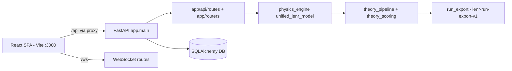
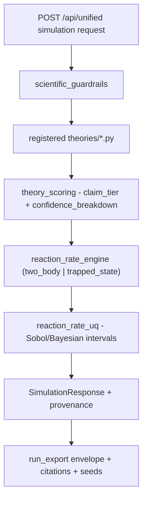
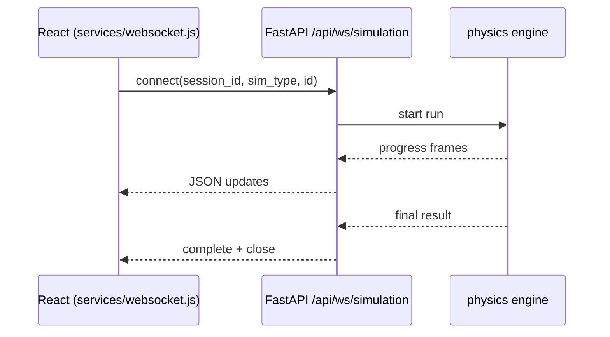

# Architecture Mapping

## Overview

Map before you build. For any change touching more than one module, first render
the relevant slice of the system as a Mermaid diagram, verify it against the
actual code, and use it to scope the change. This catches wrong assumptions
(dual routers, three WebSocket clients, package-vs-legacy models) before they
become bugs.

## When to Use

- Starting any change spanning more than one file/module.
- Onboarding to an unfamiliar subsystem (physics pipeline, viz, WS streams).
- Planning a refactor or migration.
- The user asks for an architecture map, data-flow, or sequence diagram.

## Process

```
- [ ] 1. Scope: name the subsystem and the question the diagram must answer
- [ ] 2. Seed: run scripts/map_endpoints.py to extract routes/providers
- [ ] 3. Draft: pick a diagram type and write Mermaid (templates below)
- [ ] 4. Verify: open the cited files and confirm every node/edge is real
- [ ] 5. Save: embed in your response and, for durable maps, docs/ARCHITECTURE/
```

**Step 2 - Seed from the real code:**

```bash
python .cursor/skills/architecture-mapping/scripts/map_endpoints.py
```

Lists backend route decorators + `include_router` prefixes (both `app/api/routes/`
and legacy `app/routers/`) and frontend context providers + WebSocket clients.

**Step 3 - Diagram types (pick per the question):**

- Container map: how backend, physics engine, frontend, WS, DB relate.
- Data-flow: how a simulation request becomes a scored, exported result.
- Sequence: request/stream timing (e.g. WebSocket simulation updates).

Follow the workspace Mermaid syntax rules: no spaces in node IDs (use camelCase),
quote labels containing parentheses/colons, avoid reserved IDs (`end`, `graph`),
no `style`/`click`.

**Container template:**



**Data-flow template (simulation -> scored result):**



**Sequence template (WebSocket streaming):**



## Rationalizations (excuses -> rebuttal)

- "I already understand this code." -> Diagram it in 2 minutes; if it is trivial the diagram is trivial, and if it is not you just avoided a wrong assumption.
- "Diagrams get stale." -> Regenerate from `map_endpoints.py`; the seed is derived from code, not memory.
- "It is just one endpoint." -> Then the container slice is one edge - still cheaper than tracing it wrong.

## Red Flags

- You are editing across `app/api/routes/` AND `app/routers/` without knowing which is canonical.
- You reference "the WebSocket client" when three exist (see [react-frontend-standards.mdc](../../rules/react-frontend-standards.mdc)).
- Your diagram has a node you cannot point to a file for.

## Verification

- Every node maps to a real file/module and every edge to a real call/route.
- Mermaid renders without syntax errors (respects the workspace rules).
- Durable maps saved under `docs/ARCHITECTURE/` are dated and note the commit.

See [reference.md](reference.md) for the current known architecture and the seed script details.
