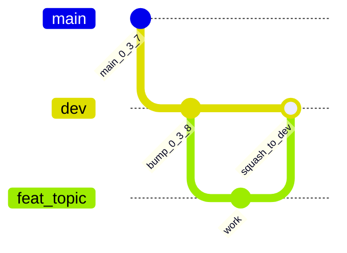

# Branching, Releases, and Hotfixes

This repository uses **two long-lived branches** aligned to version trains:

| Branch | `APP_VERSION` | Purpose |
|--------|---------------|---------|
| `main` | `0.3.7-beta` | Live public Compose beta release line. Protected. Tagged with `v0.3.7-beta`. |
| `dev` | `0.3.8-beta` | Integration line for v0.3.8-beta work (Swarm prep, science, deps). No auto VPS deploy. |

Releases remain annotated `v*` tags (normally cut from `main` when a train
ships). Short-lived topic branches are deleted on squash-merge.

Adopted October 2026 for the v0.3.7 / v0.3.8 split. Prior pure trunk-only policy
(September 2026 / PR #161) still applies to feature lifetime and squash merges;
only the long-lived set grew to include `dev`. Old version-named release branches
remain as `archive/*` tags only.

## Branches

| Branch | Lifetime | Purpose |
|--------|----------|---------|
| `main` | permanent | v0.3.7-beta release / Compose share ship line |
| `dev` | permanent | v0.3.8-beta integration; default base for new work |
| `feat/<topic>`, `fix/<topic>`, `chore/<topic>`, `docs/<topic>` | days | One change each; PR against **`dev`** (or `main` for 0.3.7 hotfixes only); squash-merged; auto-deleted |
| `consciousenergy/<topic>-<id>` | days | Same as above (Cursor agents) |
| `dependabot/**` | days | Automated dependency PRs against **`dev`** |
| `release/X.Y` | only while a hotfix is open | Created **from a tag** when a fix must ship against an older release. Forward-port to `main` and `dev`, then delete |

Naming rules: lowercase, hyphen-separated, no version numbers in feature
branch names (the version lives in the four `APP_VERSION` markers, not in git
refs).

## Day-to-day flow (v0.3.8 on `dev`)



1. `git switch -c feat/<topic> origin/dev`
2. Commit focused changes with tests; run the relevant
   [release quality gate](../.cursor/skills/release-quality-gate/SKILL.md) slice.
3. Open a PR against **`dev`**. CI must be green:
   `version-consistency`, plus path-filtered jobs when those paths change;
   also `Secret scan`, `Dependency Review`.
4. Review, then **Squash and merge**. The head branch is deleted automatically.

**0.3.7 hotfixes:** branch from `main` (or `v0.3.7-beta`), PR into `main`, then
cherry-pick / forward-port to `dev`.

**Promote 0.3.8 → public:** when ready, open a controlled PR `dev` → `main`
(version markers already `0.3.8-beta` on `dev`), then tag `v0.3.8-beta` on
`main` after merge. Do **not** continuously merge `dev` into `main`.

Keep PRs small and **topic-dense**. Split CI/infra PRs from academic claim edits.
`EQ-OPEN-*` stay OPEN unless a dedicated science PR says otherwise.

## Self-hosted CI

Heavy PR/test jobs default to labels
`self-hosted,linux,x64,lenr-ci` on the **dedicated** Hostinger CI KVM2
(`2012566` / `45.93.100.251`, runner `lenr-ci-1`). The Compose share
(`185.211.4.66`) must **not** register a runner. **Deploy/ship** (`deploy.yml`)
stays on GitHub-hosted and triggers only for **`main` + `v*` tags** — never for
pushes to `dev`. See
[`../LENR_SIM_APP_v2/docs/v0.3.7-beta/SELF_HOSTED_RUNNER.md`](../LENR_SIM_APP_v2/docs/v0.3.7-beta/SELF_HOSTED_RUNNER.md).

Dual KVM2 ≠ Swarm cutover — see
[`../LENR_SIM_APP_v2/docs/v0.3.8-beta/FULL_STACK_BUILD_UNLOCK.md`](../LENR_SIM_APP_v2/docs/v0.3.8-beta/FULL_STACK_BUILD_UNLOCK.md).

## Cutting a release

1. Land the version bump + CHANGELOG section on the train branch (`dev` for
   0.3.8; already done for 0.3.7 on `main`).
2. Promote to `main` if needed (`dev` → `main` PR for a new public train).
3. Tag the release commit on `main`:

   ```bash
   git fetch origin
   git tag -a vX.Y.Z[-beta] origin/main -m "LENR_SIM_APP vX.Y.Z[-beta]"
   git push origin vX.Y.Z[-beta]
   ```

4. Tag push runs `deploy.yml` image builds (VPS ship stays
   `workflow_dispatch` / gated `repository_dispatch`).
5. Publish the GitHub Release; paste the CHANGELOG section.

## Hotfixes against an older release

1. `git switch -c release/0.3.7 v0.3.7-beta`
2. Land the fix via PR (base = `release/0.3.7`), bump patch if needed, tag.
3. Forward-port to `main` and `dev`, then delete `release/0.3.7`.

## Tags

| Pattern | Meaning |
|---------|---------|
| `vX.Y.Z[-beta]` | Release; immutable; triggers `deploy.yml` image build. |
| `archive/<name>` | Snapshot of a deleted long-lived branch or pre-cleanup tree. |

## Repository settings that back this model

Configured by a repository admin (not enforceable from code):

- General → Pull Requests: **Automatically delete head branches** on; default
  merge method **Squash**.
- Rules → Rulesets → `main` **and** `dev`: require a PR, required checks, block
  force pushes and deletion.
- Default PR base for contributors: **`dev`** (set in GitHub Settings → General
  if available; otherwise document in the PR template).
- Dependabot reads `.github/dependabot.yml` from **default branch** (`main`);
  that file sets `target-branch: dev` so weekly PRs land on the integration line.
