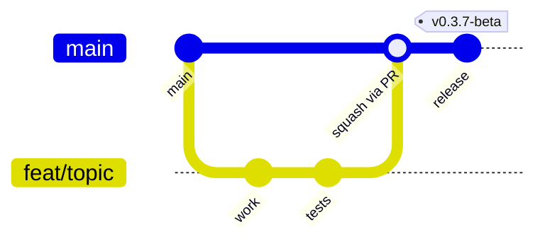
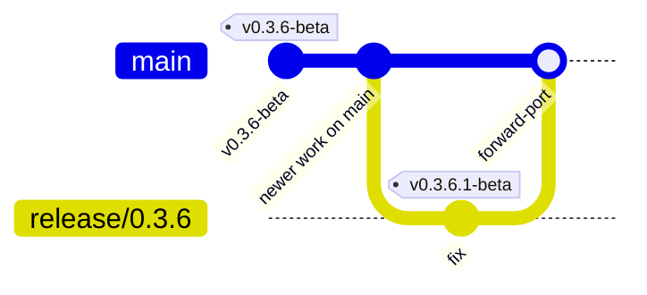

# Branching, Releases, and Hotfixes

This repository is **trunk-based**. `main` is the only long-lived branch;
everything else is short-lived and deleted on merge. Releases are annotated
`v*` tags on `main`.

Adopted September 2026 after the `v0.3.6-beta` promotion (PR #161). The previous
version-named release branches (`lenr_sim_app_v0.2-beta` … `lenr_sim_app_v0.3.6-beta`)
are preserved as `archive/*` tags and no longer receive commits.

## Branches

| Branch | Lifetime | Purpose |
|--------|----------|---------|
| `main` | permanent | Integration and release line. Always deployable; protected. |
| `feat/<topic>`, `fix/<topic>`, `chore/<topic>`, `docs/<topic>` | days | One change each, opened as a PR against `main`, squash-merged, auto-deleted. |
| `consciousenergy/<topic>-<id>` | days | Same as above, created by Cursor agents. |
| `dependabot/**` | days | Automated dependency PRs against `main` (grouped weekly). |
| `release/X.Y` | only while a hotfix is open | Created **from a tag** when a fix must ship against an older release. Deleted after the hotfix tag is cut and the fix is forward-ported to `main`. |

Naming rules: lowercase, hyphen-separated, no version numbers in feature
branch names (the version lives in the four `APP_VERSION` markers, not in git
refs).

## Day-to-day flow



1. `git switch -c feat/<topic> main`
2. Commit focused changes with tests; run the relevant
   [release quality gate](../.cursor/skills/release-quality-gate/SKILL.md) slice.
3. Open a PR against `main` using the PR template. CI must be green:
   `version-consistency`, `test`, `frontend`, `frontend-e2e`, `formalization`,
   `Secret scan`, `Dependency Review`.
4. Review, then **Squash and merge**. The head branch is deleted automatically.

Keep PRs small. Long-running work is landed behind flags or in additive,
backward-compatible slices rather than on a long-lived branch (the API
contract rules in `CONTRIBUTING.md` already require additive changes).

## Cutting a release

Releases are tags, not branches.

1. Bump the version in all four markers (`config.py`, `package.json`,
   `version.js`, `Dockerfile.backend`) and add the `CHANGELOG.md` section in a
   normal PR (`chore/release-vX.Y.Z`). CI `version-consistency` enforces
   agreement.
2. After it merges, tag the merge commit on `main`:

   ```bash
   git fetch origin
   git tag -a vX.Y.Z[-beta] origin/main -m "LENR_SIM_APP vX.Y.Z[-beta]"
   git push origin vX.Y.Z[-beta]
   ```

3. The tag push runs `deploy.yml`, which builds the GHCR images tagged with
   the tag name **and** with `APP_VERSION` read from `config.py`.
4. Create a GitHub Release from the tag; paste the CHANGELOG section.

Versioning follows SemVer with a `-beta` pre-release suffix while the project
is in beta: `v0.3.7-beta`, `v0.4.0-beta`, then `v1.0.0`.

## Hotfixes against an older release

Only needed when `main` has moved on and the fix must ship for the released
version without the newer work.



1. `git switch -c release/0.3.6 v0.3.6-beta`
2. Land the fix on `release/0.3.6` via PR (base = `release/0.3.6`), bump the
   patch version, tag `v0.3.6.1-beta` from that branch.
3. Forward-port the fix to `main` in a normal PR (cherry-pick), then delete
   `release/0.3.6`.

## Tags

| Pattern | Meaning |
|---------|---------|
| `vX.Y.Z[-beta]` | Release; immutable; triggers `deploy.yml`. |
| `archive/<name>` | Snapshot of a deleted long-lived branch or of the tree before a large cleanup (e.g. `archive/pre-legacy-removal`). Immutable. |

Both patterns should be protected from deletion and force-update by a tag
ruleset (Settings → Rules → Rulesets).

## Repository settings that back this model

Configured by a repository admin (not enforceable from code):

- General → Pull Requests: **Automatically delete head branches** on; default
  merge method **Squash**; merge commits remain allowed for release merges.
- Rules → Rulesets → `main`: require a PR, 1 approval, code-owner review,
  the required status checks listed above, block force pushes and deletion,
  apply to administrators. (Requires a public repository or GitHub Pro.)
- Code security: Dependency graph, Dependabot alerts + security updates,
  Secret scanning + Push protection, Private vulnerability reporting, and
  CodeQL (public repos / GHAS). Once the Dependency graph is on, remove
  `continue-on-error` from `dependency-review.yml` so it blocks on high/critical.
