# LENR Simulation App - Architecture Documentation

**Version:** 0.2.1-beta  
**Last Updated:** January 2026

---

## System Architecture Overview

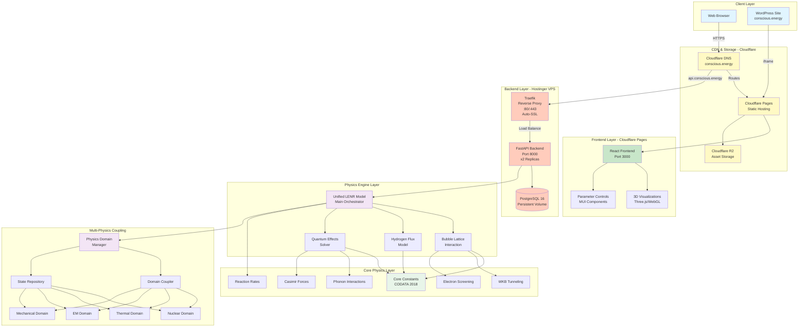

---

## Deployment Architecture

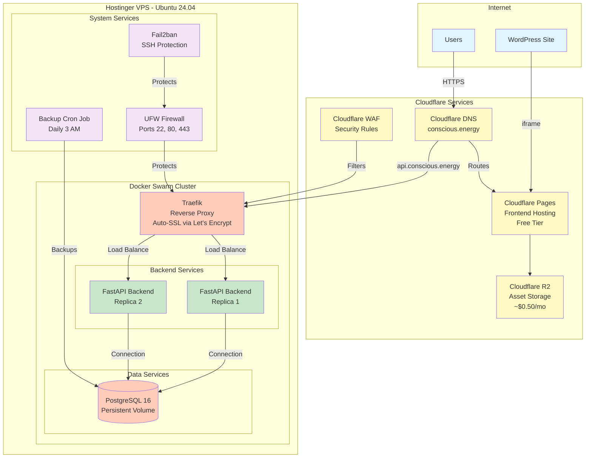

---

## Physics Module Architecture

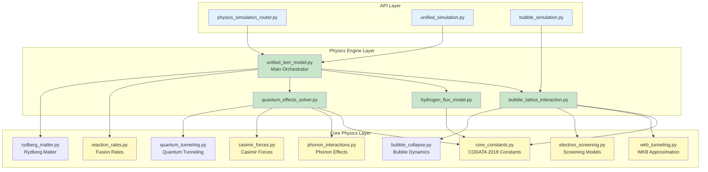

---

## Multi-Physics Coupling Architecture

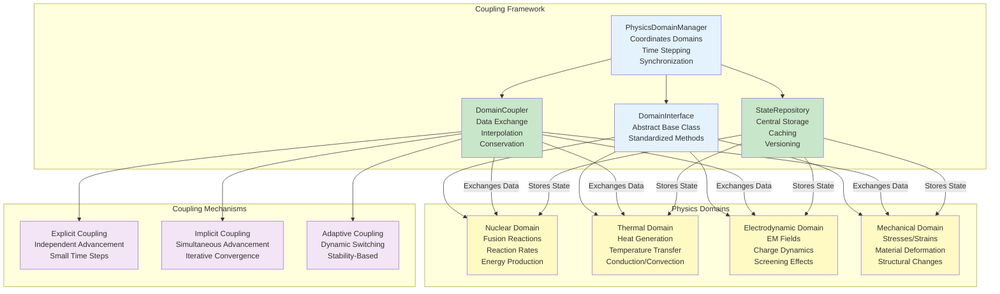

---

## Data Flow Architecture

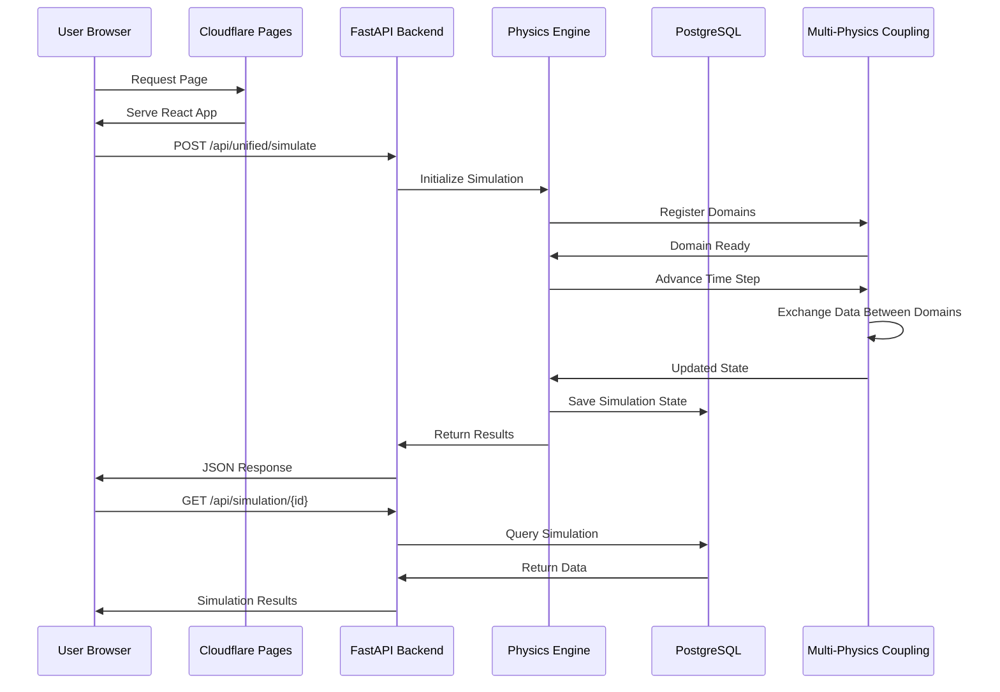

---

## Component Interaction Diagram

```mermaid
graph LR
    subgraph "Frontend Components"
        Dashboard[Dashboard]
        SimPage[Simulation Pages]
        VizPage[Visualization Pages]
        DocPage[Documentation]
    end

    subgraph "API Endpoints"
        Health[/api/health]
        Physics[/api/physics/*]
        Unified[/api/unified/*]
        Bubble[/api/bubble/*]
    end

    subgraph "Business Logic"
        SimService[Simulation Service]
        SharedService[Shared Simulation Service]
        PhysicsService[Physics Service]
    end

    subgraph "Data Layer"
        Models[SQLAlchemy Models]
        Migrations[Alembic Migrations]
    end

    Dashboard --> Health
    SimPage --> Physics
    SimPage --> Unified
    VizPage --> Bubble
    DocPage --> Health
    
    Health --> SimService
    Physics --> PhysicsService
    Unified --> SimService
    Bubble --> SimService
    
    SimService --> Models
    SharedService --> Models
    PhysicsService --> Models
    
    Models --> Migrations

    style Dashboard fill:#e3f2fd
    style SimPage fill:#e3f2fd
    style VizPage fill:#e3f2fd
    style DocPage fill:#e3f2fd
    style Health fill:#c8e6c9
    style Physics fill:#c8e6c9
    style Unified fill:#c8e6c9
    style Bubble fill:#c8e6c9
    style SimService fill:#fff9c4
    style SharedService fill:#fff9c4
    style PhysicsService fill:#fff9c4
    style Models fill:#ffccbc
    style Migrations fill:#ffccbc
```

---

## Request/Response Architecture

### Current Behavior: Synchronous Blocking

**⚠️ Important:** Most physics calculation endpoints are **synchronous and blocking**. The backend responses wait for physics simulations to complete before returning.

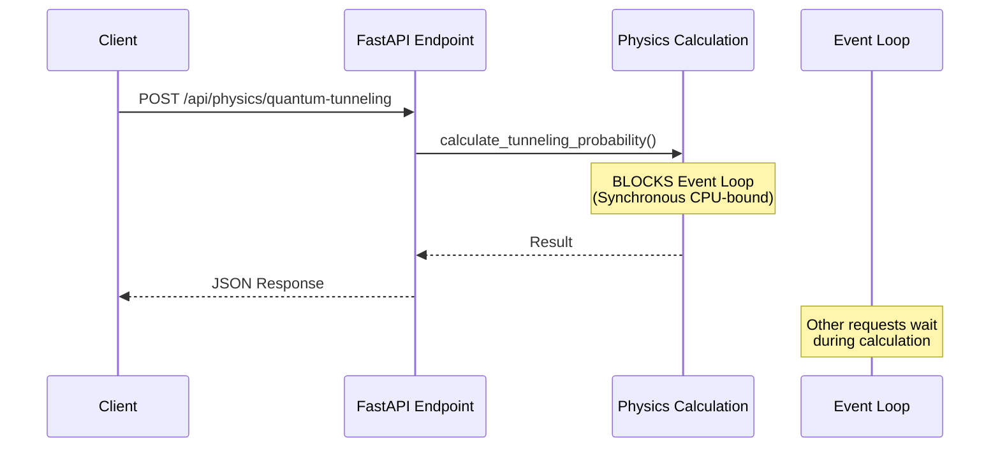

### Current Implementation Patterns

1. **Direct Synchronous Calls** (Most endpoints)
   - Physics calculations run directly in async functions
   - Blocks the FastAPI event loop during computation
   - Timeouts configured: 180-360 seconds
   - Example: `/api/physics/quantum-tunneling`

2. **Thread Pool Execution** (Some endpoints)
   - Uses `loop.run_in_executor(None, simulation.run)`
   - Offloads blocking work to thread pool
   - Example: `simulation_manager.py`

3. **WebSocket Streaming** (Real-time simulations)
   - Uses `asyncio.create_task` for background tasks
   - Streams updates via WebSocket
   - Example: `/api/websocket/simulate/{simulation_id}`

### Performance Implications

| Endpoint Type | Blocking Behavior | Timeout | Impact |
|--------------|------------------|---------|--------|
| Simple calculations | Blocks event loop | 180s | Low (fast calculations) |
| Complex enhancement | Blocks event loop | 360s | Medium (cached results) |
| Multi-physics | Blocks event loop | 300s | High (long calculations) |
| WebSocket simulations | Non-blocking | N/A | Low (streaming) |

### Recommendations for Improvement

1. **Use Thread Pool for All Blocking Calculations**
   ```python
   # Current (blocking)
   result = calc.calculate_tunneling_probability(...)
   
   # Recommended (non-blocking)
   loop = asyncio.get_event_loop()
   result = await loop.run_in_executor(
       None, 
       calc.calculate_tunneling_probability, 
       ...
   )
   ```

2. **Implement Background Task Pattern for Long Simulations**
   ```python
   @router.post("/simulate")
   async def create_simulation(
       request: SimulationRequest,
       background_tasks: BackgroundTasks
   ):
       simulation_id = generate_id()
       # Start simulation in background
       background_tasks.add_task(run_simulation, simulation_id, request)
       return {"simulation_id": simulation_id, "status": "started"}
   ```

3. **Add Progress Tracking for Long Operations**
   - Use WebSocket for real-time progress
   - Store intermediate results in database
   - Allow clients to poll for completion

4. **Consider Celery/Redis for Heavy Computations**
   - Offload to worker processes
   - Better scalability
   - Built-in retry and monitoring

---

## Architecture Comparison: Current vs. Proposed Queue-Based

### Current Architecture (Synchronous Blocking)

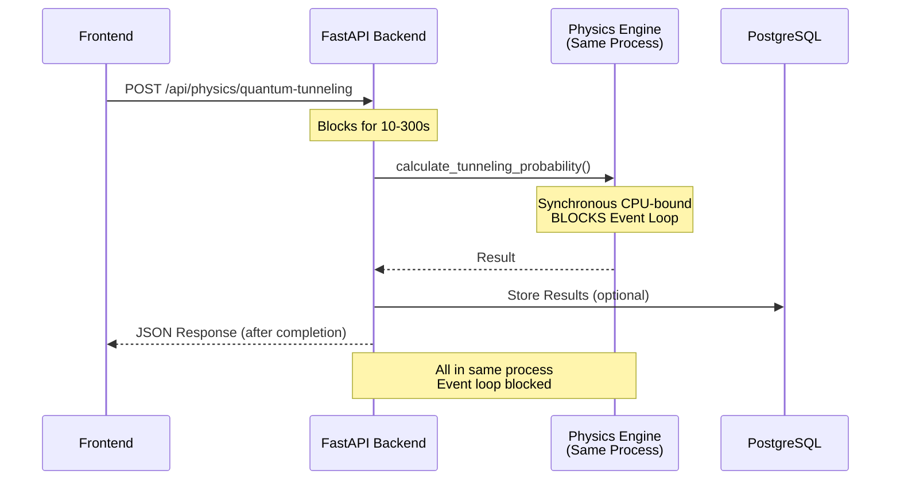

**Characteristics:**
- ✅ Simple implementation
- ✅ Immediate results
- ❌ Blocks event loop
- ❌ No horizontal scaling
- ❌ Timeout risks (180-360s)
- ❌ Single point of failure

### Proposed Architecture (Queue-Based Async)

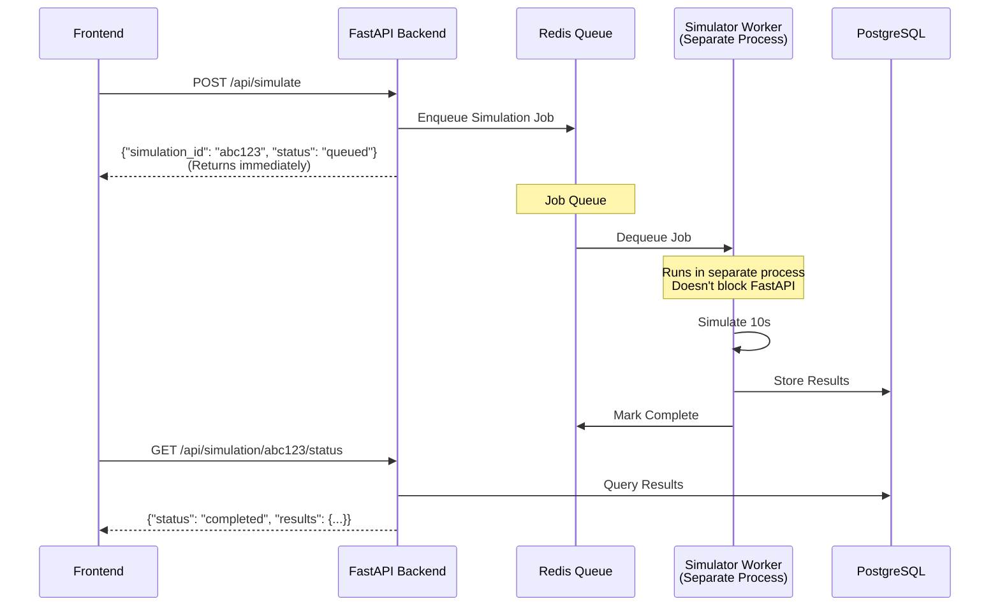

**Characteristics:**
- ✅ Non-blocking (immediate response)
- ✅ Horizontal scaling (multiple workers)
- ✅ Fault tolerance (retry failed jobs)
- ✅ Better resource utilization
- ❌ More complex setup
- ❌ Requires polling/WebSocket for status
- ❌ Additional infrastructure (Redis)

### Side-by-Side Comparison

| Aspect | Current (Synchronous) | Proposed (Queue-Based) |
|--------|----------------------|------------------------|
| **Response Time** | 10-300 seconds | <1 second (immediate) |
| **Event Loop** | Blocked during calculation | Never blocked |
| **Scalability** | Vertical only (more CPU) | Horizontal (more workers) |
| **Fault Tolerance** | Request fails if calculation fails | Jobs can retry automatically |
| **User Experience** | Long wait, timeout risk | Immediate feedback, progress tracking |
| **Infrastructure** | FastAPI + PostgreSQL | FastAPI + Redis + Workers + PostgreSQL |
| **Complexity** | Low | Medium-High |
| **Resource Usage** | Single process | Distributed across processes |
| **Monitoring** | Basic (timeouts) | Advanced (queue depth, worker status) |

### Migration Path

**Phase 1: Add Thread Pool (Minimal Change)**
```python
# Current blocking
result = calc.calculate_tunneling_probability(...)

# Phase 1: Non-blocking but still synchronous
loop = asyncio.get_event_loop()
result = await loop.run_in_executor(None, calc.calculate_tunneling_probability, ...)
```
- ✅ No infrastructure changes
- ✅ Prevents event loop blocking
- ❌ Still waits for completion
- ❌ No horizontal scaling

**Phase 2: Background Tasks (FastAPI Native)**
```python
@router.post("/simulate")
async def create_simulation(request: SimulationRequest, background_tasks: BackgroundTasks):
    simulation_id = generate_id()
    background_tasks.add_task(run_simulation, simulation_id, request)
    return {"simulation_id": simulation_id, "status": "started"}
```
- ✅ No new infrastructure
- ✅ Immediate response
- ❌ No persistence if server restarts
- ❌ Limited scalability

**Phase 3: Redis Queue (Full Async)**
```python
@router.post("/simulate")
async def create_simulation(request: SimulationRequest):
    simulation_id = generate_id()
    await redis_client.enqueue("simulations", {
        "simulation_id": simulation_id,
        "params": request.dict()
    })
    return {"simulation_id": simulation_id, "status": "queued"}
```
- ✅ Full async architecture
- ✅ Horizontal scaling
- ✅ Fault tolerance
- ❌ Requires Redis infrastructure
- ❌ More complex deployment

### Recommendation

For **v0.2.1-beta**, the current synchronous architecture is acceptable because:
- Most calculations are fast (<10s)
- Caching reduces repeated expensive calculations
- Two FastAPI replicas provide basic redundancy

**Consider migrating to queue-based architecture when:**
- Calculations regularly exceed 30 seconds
- You need to handle >10 concurrent simulations
- You want better fault tolerance
- You need progress tracking for long operations

---

## Infrastructure Evolution: Docker Swarm vs Kubernetes + Flux

### Current Architecture: Docker Swarm (v0.2.1-beta)

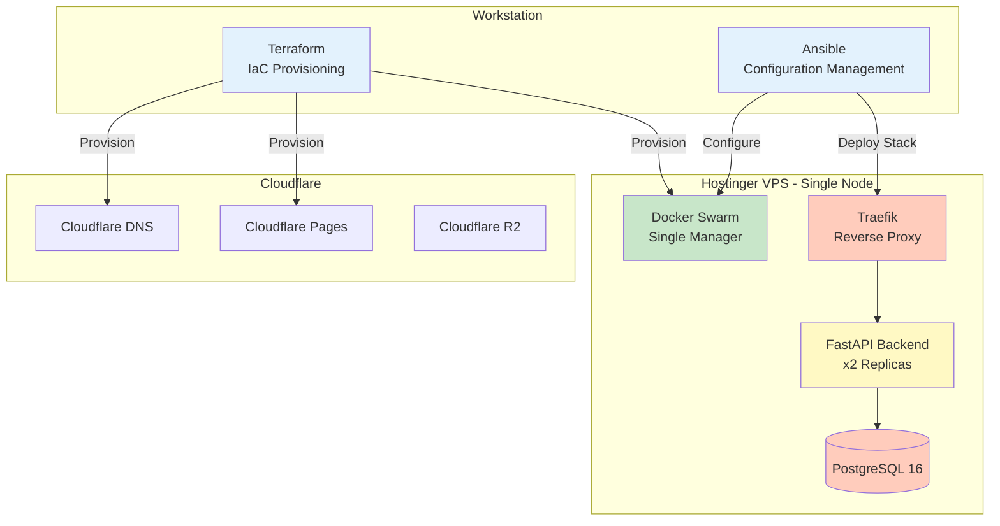

**Current Setup:**
- **Cost:** ~$7.50/month (1 VPS @ $6.99 + Cloudflare)
- **Complexity:** Low-Medium
- **Scalability:** Vertical (add CPU/RAM to single node)
- **Deployment:** Ansible playbooks + Docker Swarm stack files
- **Orchestration:** Docker Swarm (built into Docker)

### Proposed Architecture: Kubernetes + Flux GitOps

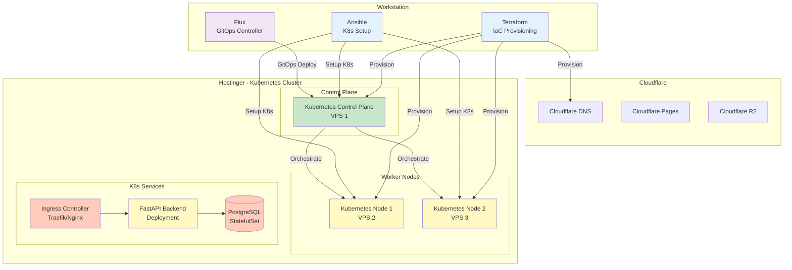

**Proposed Setup:**
- **Cost:** ~$21/month (3 VPS @ $6.99 each + Cloudflare)
- **Complexity:** High
- **Scalability:** Horizontal (add more nodes)
- **Deployment:** GitOps (Flux watches Git repo, auto-deploys)
- **Orchestration:** Kubernetes (industry standard)

### Detailed Comparison

| Aspect | Docker Swarm (Current) | Kubernetes + Flux (Proposed) |
|--------|------------------------|------------------------------|
| **Monthly Cost** | ~$7.50 (1 VPS) | ~$21 (3 VPS) |
| **Setup Complexity** | Low-Medium | High |
| **Learning Curve** | Moderate | Steep |
| **Scalability** | Vertical only | Horizontal + Vertical |
| **High Availability** | Limited (single node) | Excellent (multi-node) |
| **Auto-scaling** | Manual | Built-in (HPA) |
| **Rolling Updates** | Yes (Docker Swarm) | Yes (Kubernetes) |
| **Self-healing** | Basic | Advanced |
| **GitOps** | Manual (Ansible) | Automatic (Flux) |
| **Resource Management** | Basic | Advanced (requests/limits) |
| **Service Discovery** | Built-in | Built-in (more powerful) |
| **Load Balancing** | Built-in | Built-in (more options) |
| **Storage** | Docker volumes | PersistentVolumes (more flexible) |
| **Networking** | Overlay network | CNI plugins (more options) |
| **Monitoring** | Basic | Rich ecosystem (Prometheus, Grafana) |
| **Deployment Speed** | Fast (simple stack) | Slower (more components) |
| **Maintenance Overhead** | Low | Medium-High |
| **Industry Adoption** | Declining | Dominant standard |

### When to Migrate to Kubernetes

**✅ Migrate if:**
- You need **high availability** (99.9%+ uptime)
- You're running **>10 concurrent simulations**
- You need **auto-scaling** based on load
- You want **GitOps** workflow (deploy on Git push)
- You plan to add **multiple applications/services**
- You need **advanced resource management**
- You want **industry-standard** orchestration
- You have **budget for 3x infrastructure cost**

**❌ Stay with Docker Swarm if:**
- Current setup meets your needs
- Budget is constrained (~$7.50/mo)
- Team lacks Kubernetes expertise
- You have **<5 concurrent users**
- You want **simpler operations**
- You prefer **lower maintenance overhead**
- You're in **early beta** (v0.2.1-beta)

### Migration Path (If Deciding to Migrate)

**Phase 1: Prepare (1-2 weeks)**
1. Set up Kubernetes cluster (3 VPS nodes)
2. Install Flux in cluster
3. Create Kubernetes manifests (Deployments, Services, Ingress)
4. Test deployment in staging

**Phase 2: Migrate (1 week)**
1. Set up Flux GitOps repository
2. Configure Flux to watch your Git repo
3. Migrate Docker Swarm stack to Kubernetes manifests
4. Test all services in K8s

**Phase 3: Cutover (1 day)**
1. DNS cutover to Kubernetes cluster
2. Monitor and verify
3. Decommission Docker Swarm

**Phase 4: Optimize (Ongoing)**
1. Configure HPA (Horizontal Pod Autoscaler)
2. Set up monitoring (Prometheus/Grafana)
3. Implement resource limits
4. Optimize for cost

### Cost-Benefit Analysis

**Current (Docker Swarm):**
- ✅ Low cost ($7.50/mo)
- ✅ Simple operations
- ✅ Fast deployment
- ❌ Limited scalability
- ❌ Single point of failure
- ❌ Manual scaling

**Proposed (Kubernetes + Flux):**
- ✅ High availability
- ✅ Auto-scaling
- ✅ GitOps workflow
- ✅ Industry standard
- ❌ 3x cost ($21/mo)
- ❌ Higher complexity
- ❌ Steeper learning curve

### Recommendation for v0.2.1-beta

**For now: Stay with Docker Swarm** because:
1. **Cost-effective** for beta phase
2. **Sufficient** for current scale
3. **Simpler** to maintain
4. **Adequate** for 2 replicas + load balancing

**Consider Kubernetes migration when:**
- You reach **production** (v1.0.0)
- You need **>99.9% uptime**
- You have **>50 concurrent users**
- Budget allows **$21+/month**
- Team has **Kubernetes expertise**

### Hybrid Approach (Recommended Migration Path)

**This is the recommended approach for gradual infrastructure evolution:**

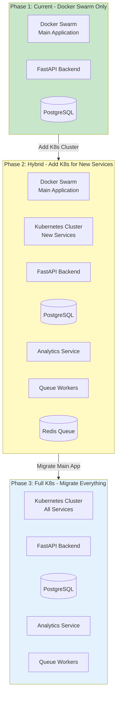

**Hybrid Strategy Benefits:**

1. **Phase 1 (Current): Docker Swarm Only**
   - Main application on Docker Swarm
   - Cost: ~$7.50/month
   - Simple operations

2. **Phase 2 (Hybrid): Add Kubernetes for New Services**
   - **Keep Docker Swarm** for stable main application (FastAPI + PostgreSQL)
   - **Add Kubernetes cluster** (3 VPS nodes) for new services:
     - Analytics dashboard service
     - Queue workers (Redis + Celery)
     - Background job processors
     - Future microservices
   - **Use Flux GitOps** for Kubernetes services from day one
   - Cost: ~$28.50/month ($7.50 Swarm + $21 K8s)
   - Benefits:
     - ✅ Keep stable main app unchanged
     - ✅ Learn Kubernetes gradually
     - ✅ Test GitOps workflow on new services
     - ✅ Isolate risk (new services can fail without affecting main app)

3. **Phase 3 (Full K8s): Migrate Everything**
   - Migrate main application to Kubernetes
   - Decommission Docker Swarm
   - Cost: ~$21/month (3 VPS nodes)
   - Benefits:
     - ✅ Unified orchestration
     - ✅ Full GitOps workflow
     - ✅ Advanced features (HPA, auto-scaling)

**Hybrid Migration Timeline:**

| Phase | When | Cost | Complexity | Main App | New Services |
|-------|------|------|------------|----------|--------------|
| Phase 1 | v0.2.1-beta (Current) | $7.50/mo | Low | Docker Swarm | N/A |
| Phase 2 | v0.3.0-beta (Add analytics) | $28.50/mo | Medium | Docker Swarm | Kubernetes + Flux |
| Phase 3 | v1.0.0 (Production) | $21/mo | High | Kubernetes | Kubernetes |

**Why Hybrid is Recommended:**

- ✅ **Risk Mitigation**: New services can fail without affecting stable main app
- ✅ **Gradual Learning**: Team learns Kubernetes on non-critical services first
- ✅ **Cost Flexibility**: Can scale K8s services independently
- ✅ **GitOps Testing**: Validate Flux workflow before migrating critical services
- ✅ **Rollback Safety**: Easy to revert new services without touching main app
- ✅ **Incremental Migration**: Move services one at a time when ready

---

## Legend

- **Blue** - Client/User-facing components
- **Yellow** - Infrastructure/CDN services
- **Green** - Application services
- **Orange** - Data/Storage services
- **Purple** - System/Support services

---

**Document maintained by:** LENR Simulation Platform Development Team  
**Contact:** diadon@conscious.energy
