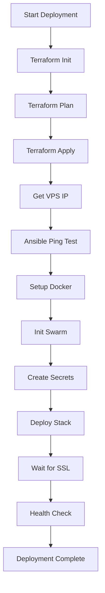

# LENR Simulation App - Infrastructure Summary

**Version:** 0.2.1-beta  
**Last Updated:** January 2026

---

## Infrastructure Overview

The LENR Simulation App uses a modern, cost-effective infrastructure stack:

### Architecture

```
┌─────────────────────────────────────────────────────────────┐
│                    Cloudflare (Frontend)                     │
│  • Pages: Static React app hosting                          │
│  • R2: Asset storage (optional)                              │
│  • DNS: Domain management                                   │
│  • CDN: Global content delivery                              │
│  Cost: $0/month (Pages), ~$0.50/month (R2)                  │
└─────────────────────────────────────────────────────────────┘
                            │
                            │ HTTPS API Calls
                            ▼
┌─────────────────────────────────────────────────────────────┐
│              Hostinger VPS (Backend)                         │
│  • Ubuntu 24.04 LTS                                         │
│  • Docker Swarm (single node)                               │
│  • Traefik: Reverse proxy + SSL                             │
│  • FastAPI: Backend service (2 replicas)                     │
│  • PostgreSQL 16: Database                                  │
│  Cost: $6.99/month (KVM 2: 2 vCPU, 8GB RAM)                │
└─────────────────────────────────────────────────────────────┘
```

---

## Technology Stack

| Component | Technology | Purpose |
|-----------|------------|---------|
| **IaC Provisioning** | Terraform | Declarative infrastructure |
| **Configuration** | Ansible | Idempotent server setup |
| **Orchestration** | Docker Swarm | Container management |
| **Reverse Proxy** | Traefik v3.0 | SSL, routing, load balancing |
| **Backend** | FastAPI (Python 3.11) | REST API |
| **Database** | PostgreSQL 16 | Data persistence |
| **Frontend Hosting** | Cloudflare Pages | Static site hosting |
| **Storage** | Cloudflare R2 | Asset storage (optional) |

---

## File Structure

### Terraform (`infrastructure/terraform/`)

- `main.tf` - Root module configuration
- `variables.tf` - Input variable definitions
- `outputs.tf` - Output values (URLs, IPs)
- `terraform.tfvars.example` - Example configuration
- `modules/cloudflare/` - Cloudflare provisioning
- `modules/hostinger/` - Hostinger VPS provisioning

### Ansible (`infrastructure/ansible/`)

- `ansible.cfg` - Ansible configuration
- `inventory.yml.example` - Server inventory template
- `group_vars/all.yml` - Shared variables
- `playbooks/` - Deployment playbooks
  - `site.yml` - Master playbook
  - `setup-docker.yml` - Docker installation
  - `deploy-stack.yml` - Application deployment
  - `backup.yml` - Database backup
- `templates/` - Jinja2 templates
  - `docker-stack.yml.j2` - Docker Swarm stack
  - `traefik.yml.j2` - Traefik configuration
  - `traefik-dynamic.yml.j2` - Dynamic routing rules

### Docker (`infrastructure/docker/`)

- `Dockerfile.backend` - Multi-stage FastAPI build

### Scripts (`infrastructure/scripts/`)

- `deploy.sh` - Full deployment automation
- `rollback.sh` - Service rollback
- `backup-db.sh` - Database backup

---

## Deployment Flow



---

## Security Features

- **Firewall:** UFW configured (ports 22, 80, 443 only)
- **SSH:** Key-based authentication only
- **Fail2ban:** SSH brute-force protection
- **Docker Secrets:** Encrypted secret management
- **Non-root containers:** Application runs as non-root user
- **HTTPS:** Automatic SSL via Let's Encrypt
- **CORS:** Restricted to authorized domains
- **Rate Limiting:** Traefik middleware (100 req/min)

---

## Monitoring

### Health Checks

- **Backend:** `/api/health` endpoint
- **PostgreSQL:** `pg_isready` check
- **Traefik:** Built-in dashboard

### Logs

```bash
# Backend logs
docker service logs lenr-sim_backend -f

# All services
docker service logs lenr-sim_traefik -f
docker service logs lenr-sim_postgres -f
```

### Metrics

- Traefik dashboard: `https://traefik.conscious.energy` (with auth)
- Docker stats: `docker stats`
- System resources: `htop`, `df -h`

---

## Backup Strategy

- **Automated:** Daily backups at 3 AM (cron job)
- **Retention:** 7 days
- **Location:** `/opt/lenr-sim/backups/`
- **Format:** Compressed SQL dumps (`.sql.gz`)

---

## Scaling

### Horizontal Scaling

```bash
# Scale backend replicas
docker service scale lenr-sim_backend=4
```

### Vertical Scaling

Upgrade Hostinger VPS plan:
- KVM 1 → KVM 2: +$2/month (2x CPU, 2x RAM)
- KVM 2 → KVM 4: +$6/month (2x CPU, 2x RAM)

---

## Cost Breakdown

| Service | Provider | Monthly Cost | Notes |
|---------|----------|--------------|-------|
| Frontend Hosting | Cloudflare Pages | $0 | Free tier |
| CDN | Cloudflare | $0 | Included |
| R2 Storage | Cloudflare | ~$0.50 | Pay-as-you-go |
| VPS | Hostinger KVM 2 | $6.99 | 2 vCPU, 8GB RAM |
| SSL | Let's Encrypt | $0 | Free |
| **Total** | | **~$7.50/mo** | |

---

## Quick Commands Reference

### Terraform

```bash
terraform init
terraform plan
terraform apply
terraform output
terraform destroy  # CAREFUL!
```

### Ansible

```bash
ansible all -i inventory.yml -m ping
ansible-playbook -i inventory.yml playbooks/setup-docker.yml
ansible-playbook -i inventory.yml playbooks/deploy-stack.yml
```

### Docker Swarm

```bash
docker stack services lenr-sim
docker service logs lenr-sim_backend -f
docker service scale lenr-sim_backend=4
docker service rollback lenr-sim_backend
```

---

## Documentation Links

- [DEPLOYMENT.md](DEPLOYMENT.md) - Complete deployment guide
- [DEPLOYMENT_CHECKLIST.md](DEPLOYMENT_CHECKLIST.md) - Step-by-step checklist
- [DEPLOYMENT_QUICK_REFERENCE.md](DEPLOYMENT_QUICK_REFERENCE.md) - Quick commands
- [TROUBLESHOOTING.md](TROUBLESHOOTING.md) - Common issues and solutions
- [WORDPRESS_INTEGRATION.md](WORDPRESS_INTEGRATION.md) - WordPress setup

---

**Infrastructure Summary maintained by:** LENR Simulation Platform Development Team  
**Contact:** diadon@conscious.energy
