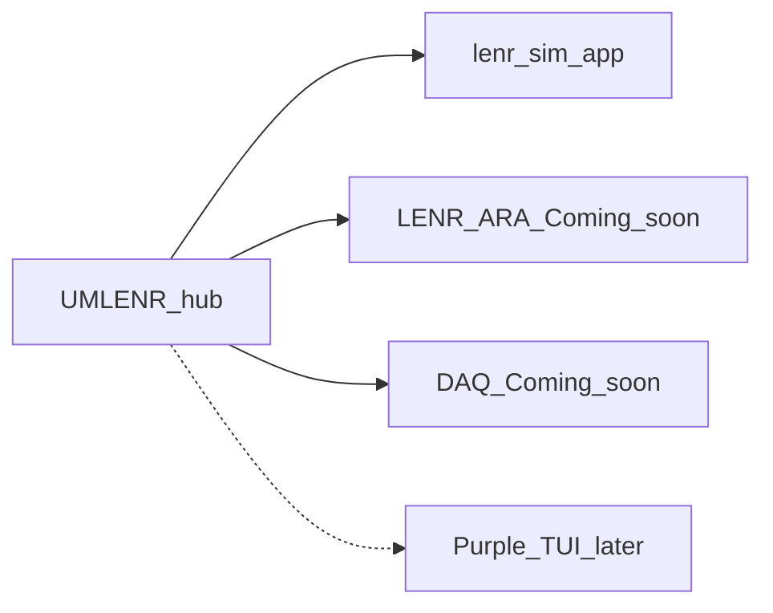

# Scope and maturity (three-repo matrix)

**Audience:** humans and agents staging the public UMLENR hub.  
**Framing:** UMLENR is the **encompassing program hub**. The LENR Simulation
Application is **one pillar**, not the whole program.

Status language for the public hub:

- Program / hub: **In Development**
- Private or unreleased children: **Coming soon** (no private clone URLs on the
  public README)

## Matrix

| Surface | Visibility (forge) | Maturity | Hub treatment |
|---------|-------------------|----------|---------------|
| `UMLENR` | Public | Legacy research dump on `main` (Py Sims, `LENR_ARA_GPT`, `LENR_Math_Sim`, datasets). Soft-archive, then docs-first hub. | Program narrative, schemas, registries |
| `lenr_sim_app` | Public | Most developed child — markers **0.4.0-beta**; live research preview at `lenr-sim-beta` on the program domain | One pillar; link product README for deep onboarding |
| `LENR_ARA` (expected private product) | Private / path TBD (404 to many tokens) | In Development | **Coming soon** — agentic lab assistant |
| LENR-ARA DAQ software | Private | Planned | **Coming soon** — separate trust plane |
| Public ARA lineage (context) | Public | Historical (`ARA`, `gpt-ARA`, archived `LENR-Project`, UMLENR `LENR_ARA_GPT/`) | History only — not the private product |

## Safe to describe on the public hub

- Program pillars and **In Development** / **Coming soon** status chips
- Sim as public research preview **v0.4.0-beta** (link child repo; do not paste full sim README)
- Contract ids the hub **registers** (e.g. `lenr-run-export-v1`; planned `lenr-ara-daq-sample-v1`)
- Trust planes: CI ≠ deploy ≠ runtime ≠ DAQ
- Later goals: Purple TUI, ARA↔Sim, DAQ data — **not** cutover gates
- GPL-3.0 program-wide

## Must not land on public UMLENR yet

- Private ARA / DAQ application trees, inventories, deploy secrets, DAQ credentials
- Closing or soft-pedaling `EQ-OPEN-*`
- Merging unfinished private code into the hub
- Treating `LENR_Math_Sim` as current Sim (ancestor only)

## Related

- [`drafts/UMLENR_README.md`](drafts/UMLENR_README.md) — program-hub README draft
- [`LATER_GOALS.md`](LATER_GOALS.md) — Purple / ARA↔Sim / DAQ ladder
- [`TRUST_PLANES.md`](TRUST_PLANES.md) — security model
