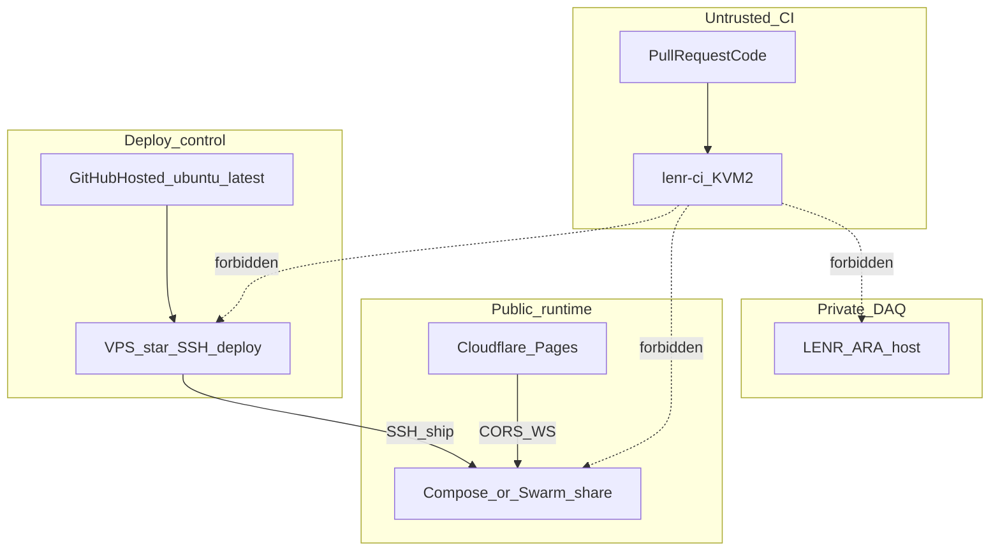

# Trust planes (security model)

Split trust so a compromise in one plane cannot take the others.

## Rules

1. **CI plane** (`lenr-ci` on `2012566`): runs untrusted branches. No `VPS_*`,
   no Swarm manager role, no production DB volumes, no DAQ credentials.
2. **Deploy plane**: GitHub-hosted workflows (or a future dedicated
   `lenr-deploy` pool) hold ship secrets. Prefer short-lived SSH keys.
3. **Runtime plane**: Compose today; Swarm+Traefik at cutover. Public API +
   Postgres. Rollback Compose tag retained.
4. **DAQ plane** (LENR-ARA): private network / separate VPS. Consumes hub
   **schemas** only — never co-tenant with CI or public Sim DB.
5. **Secrets channels**: GitHub Actions secrets, operator password managers,
   untracked `*.tfvars` / Ansible inventories. Never Slack, PR bodies, or git.
6. **Least privilege tokens**: Cloudflare zone-scoped; Hostinger API off CI;
   Traefik dashboard off or authenticated.

## Developer practices

- Trunk-based short PRs; one topic per PR (ops ≠ academic claims).
- Confirm-string gates for destructive infra.
- Path-filtered CI so docs-only PRs skip heavy e2e when configured.
- Academic honesty: hub docs link ledgers; they do not “close” open equations.
