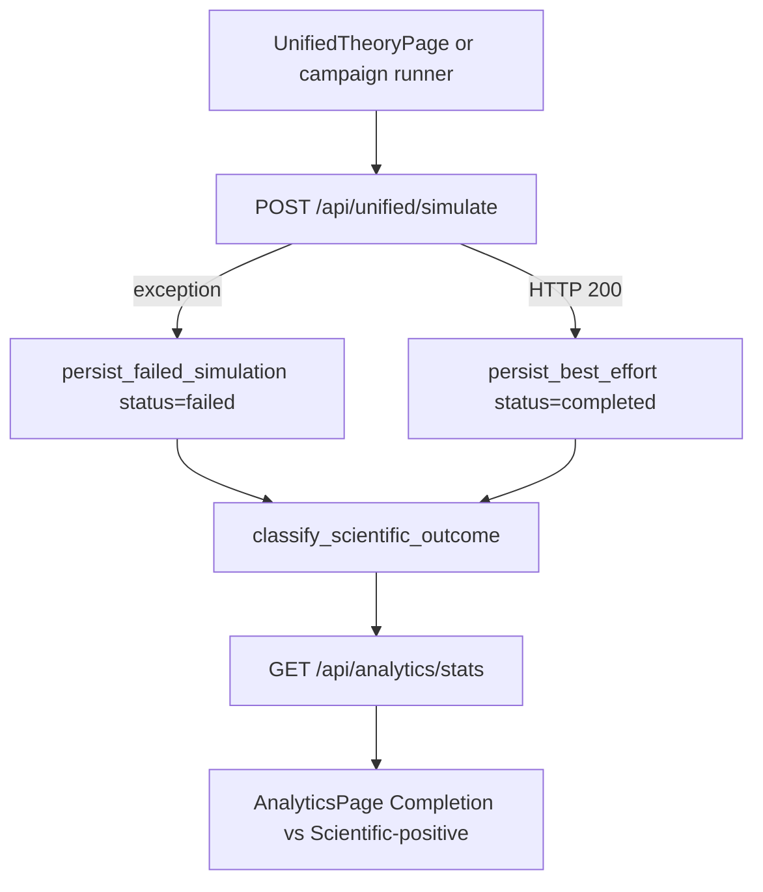

# Analytics Transparency Notes

## Completion vs scientific outcome

Analytics Overview previously showed a **Success Rate** of 100% because that
card was `completed / total`. Every saved row defaulted to `status=completed`,
including the Google/ARPA-E null seed (`excess_heat_watts: 0.0`). That is a
**completion rate**, not a scientific-positive rate and not LENR validation.

Current split (additive API fields on `GET /api/analytics/stats`):

| Field | Meaning |
|---|---|
| `completionRate` (alias `successRate`) | Share of rows with SQL/HTTP `status=completed` |
| `scientificPositiveRate` | Share classified `positive` |
| `outcomeCounts` | `{positive, null, inapplicable, failed}` |
| `claimTierCounts` | Histogram of theory `claim_tier` labels from saved pipeline scores |

Classification rules (model/literature outcomes only):

- `failed` — `status` is `failed` or `cancelled`
- `inapplicable` — completed, and every saved theory score has `is_applicable=false`
- `positive` — completed, applicable, and `excess_heat_watts > 0`
- `null` — completed with no excess heat (includes ARPA-E; enhancement-only rows stay null)

Campaign and UI true-fail paths persist `status=failed`. `lenr_proved` /
`EQ-OPEN-*` are unchanged. Extra runs are **model outputs**, not laboratory proof.

## Diverse campaign preset

`python -m app.scripts.run_simulation_campaign --preset diverse` is a designed
experiment stacked on the campaign runner, not a full cartesian of every theory:

- Unified cartesian: 77/300/350/500 K × loading 0.10/0.50/0.85/0.95 × Pd/Ni/Ti × D/H × pipeline on/off (~192)
- Extras: `trapped_state`, electric field {0, 1e6}, Cu poor-match host, electrolyte family `other`
- Theory-group axis: one `enabled_theories` representative per composition group at four cells (~40)
- `full` remains the large cartesian; do not run `diverse` in CI

## Backend Outputs Added
- `analytics_transparency.confidence_weights`
- `analytics_transparency.normalization`
- `analytics_transparency.sensitivity_note`
- `analytics_transparency.electrolyte_family`
- `analytics_transparency.electrolyte_species`
- `analytics_transparency.electrolyte_diagnostics.support_level`
- `analytics_transparency.electrolyte_diagnostics.activity_multiplier`
- `composition_provenance.combination_rule`
- `composition_provenance.applied_groups`
- `composition_provenance.excluded_theories`
- `validation.contradiction_reason_code`
- `GET /api/analytics/stats.completionRate`
- `GET /api/analytics/stats.scientificPositiveRate`
- `GET /api/analytics/stats.outcomeCounts`
- `GET /api/analytics/stats.claimTierCounts`

## Purpose
- Make confidence composition and normalization inspectable from API payloads.
- Avoid hidden score aggregation logic in frontend-only paths.
- Make electrolyte assumptions explicit (family, species, molarity regime, consistency checks).
- Expose overlap resolution policy so theory combinations are reproducible and auditable.
- Distinguish explicit contradiction reason taxonomy from generic warning text.
- Keep lifecycle completion distinct from scientific-positive so Overview cannot be read as LENR proof.

## Contradiction Reason Taxonomy
- `none`: no contradiction detected.
- `threshold_boundary`: enhancement at cap boundary without consistent phase assignment.
- `missing_phase_data`: required phase distribution keys absent.
- `inconsistent_mode`: run configuration indicates incompatible mode/species consistency.

## Composition Policy
- Runtime grouping prevents double counting from overlapping mechanisms (screening, coherence, confinement, etc.).
- Within each group, one theory is selected with `max(enhancement_factor * confidence)`.
- Excluded theories are still returned in per-theory outputs and tagged with `composition_status: excluded_overlap`.
