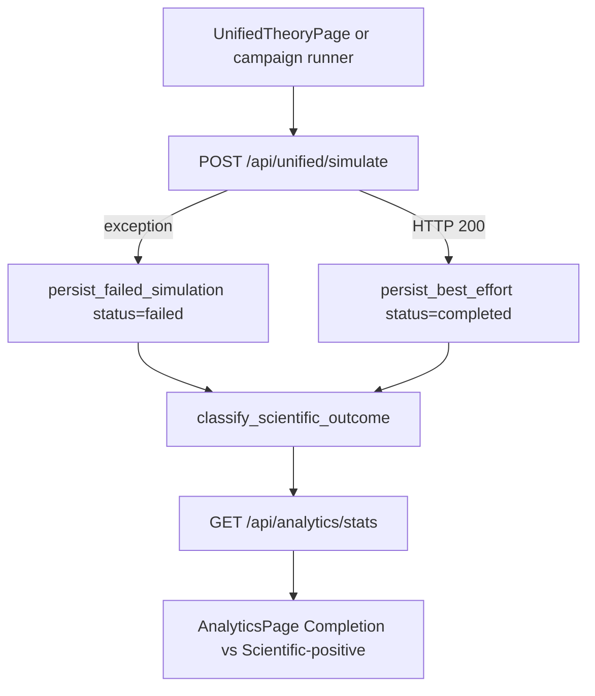
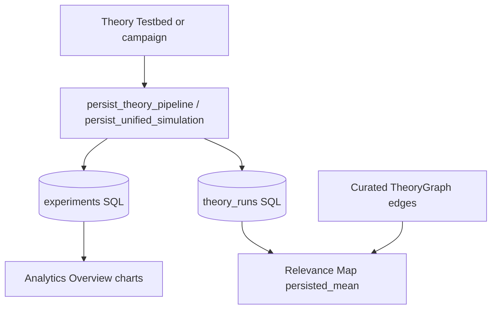

# Analytics Transparency Notes

## Completion vs scientific outcome

Analytics Overview previously showed a **Success Rate** of 100% because that
card was `completed / total`. Every saved row defaulted to `status=completed`,
including the Google/ARPA-E null seed (`excess_heat_watts: 0.0`). That is a
**completion rate**, not a scientific-positive rate and not LENR validation.

Current split (additive API fields on `GET /api/analytics/stats`):

| Field | Meaning |
|---|---|
| `completionRate` (alias `successRate`) | Share of rows with SQL/HTTP `status=completed` |
| `scientificPositiveRate` | Share classified `positive` |
| `outcomeCounts` | `{positive, null, inapplicable, failed}` |
| `claimTierCounts` | Histogram of theory `claim_tier` labels from saved pipeline scores |
| `openQuestionCounts` | Histogram of `parameters.open_question_ids` on persisted rows (campaign + seeded baselines). Model N, not Q1–Q5 closure |
| `openQuestionCountsCampaign` | Same histogram restricted to `source=simulation_campaign` |
| `sourceClassCounts` | `{Baseline, Campaign, Auto, User}` from `is_baseline` + `source` |

Classification rules (model/literature outcomes only):

- `failed` — `status` is `failed` or `cancelled`
- `inapplicable` — completed, and every saved theory score has `is_applicable=false`
- `positive` — completed, applicable, and `excess_heat_watts > 0`
- `null` — completed with no excess heat (includes ARPA-E; enhancement-only rows stay null)

Campaign and UI true-fail paths persist `status=failed`. `lenr_proved` /
`EQ-OPEN-*` are unchanged. Extra runs are **model outputs**, not laboratory proof.

## Diverse campaign preset

`python -m app.scripts.run_simulation_campaign --preset diverse` is a designed
experiment stacked on the campaign runner, not a full cartesian of every theory:

- Unified cartesian: 77/300/350/500 K × loading 0.10/0.50/0.85/0.95 × Pd/Ni/Ti × D/H × pipeline on/off (~192)
- Extras: `trapped_state`, electric field {0, 1e6}, Cu poor-match host, electrolyte family `other`
- Theory-group axis: one `enabled_theories` representative per composition group at four cells (~40)
- `full` remains the large cartesian; do not run `diverse` in CI

## Chart ↔ SQL field map

Overview charts plot columns from the `experiments` table. They do **not**
share one Y-axis. A 2500 keV Taleyarkhan `energy_output_kev` row must not
flatten 5–85× `enhancement_factor` traces.

| UI | SQL / API field |
|---|---|
| Total Records | `COUNT(experiments)` (`stats.totalSimulations`) |
| Completion Rate | `status = completed` / total (`completionRate`, alias `successRate`) |
| Scientific-positive | `excess_heat_watts > 0` (`scientificPositiveRate`) |
| Avg Enhancement | mean `enhancement_factor` |
| Total Energy Output | sum of estimated `energy_output_kev` (not a conserved total) |
| Enhancement factor (SQL) | timeline `enhancementFactor` vs `created_at` date |
| Energy output (SQL keV) | timeline `energyOutput` vs `created_at` date |
| Stored experiment type | `experiment_type` enum pie |
| Source class | Baseline / Campaign / Auto / User from `is_baseline` + `source` |
| Temperature Distribution | binned `temperature_k` |
| History Name | `experiments.name` |
| Comparison / CSV pressure | `pressure_bar` (bar, not atm) |

`GET /api/analytics/timeline` is additive: `date`, `name`, `is_baseline`,
`source`, `sourceClass`. `GET /api/analytics/distribution/source` is new.
`include_baseline=false` hides **literature seeds** (`is_baseline`) only.
Campaign and auto-persist (`source` in `simulation_campaign` / `auto_persist`)
stay visible so seed-only vs hydrated campaign N is not confused with “hide my
runs.”

Analytics Overview does **not** show a CLI hydrate banner. Seed-only vs campaign
N is in the caption (`openQuestionCounts` / `openQuestionCountsCampaign`).
Researchers import `q_campaign_demo` from the CLI; see `RESEARCHER_REVIEW_PACK.md`.

## Score contract: `final_score` vs `weighted_score`

Two formulas used to share the name `score`:

| Field | Formula | Where |
|---|---|---|
| `score` | guardrails `confidence_breakdown.weighted_score` | existing persist column |
| `final_score` | five-factor geometric mean × claim-tier | Relevance Map live + persist overlay |

Persist enrichment is **additive**. `theory_runs.theory_scores[*]` now also
stores `final_score`, the five subscores, and
`score_formula: five_factor_gm_x_claim_tier`. Persist calls
`compute_theory_scores(..., skip_sensitivity=True)` so campaigns are not 2–3×
slower; stored `parameter_sensitivity` is the neutral **0.5**. Live
“Run live scores” still computes sensitivity.

`GET /api/analytics/theory-run-history` (`lenr-theory-run-history-v1`) is
additive: `score_field: final_score_preferred`, `mean_final_score`,
`mean_weighted_score`, mean subscores, percentile `ci_lo`/`ci_hi`
(2.5/97.5), `by_source_class`, and `skip_sensitivity_note`. `mean_score`
prefers `final_score`. Curated edge strength is never rewritten from SQL
co-occurrence.

SQL mean is **not** experimental confirmation. `scientificPositiveRate` is
**not** LENR proof. Mixed Overview **Avg enhancement** can be dominated by
capped `combined_enhancement` (\(10^5\)) from pipeline rows.

The map defaults to **SQL means** when `n_runs > 0`, with **Run live scores**
/ **Use SQL means** to switch. Node radius in `persisted_mean` uses
`mean_final_score`. Relevance Map chips show N, CI, `score_formula`, and
that persisted sensitivity is 0.5 unless live scores are computed. The
page also calls existing `parameter-sweep` (max 100 steps) and
`validation-report` APIs; those checks are phenomenology screens, not proof.

## Collection loop (model outputs)

`python -m app.scripts.run_simulation_campaign --preset all_claims` samples
every registered `theory_id` plus a 2 T × 2 loading Pd-D cartesian (4) and
two tagged occurrence-anchored Pd-D cells. `--preset literature_grid` is the
designed literature-anchored grid (distinct baseline cells + negative
controls, ~16–32). Extra runs are **model outputs**.
They do not raise empirical claim tiers or close `EQ-OPEN-*`.
`lenr_proved` stays false. Do not run `--preset full` or full `diverse` in CI.

## Backend Outputs Added
- `analytics_transparency.confidence_weights`
- `analytics_transparency.normalization`
- `analytics_transparency.sensitivity_note`
- `analytics_transparency.electrolyte_family`
- `analytics_transparency.electrolyte_species`
- `analytics_transparency.electrolyte_diagnostics.support_level`
- `analytics_transparency.electrolyte_diagnostics.activity_multiplier`
- `composition_provenance.combination_rule`
- `composition_provenance.applied_groups`
- `composition_provenance.excluded_theories`
- `validation.contradiction_reason_code`
- `GET /api/analytics/stats.completionRate`
- `GET /api/analytics/stats.scientificPositiveRate`
- `GET /api/analytics/stats.outcomeCounts`
- `GET /api/analytics/stats.claimTierCounts`
- `GET /api/analytics/timeline.{date,name,is_baseline,source,sourceClass}`
- `GET /api/analytics/distribution/source`
- `GET /api/analytics/distribution/{type,material,temperature}.include_baseline`
- `theory_runs.theory_scores[*].final_score` (additive; `score` remains weighted)
- `GET /api/analytics/theory-run-history.{score_field,mean_final_score,mean_weighted_score,ci_lo,ci_hi,by_source_class}`
- `POST /api/analytics/theories/run-coupled` auto-persist (`persist_session_id`, `persist_source`)

## Purpose
- Make confidence composition and normalization inspectable from API payloads.
- Avoid hidden score aggregation logic in frontend-only paths.
- Make electrolyte assumptions explicit (family, species, molarity regime, consistency checks).
- Expose overlap resolution policy so theory combinations are reproducible and auditable.
- Distinguish explicit contradiction reason taxonomy from generic warning text.
- Keep lifecycle completion distinct from scientific-positive so Overview cannot be read as LENR proof.

## Contradiction Reason Taxonomy
- `none`: no contradiction detected.
- `threshold_boundary`: enhancement at cap boundary without consistent phase assignment.
- `missing_phase_data`: required phase distribution keys absent.
- `inconsistent_mode`: run configuration indicates incompatible mode/species consistency.

## Composition Policy
- Runtime grouping prevents double counting from overlapping mechanisms (screening, coherence, confinement, etc.).
- Within each group, one theory is selected with `max(enhancement_factor * confidence)`.
- Excluded theories are still returned in per-theory outputs and tagged with `composition_status: excluded_overlap`.
