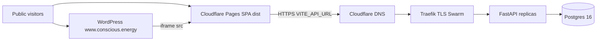

# Public release review — v0.3.6-beta (2026-08-31)

**Verdict: NO-GO for live Cloudflare / Hostinger cutover.**

Specialists re-ran gates on product HEAD `d6be618` (`lenr_sim_app_v0.3.6-beta`, PR #118) rather than quoting the 2026-08-23 evidence pack. Review branch: `consciousenergy/public-release-review-7a95`. Review-first ledgers: [review-2026-08/](review-2026-08/).

This document is the Wave 2 synthesis. Wave 3 (same branch) implements confirmed **code** blockers from the plan list. Operator DNS, Terraform apply, Hostinger login, and GitHub Advanced Security stay operator-owned.

Live probe 2026-08-31: that architecture is **not** what serves `conscious.energy` today. Authoritative NS are WordPress.com. Apex, `www`, `api`, and `app` all land on Automattic. `api.conscious.energy` presents a `wordpress.com` certificate. `lenr-sim-prod.pages.dev` is NXDOMAIN.

---

## Go / no-go rubric (plan)

| Required for GO | Result |
|---|---|
| Four version markers identical `0.3.6-beta` | **PASS** |
| Science gates green | **PASS** — 55 passed (3 V&V + 52 experiment-anchored) |
| No new high/critical audits | **PASS** — pip-audit 0 new IDs (11 ignored); npm high=0 |
| Export envelope and `contract_version` additive-only | **PASS** — `lenr-run-export-v1`, `v0.3.6-beta-science-gate-1` |
| Production hides OpenAPI/metrics/diagnostics; Analytics writes token-gated; persist off | **PASS** in code / Swarm template |
| Cloudflare Pages would build **this** release branch with `VITE_API_URL=https://api.conscious.energy` (not `main`) | **FAIL** — Terraform `production_branch = "main"`; `origin/main` is 88 commits behind |
| GHCR image tag matches `0.3.6-beta`, not `latest`/`main` by accident | **FAIL** — Swarm pulls `:latest`; `deploy.yml` only on `main` + `v*` tags; `BUILD_VERSION=${{ github.ref_name }}` |
| No public UI path claims LENR is proved or presents `1e5` as a laboratory measurement | **FAIL** — `/bubble-fusion` shows **1.00e+13×** when the API omits `enhancement_factor`. Analytics History `≥1e5 (capped)` is honest. `lenr_proved` remains false |
| Traefik dashboard is not world-reachable with a placeholder password | **FAIL in template** — public router + `admin:$apr1$xxxxx$xxxxx`. Not live until DNS exists (today NS is WordPress.com) |
| Operator runbook no longer tells them to open `/api/docs` in production | **FAIL** — `DEPLOYMENT_CHECKLIST.md` still expects Swagger 200 |

**Slice gates that are green do not make a public GO.** Cutover would either publish stale `main`, fail GHCR pull, steal the WordPress marketing site, or show a 10^13 enhancement chip.

---

## Three buckets

### Code blockers (must change in git before a safe apply)

| ID | Finding | Owner file |
|---|---|---|
| SCI-001 | `/bubble-fusion` defaults missing `enhancement_factor` to `1e13` | [02-science-honesty.md](review-2026-08/02-science-honesty.md) |
| INF-001 | Pages Terraform pins `production_branch = "main"` twice | [06-infra-website.md](review-2026-08/06-infra-website.md) |
| INF-002 | `deploy.yml` on `main`+tags only; `BUILD_VERSION` stamps `main`/`v0.3.6-beta`; Swarm `:latest` | same |
| INF-012 | No Pages `_redirects` → SPA deep links 404 | same |

### Operator blockers (nothing in git goes live until these)

| ID | Finding | Owner file |
|---|---|---|
| INF-008 | Live DNS is WordPress.com; `api` TLS SAN mismatch; Pages project NXDOMAIN. Naive `terraform apply` of apex CNAME would steal the marketing site | [06-infra-website.md](review-2026-08/06-infra-website.md) |
| INF-004 / INF-013 | WordPress iframe vs SPA host not decided; docs still iframe apex while apex **is** WordPress | same |
| INF-017 | Ansible never `docker login ghcr.io` | same |
| GATE-004 / FRM-006 | Local `lake build` skipped (no elan). **CI `formalization` job succeeded** on `d6be618` (run `33132075488`, 2026-08-28) | [01-quality-gates.md](review-2026-08/01-quality-gates.md), [08-formalization.md](review-2026-08/08-formalization.md) |
| SCI-015 | WolframAlpha MCP not in this session; in-repo CODATA checks only | [02-science-honesty.md](review-2026-08/02-science-honesty.md) |
| SEC-008 | `dependency-review.yml` `continue-on-error` until GHAS is enabled | [05-security.md](review-2026-08/05-security.md) |

### Accepted residuals (do not block this beta)

| ID | Residual |
|---|---|
| GATE-001 / SEC-002 | pip-audit ignores: starlette 0.49.1, vtk 9.4.2, ecdsa 0.19.2 (9 unique PYSEC IDs → 11 rows) |
| GATE-002 / SEC-003 / FE-010 | react-router 6.x two moderate GHSAs; CI gate is `--audit-level=high` |
| GATE-003 | eslint **0 errors / 506 warnings** (unchanged vs 08-23) |
| SCI-011 / SCI-012 / SCI-013 / FRM-001 / FRM-004 | `two_body` default; `lenr_proved` false; five `EQ-OPEN-*` remain OPEN |
| INF-007 / AN-001 / AN-002 / AN-006 | Swarm `LENR_AUTO_PERSIST=0`; Analytics writes token-gated; no boot seed |
| AN-004 | Demo pack 150 experiments / 132 theory_runs; clone ≠ 150 |
| SEC-008 | GHAS dependency-review theater until operator enables it |

---

## Seed hypotheses (Wave 0 → Wave 1)

| # | Hypothesis | Result |
|---|---|---|
| 1 | Pages `production_branch = "main"` while ship work is on `lenr_sim_app_v0.3.6-beta` | **Confirmed** (INF-001, blocker) |
| 2 | `deploy.yml` `BUILD_VERSION=${{ github.ref_name }}` breaks the four-marker rule | **Confirmed** for the image **label**; runtime `APP_VERSION` stays `0.3.6-beta`. Workflow does not run on the ship branch (INF-002) |
| 3 | Deployment checklist contradicts production OpenAPI hiding | **Confirmed** (INF-003). Hiding in code is correct; 404 is the probe |
| 4 | Traefik dashboard + placeholder basic-auth | **Confirmed** (SEC-001 / INF-011) |
| 5 | Playwright E2E exists but is absent from CI | **Confirmed** (FE-006 / GATE-007). Local: 25 passed / 2 failed |
| 6 | No `robots.txt` / privacy policy; PostHog present and env-gated | **Confirmed** (DOC-001). No `phc_` key in git (DOC-002) |
| 7 | WordPress iframe vs `frame-ancestors` (SPA vs API) | **Confirmed** plus live DNS inversion (INF-004) |
| 8 | 08-23 evidence pack is stale vs 08-24..08-27 CHANGELOG | **Confirmed**. 56 non-merge commits since `e733fc2`. Jest 201 → **210** |
| 9 | Documented pip-audit ignores and react-router moderate remain residuals | **Confirmed**. No new high/critical |
| 10 | Dual CORS layers and GHCR `ConsciousEnergy` vs lowercase | **Confirmed** (API-003 / SEC-004 / INF-009 / SEC-005) |

---

## Gate counts vs 2026-08-23

| Gate | 08-23 | 2026-08-31 | Delta |
|---|---|---|---|
| Version markers | `0.3.6-beta` | `0.3.6-beta` | match |
| pip-audit + CI ignores | 11 ignored, 0 new | 11 ignored, 0 new | match |
| Combined science gates | 55 passed | **55 passed** | match |
| Backend unit `tests/` + `app/tests/` | not quoted | **1077 passed, 9 skipped** | new baseline |
| `check_ir.py` / `diff_code_literals.py` | PASS | **PASS** (51 IR / 75 taxonomy) | match |
| `lake build` | cited 08-22 local | **CI PASS** on `d6be618` (`formalization` job). Local elan absent | CI is the oracle |
| `npm audit --audit-level=high` | 0 high | 0 high / 2 moderate | match |
| `npm run lint` | 0 / 506 | **0 / 506** | match |
| `npm test` | 201 / 30 suites | **210 / 32 suites** | +9 / +2 |
| `CI=true npm run build` | PASS | **PASS** | match |
| Playwright | not in pack | **25 passed, 2 failed**, not in `test.yml` | new / failing |
| Analytics honesty pytest | n/a | **20 passed** | new |

Logs: `/opt/cursor/artifacts/` (`pip-audit.log`, `pytest-unit.log`, `science-gates.log`, `formalization.log`, `npm-*.log`, `fe-playwright.log`, `analytics-persistence-pytest.log`).

`TestPhysicsCalculations` 429 isolation issue did **not** fire in the full unit run (GATE-008).

---

## Majors (fix before or on day-one; not silent)

Science / public copy: SCI-002 idle viz retired 10^8 QED/Casimir/Rydberg; SCI-003 catalog/clamp `10^20`–`10^30`; SCI-004 local-fallback up to 6e5; SCI-005 Miles module “independently confirmed” vs UI 24±4; SCI-006 missing claim-tier chips; SCI-007 / DOC-003 weak About; FRM-002 Q4 “0.000 MeV”; FRM-003 paper 6.2/6.3/6.6 present-tense closure.

API / security / infra: API-002 / AN-008 datasets (and in-app docs) not in Docker image; API-003 / SEC-004 / INF-010 dual CORS; API-006 / SEC-012 unauthenticated `/api/simulations` + cache-clear / custom reactions; SEC-001 / INF-011 Traefik dashboard; SEC-005 / INF-009 GHCR mixed-case + `:latest`; SEC-006 docker.sock; SEC-007 rate-limit mismatch; SEC-013 WebSocket Origin; INF-003 / DOC-005 `/api/docs` should load; INF-005 `Dockerfile.frontend` localhost default; INF-006 no `_headers`; INF-014 / FE-003 preview `NODE_ENV=development`; FE-006/007 Playwright; FE-008 success-styled schematic fallbacks; AN-009 Save-to-Analytics success toast on **403**; DOC-001 no privacy/robots if PostHog key is set; DOC-006 OpenAPI license MIT vs GPL-3.0.

---

## What already holds (do not regress)

- Canonical `/api/unified` path: `two_body` default, `MAX_ENHANCEMENT_FACTOR = 1e5`, `lenr_proved: false`, `EQ-OPEN-*` OPEN.
- Production boot: `LENR_SECRET_KEY` required; OpenAPI / ReDoc / metrics / fitting / logs / diagnostics / mock simulations off; `/memory` and `/cache/*` 404.
- Analytics GET public; POST/PUT/DELETE require `X-LENR-Write-Token`.
- Swarm `LENR_AUTO_PERSIST=0`. Hydrate is operator CLI (image currently cannot see `datasets/` — AN-008).
- History `≥1e5 (capped)` and “model association %, not P(LENR)”.
- No public UI prints Lean `PROVED` as “LENR proved.”
- PostHog: no committed key; init requires production + key + not DNT.
- `IS_PRODUCTION` hides debug routes in a clean `vite build`.

---

## Operator cutover punch-list (after Wave 3 code)

Do **not** `terraform apply` until a written hostname map exists.

1. Inventory WordPress.com DNS (MX, SPF, Google/Outlook TXT).
2. Keep WordPress on one hostname; point the SPA at Pages; point `api` A/AAAA at the VPS (`proxied = false`).
3. Move NS to Cloudflare only after records exist. Do not CNAME apex to Pages while WordPress still owns the brochure.
4. Confirm `docker pull ghcr.io/consciousenergy/lenr-sim-backend:<version>` (lowercase) after GHCR login.
5. Pin Swarm to a version/digest, not floating `:latest`.
6. One-replica `alembic upgrade head` then `seed_database --force --hydrate-demo` **after** the image contains `datasets/`.
7. Probe: `GET /api/health` 200 `version: 0.3.6-beta`; `GET /api/docs` (no slug) **404**; `GET /metrics` **404**; OPTIONS CORS a **single** `Access-Control-Allow-Origin`.
8. Do not create public DNS for `traefik.conscious.energy`.
9. Leave `VITE_POSTHOG_KEY` unset until `/privacy` + cookie notice exist (Wave 3 adds the page; still do not set the key without counsel).
10. Do not run `--preset full` or full `diverse` on the VPS.

---

## Wave 3 scope (this branch, after this synthesis)

Plan list plus confirmed code blockers:

1. Align Pages `production_branch` and `deploy.yml` with `lenr_sim_app_v0.3.6-beta` and `BUILD_VERSION=0.3.6-beta`.
2. Production verification docs: `/api/docs` expected **404**.
3. Disable Traefik dashboard (no placeholder auth).
4. Pages `_headers` / `_redirects` / `robots.txt` / privacy + PostHog notice.
5. Add Playwright to CI; fix the two failing locators.
6. Refresh stale Playwright/PostHog skills and 0.2.1-beta operator docs.
7. SCI-001: never default bubble-fusion enhancement to `1e13`.
8. GHCR image `| lower`; `Dockerfile.backend` `COPY datasets`; `Dockerfile.frontend` `VITE_API_URL`; preview `NODE_ENV=production`; drop Traefik `backend-cors`; OpenAPI license GPL-3.0; About disclaimer; Save-to-Analytics 403 not toasted as success.

Not in Wave 3 (accepted or later): discharging `EQ-OPEN-*`; FastAPI/Starlette/vtk upgrades; React Router 7; lint-warning backlog; idle-viz QED rewrite (SCI-002); Miles module rewrite (SCI-005); live `terraform apply`.

---

## Wave 3 (same branch, 2026-08-31)

Implemented confirmed **code** blockers from the plan list. Operator DNS / `terraform apply` remain PENDING. Public cutover is still **NO-GO** until WordPress.com NS is replaced with a written hostname map.

| Fix | Finding |
|---|---|
| Bubble-fusion never defaults enhancement to `1e13` | SCI-001 |
| Pages `production_branch` = `lenr_sim_app_v0.3.6-beta`; preview `NODE_ENV=production` | INF-001, INF-014 |
| `deploy.yml` ship branch + `BUILD_VERSION=0.3.6-beta` + lowercase GHCR + `0.3.6-beta` tag | INF-002, SEC-005 |
| Traefik dashboard off; no placeholder htpasswd | SEC-001 / INF-011 |
| Drop Traefik `backend-cors` | API-003 / INF-010 |
| `_headers` / `_redirects` / `robots.txt` / `/privacy` | INF-006, INF-012, DOC-001 |
| Playwright in `test.yml`; unique readout; `raw ≈ 10^` visible | FE-006, FE-007 |
| `COPY datasets`; frontend `VITE_API_URL`; OpenAPI GPL-3.0; About honesty; 403 not toasted as success | AN-008, INF-005, DOC-006, SCI-007, AN-009 |

| File | Agent | Slice verdict |
|---|---|---|
| [00-architecture.md](review-2026-08/00-architecture.md) | Wave 0 | Four markers PASS; 08-23 pack stale |
| [01-quality-gates.md](review-2026-08/01-quality-gates.md) | A | Gates GO; public hold |
| [02-science-honesty.md](review-2026-08/02-science-honesty.md) | B | NO-GO until SCI-001 |
| [03-api-contract.md](review-2026-08/03-api-contract.md) | C | Tokens PASS; dual CORS hold |
| [04-frontend-e2e.md](review-2026-08/04-frontend-e2e.md) | D | Prod routes OK; Playwright/CI hold |
| [05-security.md](review-2026-08/05-security.md) | E | Conditional; dashboard/GHCR/session_id |
| [06-infra-website.md](review-2026-08/06-infra-website.md) | F | Not ready to apply |
| [07-docs-legal.md](review-2026-08/07-docs-legal.md) | G | No-go for PostHog; ship-without-key residual majors |
| [08-formalization.md](review-2026-08/08-formalization.md) | H | No formalization blocker |
| [09-analytics-persistence.md](review-2026-08/09-analytics-persistence.md) | I | Anonymous SQL closed; hydrate image broken (AN-008) |
