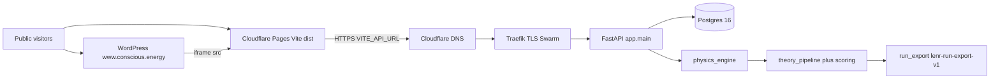
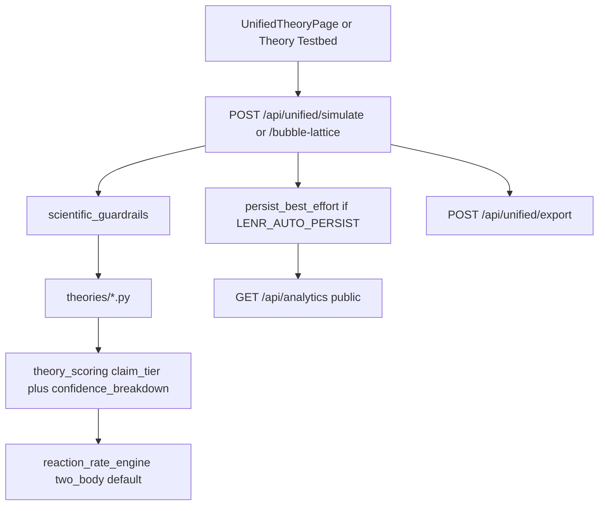

# Wave 0 — Architecture map and review seed

**Date:** 2026-08-31
**HEAD:** `d6be618` (`lenr_sim_app_v0.3.6-beta`, PR #118)
**Review branch:** `consciousenergy/public-release-review-7a95`
**Seed:** `python3 .cursor/skills/architecture-mapping/scripts/map_endpoints.py`

This file is the shared ledger for Wave 1 specialists. Seed hypotheses are listed at the bottom; confirm or refute them rather than rediscovering from scratch.

## Version markers (Step 1 of release-quality-gate)

| Surface | Value |
|---|---|
| `LENR_SIM_APP_v2/backend/app/core/config.py` `APP_VERSION` | `0.3.6-beta` |
| `LENR_SIM_APP_v2/frontend/package.json` `version` | `0.3.6-beta` |
| `LENR_SIM_APP_v2/frontend/src/config/version.js` `APP_VERSION` | `0.3.6-beta` |
| `LENR_SIM_APP_v2/infrastructure/docker/Dockerfile.backend` `BUILD_VERSION` | `0.3.6-beta` |

**Status:** PASS (all four identical).

## HEAD vs 2026-08-23 evidence pack

The 08-23 public-readiness pack is commit `e733fc2` (docs) / PR #97. Since then, `git log --since=2026-08-23 --oneline --no-merges` records **56 non-merge commits**, including:

- Auto-persist of simulations into SQL analytics (`9cfd799`)
- Campaign presets (`literature_grid`, `all_claims`, `diverse`, `question_theories`, `association_screen`, `testbed_review`)
- Analytics honesty (completion vs scientific-positive, association rank, History saturation / keV dash)
- Public API hardening (`1f01681`: Analytics write token, production boot lock)
- Pages/deploy hydrate (`c268b55`)
- Formalization / Lean IR lock without closing `EQ-OPEN-*`
- Demo pack refresh to ~150 experiments / 132 theory_runs

**Finding (seed, orchestrator):** the 08-23 evidence pack is stale relative to HEAD. Wave 1 must re-run gates, not quote 08-23 logs.

## Container map (verified against files)



Verified nodes:

- SPA entry: [`frontend/src/index.jsx`](../../../frontend/src/index.jsx) (CODEBASE_MAP still says `index.js` — stale)
- App routes: [`frontend/src/App.tsx`](../../../frontend/src/App.tsx)
- API: [`backend/app/main.py`](../../../backend/app/main.py)
- Cloudflare Pages: [`infrastructure/terraform/modules/cloudflare/main.tf`](../../../infrastructure/terraform/modules/cloudflare/main.tf)
- Swarm: [`infrastructure/ansible/templates/docker-stack.yml.j2`](../../../infrastructure/ansible/templates/docker-stack.yml.j2)

## Simulation data-flow (canonical, still required after 08-24..08-27)



Files: [`unified_simulation.py`](../../../backend/app/api/routes/unified_simulation.py), [`theory_pipeline.py`](../../../backend/app/physics_engine/theory_pipeline.py), [`simulation_persistence.py`](../../../backend/app/services/simulation_persistence.py), [`run_export.py`](../../../backend/app/physics_engine/run_export.py), [`analytics_routes.py`](../../../backend/app/routers/analytics_routes.py).

## Backend router inventory (live seed)

Two layouts remain (canonical vs legacy):

| Prefix | Module | Production? |
|---|---|---|
| `/api/unified` | `api/routes/unified_simulation.py` | yes |
| `/api/physics` | `api/routes/physics.py` (theory testbed) **and** `routers/physics_routes.py` + `physics_simulation_router.py` | yes |
| `/api` + `/analytics` | `routers/analytics_routes.py` | yes (writes token-gated) |
| `/api/docs/{slug}` | `api/routes/docs_routes.py` | **yes, still mounted** |
| `/api/visualization` | `routers/visualization_routes.py` | yes |
| `/api/results` | `routers/result_visualization_routes.py` | yes |
| `/api/multi-physics` | `routers/multi_physics_routes.py` | yes |
| `/api/simulations` | `routers/shared_simulation_router.py` | yes (session_id, no auth) |
| `/api/ws/...` | `routers/websocket_router.py` | yes |
| `/api/fitting`, `/api/logs`, `/api/diagnostics`, mock `/api/simulations` | legacy routers | **gated off in production** |
| `/memory`, `/cache/stats` | `main.py` | 404 in production |

`GET /` in `main.py` still advertises `/api/fitting`, `/api/logs`, `/api/diagnostics`, and `/docs` even when those are off — Wave 1-C/E should classify this.

## Frontend public routes

From `App.tsx` (always mounted): `/`, `/dashboard`, `/simulations`, `/new-simulation`, `/simulation/:id`, `/quantum-tunneling`, `/fusion-simulation`, `/lenr-simulation`, `/bubble-fusion`, `/real-time-visualization`, `/physics-dashboard`, `/physics-visualization`, `/about`, `/theory`, `/theory-paper`, `/unified-theory`, `/analytics`, `/advanced-analysis`, `/documentation`, `/docs`, `/docs/:slug`, `/team`, `/settings`.

Hidden when `IS_PRODUCTION` (`NODE_ENV === production` or `REACT_APP_ENVIRONMENT === production`): `/diagnostics`, `/component-showcase`, `/visualization-test`, `/visualization-debug`, `/three-test`, `/lattice-test`.

Vite production builds set `NODE_ENV=production`, so debug routes should be absent from the Pages bundle. Agent D must confirm the baked `IS_PRODUCTION` flag and that `REACT_APP_ENVIRONMENT` is not required.

Provider tree (`index.jsx`): `PostHogProvider` > `OfflineProvider` > `ThrottleProvider` > `SnackbarProvider` > `App` (App adds `ThemeProvider` + `PhysicsProvider`). Additional unused/legacy contexts: `AppSettingsContext`, `LogContext`, `SettingsContext`.

WebSocket clients (three canonical + extras): `services/websocket.js`, `api/physics/websocketClient.ts`, `utils/visualizationWebSocket.js`, plus `hooks/useBubbleLatticeStream.js`.

## Physics theories vs CODEBASE_MAP

`CODEBASE_MAP.md` lists 21 theory modules and omits `stellar_scaling_mhd.py`. The `theories/` directory has **22** modules (plus `__init__.py`). Agent H should confirm registration vs the map.

## CODEBASE_MAP staleness (orchestrator notes)

- Entry listed as `frontend/src/index.js`; actual is `index.jsx`
- Theory count 21 vs 22
- Does not mention PostHog, campaign persistence, or production write-token
- Pages listed omit several public routes that `App.tsx` still serves

## Seed hypotheses for Wave 1 (confirm or refute)

1. Pages Terraform pins `production_branch = "main"` while ship work is on `lenr_sim_app_v0.3.6-beta`
2. `deploy.yml` `BUILD_VERSION=${{ github.ref_name }}` breaks the four-marker rule
3. Deployment checklist contradicts production OpenAPI hiding
4. Traefik dashboard + placeholder basic-auth
5. Playwright E2E exists but is absent from CI
6. No `robots.txt` / privacy policy; PostHog present and env-gated
7. WordPress iframe vs frame-ancestors (SPA vs API)
8. 08-23 evidence pack is stale vs 08-24..08-27 CHANGELOG — **confirmed by this Wave 0 git log**
9. Documented pip-audit ignores (starlette/vtk/ecdsa) and react-router moderate advisories remain accepted residuals
10. Dual CORS layers and GHCR `ConsciousEnergy` vs lowercase image names

## Finding schema

Each Wave 1 file uses:

```
### {ID}
- severity: blocker | major | minor | accepted-residual
- surface: science | api | frontend | security | infra | docs | legal | ci
- status: confirmed | refuted | needs-operator
- evidence:
- recommendation:
```
