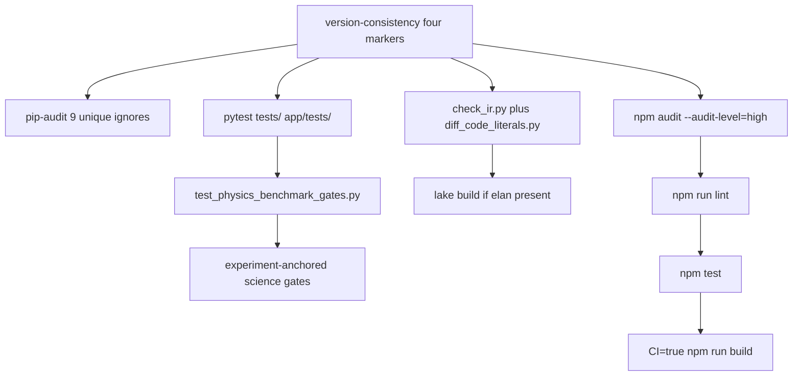

# Wave 1-A — Release quality gates

**Date:** 2026-08-31
**Agent:** A (release-quality-gate; review-first, no product-code edits)
**Branch:** `consciousenergy/public-release-review-7a95`
**Product HEAD:** `d6be618` (`lenr_sim_app_v0.3.6-beta`, PR #118)
**Review HEAD at write:** `0207b44`
**Python:** 3.12.3 via `LENR_SIM_APP_v2/backend/.venv` (reused in-flight venv install)
**Node:** v22.14.0 / npm 10.9.7
**Skill:** `.cursor/skills/release-quality-gate/` mirroring `.github/workflows/test.yml`



## Verdict (this surface)

The commands in the release-quality-gate skill are **green** on this tree. Combined science gates are **55 passed**, matching the 2026-08-23 pack. Frontend high-audit, lint errors, Jest, and Vite build all pass. No new pip-audit IDs beyond the documented ignore list.

This slice does **not** by itself make a public go: `lake build` was skipped here (no elan), Playwright is still absent from `test.yml` (FE-006), and the 08-23 evidence pack counts are stale on Jest (201 → 210). None of those are failures of the pytest/npm gates that CI already runs on `lenr_sim_app_v0.3.6-beta` (last green push: PR #118, 2026-08-28).

Wave 0 seed **9** (pip-audit ignores + react-router moderate residuals) is **confirmed**. Seed **8** (08-23 pack stale) is **confirmed** for frontend test count. Seed **5** (Playwright absent from CI) is **confirmed** (owned in detail by Agent D).

## Summary vs 2026-08-23

08-23 pack (`RELEASE_EVIDENCE_PACK.md` / `VERIFICATION_GATE_REPORT.md` / `MASTER_PROGRESS_AND_KNOWN_ISSUES.md`): science gates **55 passed**; frontend **201** tests / 30 suites; lint **0 errors / 506 warnings**; pip-audit clean under **11 ignored**; npm **high=0**.

| Gate | 08-23 | This run (2026-08-31) | Delta |
|---|---|---|---|
| Version markers (4 surfaces) | `0.3.6-beta` | all `0.3.6-beta` | match / **PASS** |
| `pip-audit -r requirements.txt` + CI ignores | clean, **11 ignored** | `No known vulnerabilities found, 11 ignored`, exit **0** | match / **PASS** |
| Unique `--ignore-vuln` IDs in `test.yml` | 9 IDs (docs also say 11 ignored) | 9 IDs → 11 advisory rows | match; 11 is row count |
| Unit `pytest tests/ app/tests/ --cov=app` | not quoted as a single number | **1077 passed, 9 skipped, 42 warnings** in 108.72s, exit **0** | new recorded baseline |
| V&V `test_physics_benchmark_gates.py` | part of 55 | **3 passed, 16 warnings** in 7.42s, exit **0** | see combined |
| Experiment-anchored science set (6 files) | part of 55 | **52 passed, 15 warnings** in 17.43s, exit **0** | see combined |
| Combined science gates (3 + 52) | **55 passed** | **55 passed** | **match / PASS** |
| `check_ir.py` | PASS (08-22 pack) | `IR equations: 51`, taxonomy 75, **PASS**, exit **0** | match |
| `diff_code_literals.py` | PASS | **PASS**, exit **0** | match |
| `lake build` | cited PASS 08-22 | **skipped** (elan/lake absent) | **needs-operator** (CI) |
| `npm audit --audit-level=high` | 0 high (2 moderate) | exit **0**; **2 moderate, 0 high** | match / **PASS** |
| `npm run lint` | 0 errors / **506** warnings | **0 errors / 506 warnings**, exit **0** | **match / PASS** |
| `npm test -- --watchAll=false --runInBand` | **201** passed / 30 suites | **210** passed / **32** suites, exit **0** | **+9 tests, +2 suites / PASS** |
| `CI=true npm run build` | PASS | **PASS** (15.69s), exit **0** | PASS; extra Vite warnings |
| `TestPhysicsCalculations` 429 isolation | known residual | both methods **PASSED** in the full unit suite | **not a regression this run** |
| Product-branch CI `Test and Benchmark` | green on 08-23 pack | last green on `lenr_sim_app_v0.3.6-beta`: run `33132075488` (PR #118, 2026-08-28) | review-PR CI was in flight at write |

### Exact pytest summary lines

```text
=========== 1077 passed, 9 skipped, 42 warnings in 108.72s (0:01:48) ===========
======================== 3 passed, 16 warnings in 7.42s ========================
======================= 52 passed, 15 warnings in 17.43s =======================
```

Combined science-gate arithmetic: 3 + 52 = **55**.

Unit skips (9, all pre-existing `SKIPPED`, not xfail):

- `tests/test_theory_modules.py::TestScoringFairness::test_hydroton_scores_above_40_percent`
- `app/tests/test_advanced_physics.py::TestQuantumTunneling::test_electron_screening`
- `app/tests/test_advanced_physics.py::TestPhononModes::test_phonon_dispersion_calculation`
- `app/tests/test_advanced_physics.py::TestPhononModes::test_density_of_states`
- `app/tests/test_advanced_physics.py::TestPhononModes::test_thermal_properties`
- `app/tests/test_advanced_physics.py::TestPhononModes::test_phonon_nuclear_coupling`
- `app/tests/test_unified_theory.py::test_mechanism_analysis`
- `app/tests/test_visualization_hooks.py::TestVisualizationHooks::test_error_notification`
- `app/tests/test_visualization_hooks.py::TestVisualizationHooks::test_hooks_receive_events`

Coverage from the unit run: **51%** (`TOTAL 25671 11609 6074 731 51%`). Not a release gate.

### Command logs

Copied to `/opt/cursor/artifacts/`:

| File | What |
|---|---|
| `pip-audit.log` | CI ignore list (exit 0, 11 ignored) + unfiltered inventory (11 findings / 3 packages) |
| `pytest-unit.log` | `tests/` + `app/tests/` with `--cov=app` |
| `science-gates.log` | exact two pytest invocations from the skill (not the mixed 64-test sibling run) |
| `formalization.log` | `check_ir.py`, `diff_code_literals.py`, lake skip |
| `npm-audit.log` | `--audit-level=high` |
| `npm-lint.log` | eslint |
| `npm-test.log` | Jest (in-flight sibling run reused after lock; 210/32, exit 0) |
| `npm-build.log` | `CI=true npm run build` |

`npm test` was already holding `node_modules` (`jest --runInBand`) when this agent started. Per instructions that lock was not raced; the completed log was copied. Agent D independently recorded the same **210 / 32** counts.

---

## Findings

### GATE-001
- severity: accepted-residual
- surface: ci
- status: confirmed
- evidence: `.github/workflows/test.yml` ignore list (9 unique IDs): `PYSEC-2026-161`, `PYSEC-2026-248`, `PYSEC-2026-249`, `PYSEC-2026-2280`, `PYSEC-2026-2281`, `PYSEC-2025-224`, `PYSEC-2025-225`, `PYSEC-2025-226`, `PYSEC-2026-1325`. Command: `python3 -m pip_audit -r requirements.txt` with those flags → `No known vulnerabilities found, 11 ignored`, exit 0. Unfiltered: `Found 11 known vulnerabilities in 3 packages` — `starlette 0.49.1` (PYSEC-2026-161 listed twice, 248 listed twice, plus 249/2280/2281), `vtk 9.4.2` (224/225/226), `ecdsa 0.19.2` (1325). Matches 08-23 and `SECURITY_CI_HARDENING.md`. Wave 0 seed 9. Cross-ref SEC-002.
- recommendation: Keep failing CI on any *new* ID. Do not waive the ignore list as “clean.” Track FastAPI/Starlette 1.x, vtk 9.5.1 via PyVista, and dropping `python-jose`. Align weekly `security-scan.yml` with the same ignores (SEC-015) so cron is not permanently red.

### GATE-002
- severity: accepted-residual
- surface: ci
- status: confirmed
- evidence: `npm audit --audit-level=high` exit 0. Report: `react-router` 6.0.0–7.17.0 GHSA-wrjc-x8rr-h8h6 (open redirect via backslash) and GHSA-337j-9hxr-rhxg (SSR `deserializeErrors`); `react-router-dom` depends on it. `2 moderate severity vulnerabilities`, 0 high/critical. Matches 08-23 high=0. Cross-ref SEC-003, FE-010.
- recommendation: Keep `--audit-level=high` as the ship gate. Do not `npm audit fix` into React Router 7 as part of this beta.

### GATE-003
- severity: accepted-residual
- surface: ci
- status: confirmed
- evidence: `npm run lint` exit 0. Trailer: `✖ 506 problems (0 errors, 506 warnings)`. Exact match to 08-23 (0 / 506). Dominated by unused imports (`no-unused-vars` / `@typescript-eslint/no-unused-vars`) and `react-hooks/exhaustive-deps`.
- recommendation: Do not block v0.3.6-beta on warning cleanup. Optionally ratchet errors-only in CI (already the case: eslint exits 0 with warnings).

### GATE-004
- severity: accepted-residual
- surface: ci
- status: needs-operator
- evidence: `command -v lake` / `elan` empty. Per instructions, `lake build` was **not** run. `python3 formalization/scripts/check_ir.py` → `IR equations: 51`, `Taxonomy IDs mentioned: 75`, `check_ir: PASS`. `python3 formalization/scripts/diff_code_literals.py` → `diff_code_literals: PASS`. CI job `formalization` in `test.yml` still runs both plus `lake build`. Last green product-branch `Test and Benchmark` (includes that job): run `33132075488` on `lenr_sim_app_v0.3.6-beta` (PR #118, 2026-08-28). Cross-ref FRM-005, FRM-006.
- recommendation: Wave 2 should quote a current `formalization` CI `lake build` log, not the 08-22 local citation in `VERIFICATION_GATE_REPORT.md`. Do not treat this VM skip as a product regression.

### GATE-005
- severity: minor
- surface: ci
- status: confirmed
- evidence: `CI=true npm run build` exit 0, `✓ built in 15.69s`. Vite also printed: `src/components/visualization/UnifiedLENRVisualizer.jsx (636:36): "sRGBEncoding" is not exported by "node_modules/three/build/three.module.js"`. Source still assigns `renderer.outputEncoding = THREE.sRGBEncoding`. Three.js r152+ removed that export in favor of `outputColorSpace` / `SRGBColorSpace`. Build does not fail; runtime color management on that visualizer may be wrong.
- recommendation: Replace with `renderer.outputColorSpace = THREE.SRGBColorSpace` (or equivalent for the pinned three version) in a follow-up. Not a gate failure.

### GATE-006
- severity: minor
- surface: ci
- status: confirmed
- evidence: Same build log, three circular-chunk warnings: `vendor -> react-vendor -> vendor`, `vendor -> charts -> vendor`, `vendor -> markdown -> vendor`. Agent D recorded the markdown cycle as FE-011; this run shows all three. Entry `index-UPcEzclj.js` 100.83 kB / gzip 29.24 kB (08-23 cited ~90 / ~26). `chunkSizeWarningLimit` keeps `three-*.js` ~775 kB from failing CI.
- recommendation: Adjust `manualChunks` when convenient. Not release-blocking.

### GATE-007
- severity: major
- surface: ci
- status: confirmed
- evidence: `.github/workflows/test.yml` `frontend` job is `npm ci`, `npm audit --audit-level=high`, `npm run lint`, `npm test`, `npm run build` only. No Playwright step. The skill’s Step 3 matches that list and is **green** here. Wave 0 seed 5 and FE-006/FE-007: E2E exists (`npm run e2e`, 7 specs) but is not in CI; Agent D’s local run was **25 passed / 2 failed**. This agent did not re-run Playwright (out of the skill command list; node_modules was locked for Jest at start).
- recommendation: Do not call the frontend “CI-complete” for a public cut until Playwright is in `test.yml` or explicitly waived in the Wave 2 synthesis. Fix or quarantine the two failing specs first (FE-007).

### GATE-008
- severity: accepted-residual
- surface: ci
- status: refuted
- evidence: Known isolation issue (`TestPhysicsCalculations` 429 under full-suite flood). This full unit run: `TestPhysicsCalculations::test_enhancement_increases_with_loading` **PASSED**; `::test_compression_ratio_physical` **PASSED** (HTTP 200 on `/api/unified/simulate` and `/api/unified/bubble-lattice`). Separate 429 lines in the same log are from rate-limit *unit* tests hitting `/test`, not this class. Suite exit 0; no isolation re-run required.
- recommendation: Keep the documented caveat. Do not treat a future 429 in this class as a science-gate failure if it passes in isolation. Do not use that caveat to waive a real gate failure.

### GATE-009
- severity: minor
- surface: docs
- status: confirmed
- evidence: 08-23 pack still says frontend **201** tests / 30 suites. This tree: **210 passed, 32 suites**. Lint 506 and npm high=0 unchanged. Science 55 unchanged. Wave 0 seed 8 (evidence pack stale vs 08-24..08-27 work).
- recommendation: When the evidence pack is refreshed, quote 210/32 and 1077 passed / 9 skipped for backend unit, and keep science at 55. Do not treat the +9 Jest tests as a regression.

### GATE-010
- severity: minor
- surface: ci
- status: confirmed
- evidence: `python3` (system, PyYAML 6.0.1) runs IR checkers successfully. The review venv (`backend/.venv`) does **not** install PyYAML (`requirements.txt` / test extras). A sibling invocation `$venv/bin/python formalization/scripts/check_ir.py` logged `ERROR: PyYAML required (pip install pyyaml)` / `check_ir_exit=2` in `/opt/cursor/artifacts/formalization-ir.log`. CI `formalization` job `pip install pyyaml` separately, so this is local-DX only.
- recommendation: Document “use system/CI Python with PyYAML, not the backend venv” or add PyYAML to the formalization extra. Not a release blocker.

### GATE-011
- severity: minor
- surface: ci
- status: confirmed
- evidence: `backend/pytest.ini` `addopts = --cov=app --cov-report=term-missing --cov-report=html ...`. Science-gate pytest therefore always emits a coverage table even when the skill command does not pass `--cov`. Harmless; logs are noisy (`science-gates.log` ~1000 lines of coverage after the 52-pass summary).
- recommendation: Use `--no-cov` on the science-gate CI steps, or drop global addopts and keep coverage only on the unit job (matches `test.yml` which already passes `--cov` only on unit).

### GATE-012
- severity: accepted-residual
- surface: ci
- status: needs-operator
- evidence: Skill Step 6 is “Confirm CI is green on the release branch.” `gh run list --branch lenr_sim_app_v0.3.6-beta`: latest `Test and Benchmark` **success** (PR #118, 2026-08-28, 6m53s). This review PR had `Test and Benchmark` **in_progress** / queued at write time (docs-only commits). This agent did not wait for that run to finish.
- recommendation: Wave 2 should require a green `Test and Benchmark` (including `formalization` / `lake build`) on `d6be618` or the review PR before tagging. Local gates here already match what that workflow runs except lake.

---

## What this agent did not run

- Performance benchmarks (`tests/performance/`, optional in CI).
- Playwright E2E (FE-006/FE-007; node_modules locked at start).
- Docker image builds (08-23 pack listed them; not in this skill’s command block).
- `lake build` (elan absent).
- Full `tests/test_integration/` job as a third pytest (CI runs it). The unit command `tests/ app/tests/` already collected integration modules under `tests/`, including campaign/analytics files; that is why the unit count is 1077 rather than a small unit-only number.

## Go / no-go for this slice

**Go** for the skill-defined pytest/npm/pip-audit/IR gates: all **PASS**, science **55**, npm high **0**, lint errors **0**.

**Hold** a public tag until Wave 2 folds in: lake CI confirmation (GATE-004/GATE-012), Playwright CI gap (GATE-007 / FE-006), and the non-gate majors from other Wave 1 files (science-honesty, infra, security). Do not refresh `VERIFICATION_GATE_REPORT.md` with 08-23 Jest **201** — use **210**.
