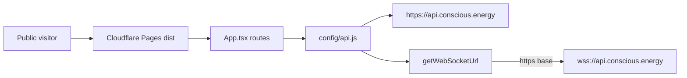

# Wave 1-D — Frontend / Playwright

**Date:** 2026-08-31
**HEAD reviewed:** `6783c16` on `consciousenergy/public-release-review-7a95` (base `lenr_sim_app_v0.3.6-beta`)
**Agent:** D
**Scope:** React SPA routes, production API/WebSocket config, local-fallback honesty, Jest/lint/build gates, Playwright E2E vs GitHub Actions
**Product code:** not modified

## Verdict (this surface)

Public production **Pages** builds (`vite build` with `NODE_ENV=production`) hide debug routes, fall back to `https://api.conscious.energy`, and derive `wss` from HTTPS. Unified Theory `ResultsPanel` labels `local_fallback` clearly.

Do not treat the frontend as CI-green for a public cut: **Playwright is not in `test.yml`**, and the local E2E run is **25 passed / 2 failed**. Legacy simulation pages can still present schematic numbers as a successful “local physics model.” Cloudflare Pages **preview** config sets `NODE_ENV=development`, which re-enables debug routes and ignores the production API URL.

## Confirmations (Wave 0 seeds)

| Check | Result |
|---|---|
| `IS_PRODUCTION` hides `/diagnostics`, `/visualization-test`, `/three-test`, `/visualization-debug`, `/lattice-test`, `/component-showcase` | **Confirmed** for `NODE_ENV=production` / `vite build`. `REACT_APP_ENVIRONMENT=production` is **not** required. |
| Production API fallback `https://api.conscious.energy` | **Confirmed** in a clean production bundle (no `.env.local`). |
| WebSocket `wss` derivation | **Confirmed** in `getWebSocketUrl()`. |
| Playwright specs exist under `frontend/tests/e2e/` but are **not** in `.github/workflows/test.yml` | **Confirmed** (Wave 0 hypothesis 5). |
| Local-fallback labelling on `ResultsPanel` | **Confirmed** (warning Alert when `validation.route_mode === 'local_fallback'`). |

## Gate counts vs 2026-08-23

08-23 pack (`RELEASE_EVIDENCE_PACK.md` / `VERIFICATION_GATE_REPORT.md`): lint **0 errors / 506 warnings**; Jest **201 passed**; `npm audit --audit-level=high` **0**; Vite build PASS. Playwright was not in that pack.

| Gate | 08-23 | This run (2026-08-31) | Delta |
|---|---|---|---|
| `npm audit --audit-level=high` | 0 high (2 moderate react-router) | exit **0**; **2 moderate**, 0 high | unchanged high-gate |
| `npm run lint` | 0 errors / **506** warnings | **0 errors / 506 warnings**, exit 0 | **match** |
| `npm test -- --watchAll=false --passWithNoTests --runInBand` | **201** passed / 30 suites | **210** passed / **32** suites, exit 0 | **+9 tests, +2 suites** |
| `CI=true npm run build` | PASS | PASS (~11s); circular `vendor -> markdown -> vendor` warning | still PASS |
| `npx playwright test` | not recorded | **27** tests, **25 passed, 2 failed**, exit 1 | new / failing |

Logs: `/opt/cursor/artifacts/fe-npm-audit.log`, `fe-npm-lint.log`, `fe-npm-test.log`, `fe-npm-build.log`, `fe-playwright.log`.

Playwright Chromium was not cached in this environment; `npx playwright install chromium` was required before the suite would run. Specs stub `/api/**` via `page.route` and **did not target production**. Vite logged `ECONNREFUSED 127.0.0.1:8010` for unmocked calls (e.g. `/api/physics/theories` on first paint). That is a missing local backend, not a prod hit.

E2E inventory: **7 spec files** (not 8) + 3 page objects + `fixtures.js`:

- `app-shell.spec.js`
- `composition-provenance.spec.js`
- `dashboard-testbed.spec.js`
- `enhancement-charts.spec.js`
- `open-questions-virtual-lab.spec.js`
- `prediction-waterfall.spec.js`
- `theory-round-trip.spec.js`

The Playwright skill (`.cursor/skills/playwright-e2e/SKILL.md`) still says “zero E2E coverage” and “Playwright is not yet a dependency” — **stale** (`@playwright/test` `^1.61.1` is in `package.json`; `npm run e2e` exists).

---

## Findings

### FE-001
- severity: accepted-residual
- surface: frontend
- status: confirmed
- evidence: `App.tsx` sets `IS_PRODUCTION = process.env.REACT_APP_ENVIRONMENT === 'production' || process.env.NODE_ENV === 'production'` and wraps the six debug `<Route>`s in `{!IS_PRODUCTION && (…)}`. `vite.config.js` defines `'process.env.NODE_ENV'` from env; `vite build` (mode production) constant-folds this to true. A clean production `dist/assets/index-*.js` contains **zero** strings `/diagnostics`, `/visualization-test`, `/three-test`, `/visualization-debug`, `/lattice-test`, `/component-showcase`. Direct hits fall through to `NotFound`. App-shell nav (`AppLayoutFixed.jsx` `menuItems`) never lists those paths. Cloudflare Pages production terraform sets both `NODE_ENV=production` and `REACT_APP_ENVIRONMENT=production`. `REACT_APP_ENVIRONMENT` is optional when Node env is production.
- recommendation: Keep the dual-OR. Do not require `REACT_APP_ENVIRONMENT` for Pages. Optionally add an `App.routing.test.tsx` case that asserts debug paths 404 when `NODE_ENV=production`.

### FE-002
- severity: minor
- surface: frontend
- status: confirmed
- evidence: Debug pages are `lazy(() => import(…))` at **module top level** in `App.tsx` (outside the `IS_PRODUCTION` guard). Production `index-*.js` still contains `a.lazy(()=>…import("./DiagnosticTool-*.js")` etc.). Emitted chunks include `DiagnosticTool-*.js`, `ThreeJsTestPage-*.js`, `VisualizationTest-*.js`, `VisualizationDebugPage-*.js`, `ComponentShowcase-*.js`, `LatticeTest-*.js`. They are not `modulepreload`ed from `dist/index.html` and are not routed, but hashed filenames are discoverable from the main bundle. `SettingsPage.jsx` (public `/settings`, Debug & Advanced tab) still links to `/visualization-test`, `/diagnostics`, `/three-test`, `/visualization-debug` — those buttons 404 in production.
- recommendation: Move the six `lazy()` bindings inside the `!IS_PRODUCTION` branch (or a `if (!IS_PRODUCTION)` module) so Rollup drops the chunks. Hide the Settings “Debug Tools” block with the same `IS_PRODUCTION` flag.

### FE-003
- severity: major
- surface: frontend
- status: confirmed
- evidence: `infrastructure/terraform/modules/cloudflare/main.tf` preview `environment_variables` set `NODE_ENV = "development"` and `REACT_APP_ENVIRONMENT = "preview"`. Reproducing `NODE_ENV=development npx vite build` produced an index that **includes** `/diagnostics` and the other debug paths, ships a ~205 kB index (vs ~101 kB production), and leaves `console.info('[API Config]', { nodeEnv: "development", …})`. Because `api.js` treats `NODE_ENV !== 'production'` as `isDev`, `API_BASE_URL` becomes `''` unless `VITE_FORCE_DIRECT_API` — the preview `VITE_API_URL=https://api.${domain}` is **ignored**. Preview fetches would go to the Pages origin `/api`, not the API host.
- recommendation: Never set `NODE_ENV=development` on a Pages **build**. Use `NODE_ENV=production` (and `REACT_APP_ENVIRONMENT=preview` if a label is needed). If preview must talk to the API, do not rely on the dev-proxy empty-base path.

### FE-004
- severity: major
- surface: frontend
- status: confirmed
- evidence: `config/api.js` production branch is `(runtimeApiUrl || 'https://api.conscious.energy')`. Clean `vite build` (gitignored `.env.local` removed) inlines `const ye = Qn || "https://api.conscious.energy"` with empty `Qn`. The same build **with** workspace `.env.local` (`REACT_APP_API_URL=http://localhost:8010`) baked `Yn="http://localhost:8010"` and **omitted** the conscious.energy fallback. `Dockerfile.frontend` defaults `ARG REACT_APP_API_URL=http://localhost:8000` (wrong port vs canonical 8010) and does not set `VITE_API_URL`. `DocumentationPage.jsx` still documents Base URL as `http://localhost:8010` on the public `/documentation` page.
- recommendation: Treat the string fallback as a safety belt only. Fail the Docker/Pages build if `REACT_APP_API_URL`/`VITE_API_URL` is missing or localhost. Change the Dockerfile default to `https://api.conscious.energy` or require a build-arg. Replace the in-app docs Base URL with the production host (or “same origin / configured API”).

### FE-005
- severity: accepted-residual
- surface: frontend
- status: confirmed
- evidence: Canonical helper `getWebSocketUrl()` in `config/api.js`: `base.startsWith('https') ? 'wss' : 'ws'`, then strip `https?://`. Clean production bundle: `function Xn(t="/ws"){const s=ye,n=s.startsWith("https")?"wss":"ws",…}` with `ye === "https://api.conscious.energy"` → `wss://api.conscious.energy${path}`. Callers: `services/websocket.js`, `api/physics/websocketClient.ts`, `api/realtime.ts`, `hooks/useBubbleLatticeStream.js`, `PhysicsContext.tsx`. Two bypasses remain: `utils/visualizationWebSocket.js` `connect()` uses `(this.baseUrl \|\| 'http://localhost:8010').replace(/^http/, 'ws')` (https→wss works coincidentally; empty base becomes **local ws**); `api/physics/physicsApiClient.ts` `createWebSocketConnection` uses `API_BASE_URL.replace(/^http/, 'ws')` instead of `getWebSocketUrl()`.
- recommendation: Route both leftovers through `getWebSocketUrl()`. Drop the `localhost:8010` last-ditch from production code paths. No unit test currently covers `getWebSocketUrl`.

### FE-006
- severity: major
- surface: ci
- status: confirmed
- evidence: `.github/workflows/test.yml` `frontend` job: `npm ci`, `npm audit --audit-level=high`, `npm run lint`, `npm test`, `npm run build`. No Playwright step, no `npx playwright install`, no `npm run e2e`. Repo-wide grep of `.github/` for `playwright` / `e2e` is empty (`deploy.yml`, `security-scan.yml`, `dependency-review.yml` likewise). `package.json` already has `"e2e": "playwright test"`. Wave 0 hypothesis 5.
- recommendation: Add a `frontend-e2e` job (Chromium only) that installs browsers, starts **stubbed** tests (existing `page.route` specs do not need a live backend), and fails the PR. Do not point the job at `api.conscious.energy`. Optionally keep a second, non-blocking job that runs against a seeded local backend.

### FE-007
- severity: major
- surface: frontend
- status: confirmed
- evidence: `npx playwright test` → **27 tests, 25 passed, 2 failed**, 44.5s, exit 1. Failures are locator/UI drift, not backend absence:
  1. `prediction-waterfall.spec.js` “Results tab shows waterfall and readout panel”: `getByTestId('prediction-readout-panel')` is **strict** and matches **two** nodes — `OpenQuestionsVirtualLab.jsx` and `ResultsPanel.jsx` both render `PredictionReadoutPanel` (`data-testid="prediction-readout-panel"`). Snapshot shows both “How to read these numbers” alerts on the Results tab. Screenshot: `/opt/cursor/artifacts/e2e_prediction_readout_duplicate_testid.png`.
  2. `theory-round-trip.spec.js` “saturated mechanisms are labelled and show their uncapped magnitude”: `getByText(/raw ≈ 10\^/)` expected 5, received **0**. That copy is gone from `src/` (no `raw ≈` in `AdvancedAnalysisPage.js` / physics components). Uncapped magnitude is now a Tooltip (`Uncapped model value is about 10^…`) on a SATURATED chip, while the Alert still says “The uncapped magnitude is shown beneath each saturated value.” Screenshot: `/opt/cursor/artifacts/e2e_advanced_analysis_raw_magnitude_missing.png`.
- recommendation: Deduplicate `PredictionReadoutPanel` (one instance per view) or scope the E2E locator. Restore visible (not tooltip-only) uncapped magnitudes **or** update the Alert + E2E to the waterfall copy. Then add the suite to CI (FE-006).

### FE-008
- severity: major
- surface: frontend
- status: confirmed
- evidence: `ResultsPanel.jsx` shows a warning Alert: “Offline placeholder values: the backend was unreachable, so these numbers come from a schematic client-side fallback, not the physics engine. Do not cite them as simulation output.” `UnifiedTheoryPage.jsx` `generateLocalResults` sets `validation.route_mode: 'local_fallback'`, empty `reaction_rate_engine`, and open-questions `INCONCLUSIVE` / no EMP chips. Collapse **numbers are still rendered** (min radius, T, P, enhancement 1e3/1e5). Jest `UnifiedTheoryPage.test.jsx` mocks `fetch` reject then asserts `1e+5` / “Enhancement Factor” **without** asserting the offline Alert. Sibling public routes are weaker: `LENRSimulationPage.jsx` / `FusionSimulationPage.jsx` / `BubbleFusionPage.jsx` catch API failure and `setSuccessMessage` / `setAlertSeverity('info')` “Simulation completed (using local physics model)”. Those routes remain reachable by URL (`/lenr-simulation`, `/fusion-simulation`; Bubble Fusion is in the Advanced Tools nav). `AnalyticsPage.jsx` does chip “Offline Mode” when the analytics API fails (better).
- recommendation: Keep the ResultsPanel warning. Stop rendering quantitative collapse/enhancement figures on `local_fallback`, or gate them behind the same banner. Change LENR/Fusion/Bubble fallbacks to **warning** severity and the same “do not cite” copy, or disable Run when `/api/health` fails. Assert the ResultsPanel Alert in Jest.

### FE-009
- severity: minor
- surface: frontend
- status: confirmed
- evidence: `index.jsx` wraps `App` in `SnackbarProvider`; `App.tsx` `AppContent` wraps again. Harmless but duplicate. `components/Navbar.tsx` still lists `/three-test` and `/visualization-debug` but is only imported from unused `TempApp.tsx`. `pages/SimulationPage.jsx` hardcodes `API_BASE_URL = 'http://localhost:8010'` and is not in `App.tsx`. `visualization/components/ThreeJsLoader.tsx` and `MHDFluidSimulation.tsx` still link to `/three-test` (404 in production if those viz paths error).
- recommendation: Single SnackbarProvider. Delete or quarantine unused Navbar/TempApp/SimulationPage. Gate remaining `/three-test` links with `IS_PRODUCTION`.

### FE-010
- severity: accepted-residual
- surface: frontend
- status: confirmed
- evidence: `npm audit --audit-level=high` exit 0. Report: `react-router` / `react-router-dom` 6.x, two moderate GHSAs (`GHSA-wrjc-x8rr-h8h6` open-redirect via backslash in Link/useNavigate; `GHSA-337j-9hxr-rhxg` SSR `deserializeErrors`). Matches `docs/v0.3.6-beta/SECURITY_CI_HARDENING.md` accepted residual (fix is react-router ≥ 7.18). App uses a static route table, no user-supplied redirects, no SSR. Vite 6.4.3 / axios current in `package.json`.
- recommendation: Do not block v0.3.6-beta on a React Router 7 migration. Track the major as a post-beta slice. Keep `--audit-level=high` as the CI gate.

### FE-011
- severity: minor
- surface: frontend
- status: confirmed
- evidence: Production build log: `Circular chunk: vendor -> markdown -> vendor`. `chunkSizeWarningLimit: 1000` keeps three.js (~775 kB) from failing the build. Entry `index-*.js` ~101 kB / gzip ~29 kB (08-23 cited ~90 kB / gzip ~26 kB). Not a functional defect.
- recommendation: Split markdown out of `vendor` in `manualChunks` when convenient. Not release-blocking.

### FE-012
- severity: minor
- surface: docs
- status: confirmed
- evidence: `.cursor/skills/playwright-e2e/SKILL.md` Overview still states the frontend has zero E2E coverage and Playwright is not a dependency. Setup status says confirm-before-install. This review ran 27 tests against `@playwright/test` 1.61.1.
- recommendation: Rewrite the skill to match the 7 specs, `playwright.config.js` (Chromium, Vite `:3000`, proxy `:8010`), and the CI gap (FE-006).

---

## What was not verified in a browser against production

No request was made to `https://api.conscious.energy` or `www.conscious.energy`. Production-bundle claims are from local `vite build` artifacts. Live Pages env (whether `VITE_API_URL` is actually set on the project) is operator-owned — terraform **intends** `https://api.${var.domain}`.

`AppLayoutFixed` drawer was exercised only via Playwright (home + Unified Theory + Advanced Analysis). Dark/light toggle and mobile drawer were not separately audited.

## Suggested public-cut bar (frontend only)

1. Fix or quarantine the two failing Playwright tests (FE-007) and add the suite to `test.yml` (FE-006).
2. Stop success-styling schematic fallbacks on LENR/Fusion/Bubble (FE-008).
3. Do not ship Pages **preview** with `NODE_ENV=development` (FE-003).
4. Do not ship `Dockerfile.frontend` with default `localhost:8000` (FE-004).
5. Accept FE-001 (route hiding), FE-005 (`wss` helper), FE-010 (react-router moderate), FE-011 (chunk cycle) as residuals if 1–4 are done.
)