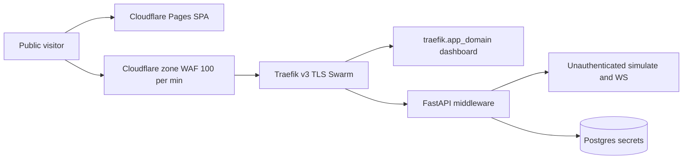

# Wave 1-E — Security review (v0.3.6-beta)

**Date:** 2026-08-31  
**Reviewer:** Agent E (review-first; no product-code edits)  
**Branch:** `consciousenergy/public-release-review-7a95`  
**HEAD at write:** `6263202`  
**Scope:** CI/security workflows, Traefik/Swarm stack, FastAPI middleware, secrets handling, dependency audits.

**Method:** static review of the files listed in Wave 0 plus `config.py`, `main.py`, `analytics_write_guard.py`, Ansible group_vars, Terraform Cloudflare module, `requirements.txt`, `package-lock.json`. Re-ran:

- `npm audit --audit-level=high` in `LENR_SIM_APP_v2/frontend` (Node 22 / npm 10.9.7) → exit 0
- `python -m pip_audit -r requirements.txt` with the CI ignore list → “No known vulnerabilities found, 11 ignored”
- unfiltered `pip-audit` → 11 findings in `starlette 0.49.1`, `vtk 9.4.2`, `ecdsa 0.19.2`

## Seed hypothesis verdicts

| ID | Hypothesis | Verdict |
|---|---|---|
| 4 | Traefik dashboard on `traefik.{{ app_domain }}` with placeholder basic-auth `admin:$apr1$xxxxx$xxxxx` | **Confirmed** — SEC-001 |
| 9 | pip-audit ignore list (starlette/vtk/ecdsa) and react-router moderate advisories remain accepted residuals | **Confirmed** — SEC-002, SEC-003 |
| 10 | Dual CORS (Traefik + FastAPI) and GHCR image `ghcr.io/ConsciousEnergy/lenr-sim-backend:latest` | **Confirmed** — SEC-004, SEC-005 |

## What is already in good shape

- Production boot fails without `LENR_SECRET_KEY` (`Settings` model validator). Swarm `api_secret_key` is an external Docker secret; `entrypoint.sh` exports `LENR_SECRET_KEY` / `LENR_JWT_SECRET_KEY`.
- OpenAPI, ReDoc, `/metrics`, fitting/logs/diagnostics/mock routers, `/memory`, and `/cache/*` are gated off when `LENR_ENVIRONMENT=production`.
- Analytics POST/PUT/DELETE require `X-LENR-Write-Token` with `hmac.compare_digest`. Stack sets `LENR_AUTO_PERSIST=0`.
- Backend image runs as `appuser` (uid 1000). Postgres is not published outside the overlay network. Traefik `api.insecure` is false. ACME certs dir is `0700` in `setup-docker.yml`.
- `npm audit --audit-level=high` is a hard gate in `test.yml`. Frontend audit on this tree: **2 moderate, 0 high**. Backend ignore list in `test.yml` matches `SECURITY_CI_HARDENING.md`.
- No `terraform.tfvars` (non-example) and no backend `.env` in git. Example env files use placeholders only.

---

### SEC-001 Traefik dashboard published with placeholder basic-auth
- severity: major
- surface: security
- status: confirmed
- evidence: [`docker-stack.yml.j2`](../../../infrastructure/ansible/templates/docker-stack.yml.j2) enables `--api.dashboard=true` and a public router `Host(\`traefik.{{ app_domain }}\`)` on `websecure` with Let's Encrypt. Basic-auth users default to `admin:$apr1$xxxxx$xxxxx` when `traefik_dashboard_basic_auth` is unset. [`group_vars/all.yml`](../../../infrastructure/ansible/group_vars/all.yml) sets `traefik_dashboard_enabled: true` and `traefik_dashboard_auth: true` but **never defines** `traefik_dashboard_basic_auth`; the Jinja `enabled` flag is not referenced by the stack template, so the dashboard cannot be turned off via that variable. Terraform Cloudflare module creates Pages + apex CNAME only — no `traefik.` record — so live reachability depends on operator DNS (wildcard or a manual A/CNAME). The placeholder APR1 hash is not a real password; the login surface is still public if DNS exists, username is known (`admin`), and a later real hash is the only control.
- recommendation: Before VPS go-live, either remove the dashboard router from the public stack, or bind it to localhost / a VPN IP **and** inject a real htpasswd via Ansible Vault (`traefik_dashboard_basic_auth`). Do not ship the `$apr1$xxxxx$xxxxx` default. Confirm `traefik.conscious.energy` is not in DNS (and not covered by a wildcard). Wire `traefik_dashboard_enabled` so false actually omits the router.

### SEC-002 pip-audit ignore list: starlette, vtk, ecdsa
- severity: accepted-residual
- surface: security
- status: confirmed
- evidence: [`test.yml`](../../../../../.github/workflows/test.yml) `Backend dependency audit` ignores exactly `PYSEC-2026-161/248/249/2280/2281` (starlette 0.49.1), `PYSEC-2025-224/225/226` (vtk 9.4.2), `PYSEC-2026-1325` (ecdsa 0.19.2), matching [`SECURITY_CI_HARDENING.md`](../SECURITY_CI_HARDENING.md). Re-run with those ignores: **0 findings, 11 ignored**. Unfiltered `pip-audit -r requirements.txt --desc`: **11 known vulnerabilities in 3 packages**, all in that table (some PYSEC IDs listed twice by the tool). Pins: `fastapi==0.128.0` → `starlette==0.49.1`; `pyvista==0.45.2` → vtk 9.4.2; `python-jose[cryptography]==3.5.0` → ecdsa 0.19.2. **App coupling:** rate-limit whitelist and content-type skip lists use `request.url.path` ([`rate_limiting.py`](../../../backend/app/api/middleware/rate_limiting.py), [`content_validation.py`](../../../backend/app/api/middleware/content_validation.py)), which is the reconstruction PYSEC-2026-161 poisons. Timeout exclusions also use `request.url.path`. Traefik `Host(\`api.…\`)` plus TLS SNI likely drops a path-bearing Host before FastAPI, which is why this stays residual rather than a ship blocker — it is not “unused Starlette internals.”
- recommendation: Keep the ignore list documented and fail CI on any *new* ID (current `test.yml` policy). Verify Traefik/Cloudflare reject malformed `Host` (path characters). Track the FastAPI/Starlette 1.x upgrade, vtk 9.5.1 via PyVista, and drop `python-jose` (see SEC-010). Do not treat weekly red `security-scan.yml` as a substitute for the PR ignore list (SEC-015).

### SEC-003 react-router / react-router-dom moderate advisories
- severity: accepted-residual
- surface: security
- status: confirmed
- evidence: `npm audit --audit-level=high` exit **0**. Full audit: `{'moderate': 2, 'high': 0, 'total': 2}`. Lockfile: `react-router@6.30.4` / `react-router-dom@6.30.4`. Advisories: GHSA-wrjc-x8rr-h8h6 (open redirect via backslash in `<Link>` / `useNavigate`), GHSA-337j-9hxr-rhxg (`deserializeErrors()` constructor injection, SSR hydration), GHSA-jjmj-jmhj-qwj2 (open redirect → XSS; range includes 6.30.2–6.30.4). Matches [`SECURITY_CI_HARDENING.md`](../SECURITY_CI_HARDENING.md) “Accepted frontend residual” (fix only in `react-router >= 7.18.0`). This app is a Vite SPA with a static route table and no SSR, so `deserializeErrors()` is not on the production path. Open-redirect still needs attacker-controlled navigation targets.
- recommendation: Keep the high gate. Do not `npm audit fix` into React Router 7 as part of this beta. Schedule a dedicated RR 7.18+ route migration. Do not pin *down* to 6.30.1: that only drops GHSA-jjmj-jmhj-qwj2 and leaves the other 6.x advisories.

### SEC-004 Dual CORS (Traefik headers middleware + FastAPI CORSMiddleware)
- severity: major
- surface: security
- status: confirmed
- evidence: Stack backend router attaches `backend-ratelimit,backend-cors` with `accesscontrolalloworiginlist=https://{{ app_domain }},https://www.{{ app_domain }}`, methods GET/POST/PUT/DELETE/OPTIONS, headers `Content-Type,Authorization,X-LENR-Write-Token` — no `accessControlAllowCredentials`. FastAPI [`middleware.py`](../../../backend/app/core/middleware.py) always adds `CORSMiddleware` with `allow_credentials=True`, `allow_methods=["*"]`, `allow_headers=["*"]`, origins from `LENR_CORS_ORIGINS` (stack sets the same two HTTPS origins). A third, unused CORS block lives in [`traefik-dynamic.yml.j2`](../../../infrastructure/ansible/templates/traefik-dynamic.yml.j2) (missing `X-LENR-Write-Token`; not referenced by the backend router). Duplicate `Access-Control-Allow-Origin` from both layers is a browser-fail-closed risk; credential-mode mismatch (FastAPI yes, Traefik no) is a fail-open/fail-closed split depending on which hop answers OPTIONS. SPA code does not set `withCredentials`, so the live Pages→API path likely works without cookies — the dual layer is still an operational footgun.
- recommendation: Pick one CORS enforcer. Prefer FastAPI as source of truth (already has production localhost-origin override) and drop Traefik `backend-cors`, *or* let Traefik own preflight and set FastAPI origins to the same list without credentials if the SPA stays cookieless. Align allowed headers (include `X-LENR-Write-Token`) and delete the unused dynamic `cors` middleware. After change, verify OPTIONS + POST from `https://www.conscious.energy` and `https://conscious.energy`.

### SEC-005 GHCR image `ghcr.io/ConsciousEnergy/lenr-sim-backend:latest`
- severity: major
- surface: security
- status: confirmed
- evidence: [`docker-stack.yml.j2`](../../../infrastructure/ansible/templates/docker-stack.yml.j2) `image: ghcr.io/{{ github_owner | default('ConsciousEnergy') }}/lenr-sim-backend:latest`. Ansible group_vars / deploy playbook **do not set** `github_owner`, so the mixed-case default is what Swarm will pull. OCI/GHCR names must be lowercase (`ghcr.io/consciousenergy/...`). [`deploy.yml`](../../../../../.github/workflows/deploy.yml) tags `ghcr.io/${{ github.repository_owner }}/lenr-sim-backend` and publishes `latest` only on the default branch. [`DEPLOYMENT_CHECKLIST.md`](../../DEPLOYMENT_CHECKLIST.md) repeats `docker push ghcr.io/ConsciousEnergy/lenr-sim-backend:latest`. Mutable `:latest` with `--with-registry-auth` is the entire production supply chain; there is no digest pin or signature verification.
- recommendation: Default and document `github_owner: consciousenergy` (lowercase). Pin Swarm to a digest or an immutable version tag that matches `APP_VERSION`, not floating `latest`. Confirm the GHCR package actually exists under the lowercase owner before first `docker stack deploy`. Align `deploy.yml` image name with `github.repository_owner` lowercased.

### SEC-006 Traefik mounts Docker socket on the Swarm manager
- severity: major
- surface: security
- status: confirmed
- evidence: [`docker-stack.yml.j2`](../../../infrastructure/ansible/templates/docker-stack.yml.j2) `volumes: /var/run/docker.sock:/var/run/docker.sock:ro` with `node.role == manager`. `:ro` does not make the Docker API read-only; a compromised Traefik container can still create privileged containers via the API (classic docker.sock breakout). Dashboard (SEC-001) + socket is a combined blast radius: dashboard RCE/auth bypass becomes host root.
- recommendation: Put a docker-socket-proxy in front of Traefik (GET-only for containers/services/networks) or switch Traefik to the file provider only. Treat Traefik as a high-value target; do not expose its API/dashboard on the public internet (SEC-001).

### SEC-007 Rate limits: FastAPI 60 vs Traefik 100 vs Cloudflare 100, and they do not share state
- severity: major
- surface: security
- status: confirmed
- evidence: Docs and [`config.py`](../../../backend/app/core/config.py) `RATE_LIMIT_PER_MINUTE: int = 60`. Traefik `backend-ratelimit.average=100`, `burst=50`, `period=1m`. Terraform Cloudflare zone ruleset: 100 req/min on `http.request.uri.path contains "/api/"` ([`modules/cloudflare/main.tf`](../../../infrastructure/terraform/modules/cloudflare/main.tf)). FastAPI limiter is in-process memory ([`rate_limiting.py`](../../../backend/app/api/middleware/rate_limiting.py)). Dockerfile CMD is `uvicorn ... --workers 4`; stack `replicas: 2` → **eight independent 60/min counters**. Edge cap is Traefik/Cloudflare ~100/min if those hops are actually in path; the documented “60/min” is not the effective public budget. Client IP is `X-Forwarded-For` first hop; whitelist includes `127.0.0.1` and `::1`. Traefik as TLS edge with default `forwardedHeaders.insecure=false` should overwrite XFF (mitigation), but FastAPI will honor a spoofed XFF if it is ever reached without Traefik. `/api/health` is **not** on the FastAPI whitelist (`/health` is); Traefik healthchecks hit `/api/health` at 30s so they stay under 60/min today.
- recommendation: Publish one number and implement it at the edge (Traefik or Cloudflare). Lower Traefik to 60 (or raise the app to 100) so they match. Do not treat the FastAPI limiter as a cluster-wide control unless it is Redis-backed. If FastAPI remains, take the *rightmost* (or Traefik-set) XFF hop and drop `127.0.0.1` from the public whitelist. Keep the tighter `/export` budget (10/min) — that one is the compute-expensive path.

### SEC-008 `dependency-review` continues on error
- severity: accepted-residual
- surface: security
- status: confirmed
- evidence: [`.github/workflows/dependency-review.yml`](../../../../../.github/workflows/dependency-review.yml) `continue-on-error: true` with `fail-on-severity: high`. Comment and [`SECURITY_CI_HARDENING.md`](../SECURITY_CI_HARDENING.md) state GitHub Dependency graph / Advanced Security is not enabled, so the action fails with “Dependency review is not supported.” PR checks stay green even when the action errors or would have failed on high.
- recommendation: Operator enables Dependency graph + GHAS, then **remove** `continue-on-error`. Until then this gate is theater; rely on `pip-audit` + `npm audit --audit-level=high` in `test.yml`.

### SEC-009 Node 22 (test/deploy) vs Node 20 (scheduled security-scan)
- severity: minor
- surface: security
- status: confirmed
- evidence: [`test.yml`](../../../../../.github/workflows/test.yml) frontend job and [`deploy.yml`](../../../../../.github/workflows/deploy.yml) use `node-version: '22'` / `22`. [`security-scan.yml`](../../../../../.github/workflows/security-scan.yml) frontend-audit uses `node-version: '20'`. `package.json` has no `engines` field. npm audit results can differ by Node/npm. This review’s audit used Node 22 (the PR gate).
- recommendation: Pin all three workflows (and any Pages build image) to the same Node major. Prefer 22 to match `test.yml` / `deploy.yml`. Add `"engines": { "node": ">=20 <23" }` if you want lockfile-install failures instead of silent drift.

### SEC-010 JWT / SECRET_KEY handling vs unused jose/passlib
- severity: minor
- surface: security
- status: confirmed
- evidence: Production **does** require `SECRET_KEY` ([`config.py`](../../../backend/app/core/config.py) validator; [`test_production_hardening.py`](../../../backend/tests/test_integration/test_production_hardening.py)). [`entrypoint.sh`](../../../infrastructure/docker/entrypoint.sh) maps Swarm `/run/secrets/api_secret_key` onto `LENR_SECRET_KEY`, `LENR_JWT_SECRET_KEY`, and unprefixed `SECRET_KEY` (same value). Settings `load_secrets_from_files` looks for `SECRET_KEY_FILE` / `JWT_SECRET_KEY_FILE`; the stack **does not set those env vars** — boot depends on the entrypoint alias. `JWT_SECRET_KEY` is optional even in production; there is **no** `from jose` / JWT encode-decode in `app/`. `python-jose[cryptography]==3.5.0` and `passlib[bcrypt]==1.7.4` are unused; they are the reason ecdsa is in the ignore list. [`security/utils.py`](../../../backend/app/security/utils.py) hashes passwords with unsalted-construction SHA-256 (not passlib/bcrypt) and exposes `generate_csrf_token` that no middleware calls. Analytics writes fall back to `SECRET_KEY` when `ANALYTICS_WRITE_TOKEN` is unset; the stack does not create a dedicated write-token secret, so the session secret *is* the mutate credential.
- recommendation: Keep the production `SECRET_KEY` boot lock. Drop `python-jose` and `passlib` from `requirements.txt` until real auth exists (clears PYSEC-2026-1325 without waiting on upstream). Set a dedicated `LENR_ANALYTICS_WRITE_TOKEN` Swarm secret so it can rotate independently of `SECRET_KEY`. Stop claiming JWT/CSRF in `SECURITY.md` (SEC-014). Optionally set `LENR_SECRET_KEY_FILE=/run/secrets/api_secret_key` so Settings can load the secret even if the entrypoint is bypassed.

### SEC-011 Secrets in git (tfvars / .env)
- severity: minor
- surface: security
- status: confirmed
- evidence: `git ls-files` finds **no** `terraform.tfvars` (only [`terraform.tfvars.example`](../../../infrastructure/terraform/terraform.tfvars.example) with `your-cloudflare-api-token` placeholders). Backend `.env` is gitignored and not tracked. Tracked env-like files: `backend/.env.example`, `frontend/.env.development` (`REACT_APP_API_URL=http://127.0.0.1:8010`), **`frontend/.env.local` and `frontend/.env.local.backup`** (localhost API URLs only — no keys). `LENR_SIM_APP_v2/.gitignore` lists `frontend/.env.local` but the files remain tracked (gitignore does not untrack). **Neither root nor v2 gitignore mentions `terraform.tfvars`.** Local `docker-compose.yml` uses `POSTGRES_PASSWORD: dev_password` and publishes `5432` — acceptable for compose, must not be copied into Swarm.
- recommendation: `git rm --cached` the two frontend `.env.local*` files; keep gitignore. Add `**/terraform.tfvars` and `**/*.tfvars` (except `*.example`) to gitignore. Rotate any Cloudflare/Hostinger tokens if a real `terraform.tfvars` ever landed on a laptop that was later copied. No production credential leak found in this tree.

### SEC-012 Unauthenticated `/api/simulations` keyed by client `session_id`
- severity: major
- surface: security
- status: confirmed
- evidence: [`shared_simulation_router.py`](../../../backend/app/routers/shared_simulation_router.py) is mounted in production ([`main.py`](../../../backend/app/main.py); Wave 0 inventory). `POST /save`, `GET /mine`, `POST /share`, `GET /{id}` authorize with a **client-supplied** `session_id` query/body field. No JWT, cookie, or write token. Anyone can write rows, enumerate another browser’s `session_id`, or fill Postgres. Analytics mutate is token-gated; this router is not. Distinct from `LENR_AUTO_PERSIST=0` (that flag only affects theory-run SQL persistence).
- recommendation: Gate writes like analytics (`require_analytics_write`) or disable the router in production. If anonymous share stays a product goal, mint an HttpOnly session cookie server-side; do not trust `session_id` in the query string.

### SEC-013 WebSockets: no Origin check; only one socket path is budgeted
- severity: major
- surface: security
- status: confirmed
- evidence: [`websocket_router.py`](../../../backend/app/routers/websocket_router.py) `manager.connect` → `websocket.accept()` with no Origin/CORS check (Starlette CORSMiddleware does not apply to WS). No global connection cap; `simulation_id` is caller-chosen. [`visualization_routes.py`](../../../backend/app/routers/visualization_routes.py) same pattern. Unified [`/bubble-lattice/stream`](../../../backend/app/api/routes/unified_simulation.py) *does* cap `MAX_WS_CONNECTIONS = 8` and `MAX_WS_NUM_CYCLES = 10` per process (× workers × replicas). Error frames in `websocket_router` still send `str(e)` to the client.
- recommendation: Reject WS unless `Origin` is in `CORS_ORIGINS`. Apply a process-wide (better: shared) connection budget to every WS route, not only bubble-lattice. Stop echoing raw exceptions on the socket (match `_client_safe_error`).

### SEC-014 `SECURITY.md` overclaims vs code
- severity: minor
- surface: security
- status: confirmed
- evidence: Root [`SECURITY.md`](../../../../../SECURITY.md) lists JWT-based authentication, CSRF protection, and password hashing as implemented. Code: JWT unused (SEC-010); CSRF token helper unused; `hash_password` is SHA-256, not a password KDF. “HTTPS is enforced in production” is Traefik’s job; `HTTPS_REDIRECT` defaults false, stack sets `LENR_HTTPS_REDIRECT=false`, and **no code path forces it true** despite the comment “Will be enforced in production regardless.” Future roadmap still says “Automated security scanning in CI/CD” though `test.yml` / `security-scan.yml` / `dependency-review.yml` already exist. Checklist still tells operators to verify `/api/docs` Swagger in production ([`DEPLOYMENT_CHECKLIST.md`](../../DEPLOYMENT_CHECKLIST.md)), which contradicts `openapi_surface(PRODUCTION)`.
- recommendation: Rewrite `SECURITY.md` to match the production surface: unauthenticated public compute API, token-gated analytics writes, Traefik TLS, documented dependency residuals. Fix the checklist OpenAPI line (Agent C/G). Do not advertise JWT/CSRF until they exist.

### SEC-015 Scheduled `pip-audit` does not use the ignore list
- severity: minor
- surface: security
- status: confirmed
- evidence: [`security-scan.yml`](../../../../../.github/workflows/security-scan.yml) runs `pip-audit -r requirements.txt --desc` with **no** `--ignore-vuln`. This tree’s unfiltered run exits 1 on the 11 documented residuals. Weekly cron will stay red, mixing known noise with new CVEs. Frontend half of the same workflow *does* use `--audit-level=high` (aligned with the PR gate).
- recommendation: Either apply the same ignore list and fail on new IDs, or keep unfiltered output in the job summary but `continue-on-error` only after writing a parsed diff against the known-ID allowlist. Do not leave a permanently red Actions badge.

### SEC-016 Request-size limit trusts `Content-Length`
- severity: minor
- surface: security
- status: confirmed
- evidence: [`request_size_limit.py`](../../../backend/app/api/middleware/request_size_limit.py) returns 413 only when `Content-Length` is present and too large. Chunked / missing-length bodies skip the check. Default cap is 10 MiB (`REQUEST_MAX_BODY_SIZE`). Combined with unauthenticated `POST /api/unified/simulate` this is a slow-DoS assist, not RCE.
- recommendation: Count bytes as the body is read (Starlette `request.stream()`) and abort at the cap regardless of headers. Keep Traefik/Cloudflare body limits as a second layer.

### SEC-017 Production `/` and `/api/health` leak topology
- severity: minor
- surface: security
- status: confirmed
- evidence: [`main.py`](../../../backend/app/main.py) `GET /` always advertises `fitting`, `logs`, `diagnostics`, and `/docs` even when those are unmounted in production (Wave 0 seed). `GET /api/health` returns `environment`, process RSS, system memory GB/%, DB `error` strings, and a physics-component inventory. Useful for operators; also useful for recon. Rate-limit whitelist does not include `/api/health` (only `/health`).
- recommendation: In production, return a short `{status, version}` on `/` and `/api/health` (keep the rich payload on a token-gated ops route). Stop advertising disabled endpoints.

---

## Operator checklist (cannot be closed from the repo)

- [ ] Does `traefik.conscious.energy` (or `*.conscious.energy`) resolve to the VPS? If yes, SEC-001 is live.
- [ ] Is a real `traefik_dashboard_basic_auth` set in Ansible Vault, or is the placeholder in the rendered `/opt/lenr-sim/docker-stack.yml`?
- [ ] Can the VPS `docker pull ghcr.io/consciousenergy/lenr-sim-backend:latest` (lowercase)? What digest is running vs `0.3.6-beta`?
- [ ] Is GitHub Dependency graph + GHAS enabled so SEC-008 can become a hard gate?
- [ ] Is `LENR_ANALYTICS_WRITE_TOKEN` set separately from `api_secret_key` on the VPS?
- [ ] After first ACME issuance, is `/opt/lenr-sim/traefik/certs/acme.json` mode `600`?
- [ ] Is `api.conscious.energy` orange-cloud (Cloudflare 100/min WAF applies) or DNS-only (Traefik is the only edge)?

## Suggested Wave 2 severity roll-up

| Severity | IDs |
|---|---|
| blocker | none from this pass (no committed production secrets; no unauthenticated RCE found) |
| major | SEC-001, SEC-004, SEC-005, SEC-006, SEC-007, SEC-012, SEC-013 |
| minor | SEC-009, SEC-010, SEC-011, SEC-014, SEC-015, SEC-016, SEC-017 |
| accepted-residual | SEC-002, SEC-003, SEC-008 |

Public-release security go/no-go from this agent: **conditional**. Dependency residuals are documented and the high npm gate is green. Do not put the Traefik dashboard on a public hostname with the placeholder hash, do not pull a mixed-case GHCR name, and do not leave `/api/simulations` as a session_id-auth write surface if Postgres is on the public API host.
