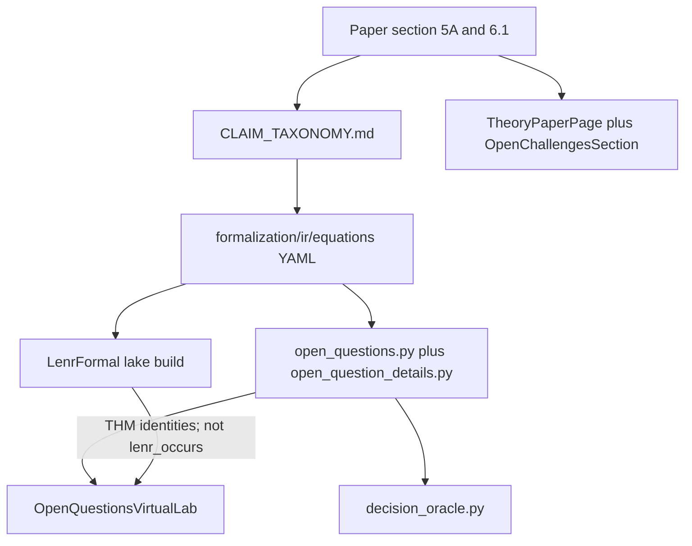

# Wave 1-H — Formalization / Lean / open questions

**Date:** 2026-08-31  
**Agent:** H  
**HEAD at review:** `consciousenergy/public-release-review-7a95` (seed `6783c16`; this file is additive)  
**Scope:** Public UI/paper vs Lean `PROVED`; Q1–Q5 / `EQ-OPEN-*`; IR checkers; theory count vs `CODEBASE_MAP`.  
**Product code:** not edited.



Verified nodes: [`FORMAL_PROOF_STATUS.md`](../../../../../docs/FORMALIZATION/FORMAL_PROOF_STATUS.md), [`CLAIM_TAXONOMY.md`](../../../../../docs/FORMALIZATION/CLAIM_TAXONOMY.md), [`formalization/ir/README.md`](../../../../../formalization/ir/README.md), [`open_questions.py`](../../../backend/app/physics_engine/open_questions.py), [`OpenQuestionsVirtualLab.jsx`](../../../frontend/src/components/physics/OpenQuestionsVirtualLab.jsx), [`OpenChallengesSection.jsx`](../../../frontend/src/components/OpenChallengesSection.jsx), [`TheoryPaperPage.jsx`](../../../frontend/src/pages/TheoryPaperPage.jsx).

## Summary

No public surface prints Lean `PROVED` as “LENR proved.” Backend `lenr_proved` is hard-`False`; Oracle A forbids `LENR_PROVED`; the virtual lab header is “Not a nature theorem. Not LENR_PROVED.” The five `EQ-OPEN-*` obligations remain `OPEN` in Lean `OpenObligations.lean`, `ISSUE_LEDGER` Q1–Q5, `open_question_register.v1.json`, and the live `open_ids` payload. `check_ir.py` and `diff_code_literals.py` both **PASS**. `elan`/`lake` are absent here, so `lake build` was not re-run.

Two **major** public-honesty issues remain: (1) the Q4 card can show “Remaining energy deficit: 0.000 MeV” and “mass gate met” while `EQ-OPEN-EC-01` is still OPEN and Lean `EQ-OPEN-EC-DEFICIT-01` is a ~10^7 deficit identity; (2) the in-app theory paper describes Hagelstein / Vysotskii / Widom–Larsen as if they close energy-gap, radiation, or capture problems, and quotes a 10^40 enhancement that contradicts Lean `EQ-COMP-01`. Wave 0’s 21-vs-22 theory-count hypothesis is **confirmed** as a docs mismatch (`CODEBASE_MAP` lists the wrong 21).

**Go/no-go for this slice:** no formalization **blocker**. Do not ship the Q4 0.000 MeV label or the 6.2/6.3/6.6 paper wording unreviewed.

---

### FRM-001
- severity: accepted-residual
- surface: science
- status: confirmed
- evidence: Public UI never renders the token `LENR_PROVED` except as a negation. `OpenQuestionsVirtualLab.jsx` header: “When and how under named conditions and data. Not a nature theorem. Not LENR_PROVED.” `LOCAL_FALLBACK_OPEN_QUESTIONS.lenr_proved` is `false`. `decision_oracle.py` sets `FORBIDDEN_STATUS = ("LENR_PROVED", "LENR_DISPROVED_AS_THEOREM")` and disclaimer “Occurrence EMP ≠ mechanism proof. Not LENR_PROVED.” Runtime payload from `build_open_questions(route_mode="legacy_unified_model")`: `lenr_proved False`, `ui_phrase_class consistency_or_odds_only`. Canonical paper §6.1 (`docs/A_Unified_Theoretical_Framework_for_LENR.md`) states theorems do **not** prove LENR occurs and “There is no `theorem lenr_occurs`.” In-app §5A (`OpenChallengesSection.jsx`) and `ReferencesSection.jsx` keep the five `EQ-OPEN-*` IDs OPEN and label `OpenQuestionBounds` as would-close-if only. Tests: `OpenQuestionsVirtualLab.test.jsx`, `open-questions-virtual-lab.spec.js` (`getByText('LENR_PROVED')` count 0), `test_open_questions.py::test_lenr_proved_never_emitted`. Lean aggregator `formalization/lean/LenrFormal.lean` claim-tier comment: mathematical consistency only. Residual: Lean ID chips (`LeanId`) are unlabeled THM/DEF/OPEN, so a visitor can still misread an ID as a nature proof.
- recommendation: Keep the negation copy. Optionally tag Lean chips with `THM`/`DEF`/`OPEN` so IDs such as `EQ-MILES-CONV-01` next to Q5 are not read as yield closure.

### FRM-002
- severity: major
- surface: science
- status: confirmed
- evidence: Default Q4 payload (two-body, no provenance override) is `status OPEN`, `mass_renormalization_threshold_met True`, `energy_deficit_mev 0.0`, `lean_theorems ['EQ-3B-MASS-DOM-01']`, `occurrence_claimed False`. `DEFAULT_MASS_RENORMALIZATION = 4.0` exceeds the ~2.53 Widom–Larsen domain gate, so the **mass-renormalization gap** is zero. The virtual lab still renders that number as “Remaining energy deficit: {n.toFixed(3)} MeV” (`OpenQuestionsVirtualLab.jsx` `ElectronCaptureDetails`). Lean `EQ-OPEN-EC-DEFICIT-01` (`OpenQuestionBounds.lean`) proves a stated 0.1 eV vs 0.782 MeV millielectronvolt deficit factor ~10^7 and explicitly does **not** discharge `EQ-OPEN-EC-01`. That Lean ID is **not** attached to the Q4 row (`lean_theorems` is the domain theorem `EQ-3B-MASS-DOM-01` only). Locked by `test_q4_q5_are_dimmed_and_open` (`energy_deficit_mev == 0.0` and `status == "OPEN"`). Mitigations present: OPEN chip, dimmed row, `unmet_reason`, “Threshold status does not establish capture occurrence.”
- recommendation: Rename the displayed quantity to the mass-renormalization gap; surface `EQ-OPEN-EC-DEFICIT-01` on the Q4 row; never print “energy deficit 0.000 MeV” for the default two-body path.

### FRM-003
- severity: major
- surface: science
- status: confirmed
- evidence: In-app `TheoryPaperPage.jsx` §6.2 (Hagelstein, no speculative chip): “The 23.8 MeV released in D+D → He-4 **is converted** into ~10⁷ phonons (each ~2.5 meV) … **avoiding** single high-energy gamma emission.” That is present-tense closure of Q1/Q2. Lean `EQ-PHONON-N-01` identity is `N = 4.76e8` at 23.8 MeV / 50 meV (`Phonon.lean`, IR `adopted_value.phononOrderN: 476000000`), and `EQ-NAIVE-GN-01` is that naive independent multi-phonon floors to 0. §6.3 (Vysotskii): “tunnelling enhancement can reach 10⁴⁰ compared to standard Gamow” with no composition-cap caveat; Lean `EQ-COMP-01` / `MAX_ENHANCEMENT_FACTOR = 1e5` is a proved software identity plus RR-001 band. §6.6 (Widom–Larsen): “producing ultra-low-momentum neutrons … without dangerous radiation” reads as Q4/Q2 solved; Q4 remains OPEN and mass renormalization is `SPEC` (`EQ-WL-MASS-01`). §5A accordion still says the five `EQ-OPEN-*` remain OPEN, so the contradiction is intra-page.
- recommendation: Put claim-tier chips on 6.2/6.3/6.6; rewrite 6.2 as a named hypothesis that does not close `EQ-OPEN-MEV-01` / `EQ-OPEN-RAD-01`; replace 10^40 with the governed 10^3–10^5 band plus `EQ-COMP-01` cap; keep Widom–Larsen as SPEC with the Tennfors domain.

### FRM-004
- severity: accepted-residual
- surface: science
- status: confirmed
- evidence: `ISSUE_LEDGER.md` Q1–Q5: paper sections exist (`ADDRESSED`) but `EQ-OPEN-MEV-01`, `EQ-OPEN-RAD-01`, `EQ-OPEN-RATE-01`, `EQ-OPEN-EC-01`, `EQ-OPEN-YIELD-01` remain OPEN. `FORMAL_PROOF_STATUS.md` open-obligations table unchanged; `OpenObligations.lean` header “Q1–Q5 remain UNDISHARGED”; `OpenQuestionBounds.lean` “These lemmas do **not** discharge EQ-OPEN-*.” Dataset `open_question_register.v1.json`: all five `status: OPEN`. Runtime `open_ids` matches those five. IR `tag: OPEN` also includes `EQ-TSC-OCC-01` and `EQ-TRAP-FNUC-01`, which are not listed in `open_ids` (n-body occupation / `f_nuc` unconstrained). UI does not flip those rows to closed except Q3’s two-body chip (FRM-008).
- recommendation: Treat remaining `EQ-OPEN-*` as accepted residual for v0.3.6-beta. Optionally add `EQ-TSC-OCC-01` / `EQ-TRAP-FNUC-01` to the virtual-lab open-id list so extra OPEN IR rows are visible.

### FRM-005
- severity: accepted-residual
- surface: science
- status: confirmed
- evidence: Scripts exist at `formalization/scripts/check_ir.py` and `diff_code_literals.py` (documented in `formalization/ir/README.md`). This environment: `python3 formalization/scripts/check_ir.py` → `IR equations: 51`, `Taxonomy IDs mentioned: 75`, `check_ir: PASS`. `python3 formalization/scripts/diff_code_literals.py` → `diff_code_literals: PASS`. CI job `formalization` in `.github/workflows/test.yml` runs both plus `lake build`. Log: `/opt/cursor/artifacts/frm_ir_checkers.log`. 51 IR YAML under `formalization/ir/equations/`; all IR IDs appear in the taxonomy (IR minus taxonomy = empty).
- recommendation: Keep IR+literal gates in CI. No local IR defect for this review.

### FRM-006
- severity: accepted-residual
- surface: science
- status: needs-operator
- evidence: `command -v elan` / `lake` / `lean` all missing on this VM. Per review instructions, `cd formalization/lean && lake build` was **not** run. `VERIFICATION_GATE_REPORT.md` still cites “PASS (local lake build + IR checks, 2026-08-22)” and lists only the early pilot IDs (EQ-RYD-01 … EQ-MILES-CONV-01), omitting later PROVED rows in `FORMAL_PROOF_STATUS.md` (EQ-COMP-03, EQ-RATE-2B-NC-01, n-body, ScaleQED, EQ-OPEN-EC-DEFICIT-01, …). CI is the remaining oracle.
- recommendation: Wave 2 should quote a current `formalization` CI `lake build`, not the 08-22 gate report. Refresh the proved-ID list in `VERIFICATION_GATE_REPORT.md` if that pack is shipped.

### FRM-007
- severity: minor
- surface: docs
- status: confirmed
- evidence: Wave 0 seed: `CODEBASE_MAP.md` lists 21 theory modules and omits `stellar_scaling_mhd.py`. On disk, `physics_engine/theories/*.py` has **22** modules (plus `__init__.py`), including `stellar_scaling_mhd.py`. `THEORY_COMPOSITION_GROUPS` has 22 keys including `stellar_scaling_mhd` (`context_line`) and `hydroton`. Default runtime (`ENABLE_LEGACY_HYDROTON: bool = False`) registers **21** ids and **does** include `stellar_scaling_mhd`; `hydroton` is **not** registered (`test_21_registered` / live `get_default_pipeline()`). `CODEBASE_MAP` lists `hydroton` and omits `stellar_scaling_mhd` — the count 21 is coincidental, membership is wrong. Frontend `theoryVisualizationMap.js` has all 22 file-backed ids (hydroton + stellar). In-app paper still says “six core … 13 additional” (19) at `TheoryPaperPage.jsx` §6 intro.
- recommendation: Rewrite `CODEBASE_MAP` to “22 modules on disk; 21 registered by default (hydroton gated; stellar_scaling_mhd in).” Fix the in-app “13 additional” sentence.

### FRM-008
- severity: minor
- surface: science
- status: confirmed
- evidence: For `rate_mode == "two_body"`, `open_questions.py` sets `q_statistical.status` to `BUDGET_DOES_NOT_CLOSE` rather than `OPEN`, while `id` stays `EQ-OPEN-RATE-01` and `open_ids` still lists it. `QuestionRow` colors `OPEN` as warning and any other status as default, so Q3 looks “resolved.” The Oracle A alert correctly prints the two-body non-closure theorem (`EQ-RATE-2B-NC-01`, log10 N = −40). Ledger/register still mark Q3 OPEN because trapped_state / three_body paths are SPEC. Q4/Q5 `lean_theorems` are proved identities (`EQ-3B-MASS-DOM-01`, `EQ-MILES-CONV-01`) rather than `EQ-OPEN-EC-DEFICIT-01` / `EQ-OPEN-YIELD-BAND-01` (the latter appear only in `ReferencesSection.jsx`).
- recommendation: Keep Q3 chip as `OPEN` (two-body does-not-close as a child note), or use a warning color for `BUDGET_DOES_NOT_CLOSE`. Attach deficit/band Lean IDs to Q4/Q5 rows.

### FRM-009
- severity: minor
- surface: science
- status: confirmed
- evidence: Canonical paper §6.1 is “Mechanized consistency (Lean)” with explicit non-claims. In-app `TheoryPaperPage.jsx` reuses **6.1** for Takahashi TSC and never renders the Lean appendix. Lean public copy is only the §5A `OpenChallengesSection` paragraph plus a bibliography note. `OpenChallengesSection.test.jsx` asserts MeV-gap / radiation / statistical list items and companion-doc chrome; it does **not** assert the five `EQ-OPEN-*` remain OPEN or the would-close-if sentence. `OpenChallengesSection` list items cover Q1–Q3 only; Q4/Q5 appear only in the ID sentence.
- recommendation: Add a short “6.x Mechanized consistency” accordion (or a 5A callout) matching paper non-claims. Lock the OPEN/Lean sentences in component tests. Add Q4/Q5 list items.

### FRM-010
- severity: accepted-residual
- surface: science
- status: confirmed
- evidence: Taxonomy mentions 75 `EQ-*` IDs; IR has 51 YAML files. Gaps called out in `CLAIM_TAXONOMY.md` “Completeness vs Traceability Matrix” (BEC Tc, S-factor, RP/KG, OP, plus AX/EMP/SPEC stubs such as `EQ-HAG-01`, `EQ-WL-MASS-01`, `EQ-HUANG-EMP-01`). `EQ-PHONON-N-01` taxonomy short claim still says “1 MeV / 50 meV ~ 2×10^7”; IR/Lean also prove 23.8 MeV / 50 meV = 4.76×10^8 (`one_MeV_phonon_order` exists beside `phonon_order_identity`). Pilot completeness is documented, not a silent hole in `check_ir.py` (every IR row has a taxonomy ID).
- recommendation: Leave as pilot residual. Align the taxonomy one-liner for `EQ-PHONON-N-01` with the 23.8 MeV identity.

## Commands run

```bash
python3 formalization/scripts/check_ir.py          # PASS (51 IR, 75 taxonomy)
python3 formalization/scripts/diff_code_literals.py # PASS
command -v elan lake lean                          # not found; lake build skipped
# backend .venv:
python -c "from app.physics_engine.open_questions import build_open_questions; ..."
pytest tests/test_physics/test_open_questions.py \
       tests/test_integration/test_open_questions_contract.py
# 32 passed
```

Artifacts: `/opt/cursor/artifacts/frm_ir_checkers.log`, `/opt/cursor/artifacts/frm_open_questions_payload.log`.
