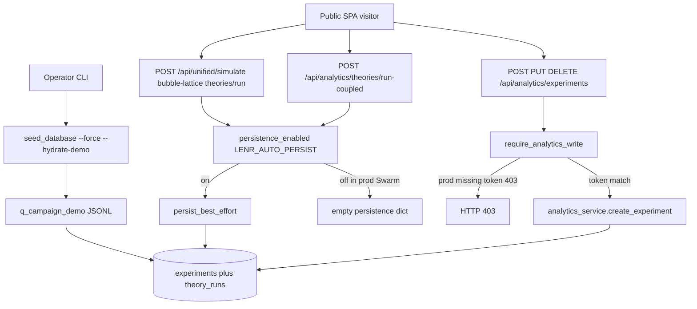

# Wave 1-I — Analytics persistence, hydrate, and public N

**Date:** 2026-08-31
**Agent:** I (Analytics / campaigns)
**Product HEAD:** `d6be618` (`lenr_sim_app_v0.3.6-beta`)
**Review branch:** `consciousenergy/public-release-review-7a95`
**Scope:** production write gating, operator hydrate, demo-pack N vs clone, Swarm auto-seed/persist, campaign-preset CI policy.
**Not in scope:** `--preset full` / full `diverse` execution (forbidden for this review). Product code was not edited.

Seeded from [00-architecture.md](00-architecture.md) and [ANALYTICS_TRANSPARENCY.md](../ANALYTICS_TRANSPARENCY.md). Architecture slice verified against files listed below (plus `python3 .cursor/skills/architecture-mapping/scripts/map_endpoints.py`).

## Persist architecture (verified)

Three SQL write paths exist. Visitors can use none of them on the Swarm template as committed.



Verified nodes:

- Write guard: [`backend/app/core/analytics_write_guard.py`](../../../backend/app/core/analytics_write_guard.py)
- Auto-persist gate: [`backend/app/services/simulation_persistence.py`](../../../backend/app/services/simulation_persistence.py) `persistence_enabled()`
- Route persist helpers: [`backend/app/services/persist_runs.py`](../../../backend/app/services/persist_runs.py)
- Mutate routes: [`backend/app/routers/analytics_routes.py`](../../../backend/app/routers/analytics_routes.py)
- Hydrate CLI: [`backend/app/scripts/seed_database.py`](../../../backend/app/scripts/seed_database.py)
- Swarm env: [`infrastructure/ansible/templates/docker-stack.yml.j2`](../../../infrastructure/ansible/templates/docker-stack.yml.j2)
- Demo pack: [`datasets/reviewer_packs/q_campaign_demo/manifest.json`](../../../datasets/reviewer_packs/q_campaign_demo/manifest.json)
- Clone ≠ 150: [`docs/v0.3.6-beta/RESEARCHER_REVIEW_PACK.md`](../RESEARCHER_REVIEW_PACK.md)
- UI disclaimers: [`frontend/src/pages/AnalyticsPage.jsx`](../../../frontend/src/pages/AnalyticsPage.jsx)

## Confirmation matrix

| Required property | Result | Finding |
|---|---|---|
| Production cannot be filled by anonymous POSTs | **Holds** for SQL | AN-001, AN-002; caveats AN-009, AN-010 |
| Hydrate is operator CLI (`seed_database --force --hydrate-demo`) | **Holds** as design; Swarm runbook is broken | AN-003, AN-008 |
| Demo pack N (~150 / 132) vs clone ≠ 150 messaging | **Holds** in pack + researcher doc; UI has no hydrate banner by design | AN-004, AN-005, AN-011 |
| Swarm does not auto-seed or auto-persist | **Holds** | AN-002, AN-006 |
| CI / this review must not run `--preset full` or full `diverse` | **Holds** | AN-007 |

## Findings

### AN-001
- severity: accepted-residual
- surface: api
- status: confirmed
- evidence: `require_analytics_write` is a no-op outside production and returns 403 in production when `X-LENR-Write-Token` is missing or does not hmac-match `LENR_ANALYTICS_WRITE_TOKEN` (else `SECRET_KEY`). Wired on `POST/PUT/DELETE /api/analytics/experiments` and `POST /api/analytics/experiments/{id}/timeline`. `GET /api/analytics/stats` stays public. Unit + HTTP coverage: `tests/test_integration/test_production_hardening.py` (`test_require_analytics_write_forbids_anonymous_production`, `test_analytics_http_writes_gated_in_production`). Traefik CORS in `docker-stack.yml.j2` allow-lists `X-LENR-Write-Token` from `https://{{ app_domain }}` only; that does not let browsers skip the header. The public SPA never sends the header (`frontend/src/services/analyticsApi.js` `saveExperiment` is a bare `POST /api/analytics/experiments`).
- recommendation: Keep mutate routes token-gated in production. Do not put a write token in the Pages bundle. Optional: mount a dedicated `ANALYTICS_WRITE_TOKEN` Swarm secret so the write token is not identical to `api_secret_key` (see AN-012).

### AN-002
- severity: accepted-residual
- surface: api
- status: confirmed
- evidence: `persistence_enabled()` returns false when `LENR_AUTO_PERSIST` is `0/false/no/off`, and when the env var is unset **and** `settings.ENVIRONMENT == production`. Swarm backend hard-codes `LENR_AUTO_PERSIST=0` and `LENR_ENVIRONMENT=production` in `docker-stack.yml.j2`. `persist_best_effort` returns `{}` before any `INSERT` when the flag is off. Simulate / bubble-lattice / Theory Testbed / coupled-pipeline persist all go through that helper. Covered by `test_auto_persist_defaults_off_in_production`. Docs: `ANALYTICS_TRANSPARENCY.md` (“Public VPS stays `LENR_AUTO_PERSIST=0`”).
- recommendation: Leave the Swarm value at `0`. Do not flip it on the public stack to “grow History”; that would also persist anonymous `POST /api/unified/simulate` (AN-013).

### AN-003
- severity: accepted-residual
- surface: infra
- status: confirmed
- evidence: Hydrate is opt-in CLI, not app boot. `seed_database.py` only imports `q_campaign_demo` when `--hydrate-demo` is passed; `hydrate_demo_pack()` calls `import_pack_rows` (idempotent upsert on row id). Equivalent: `python -m app.scripts.import_reviewer_pack --in ../datasets/reviewer_packs/q_campaign_demo`. Documented operator command: `python -m app.scripts.seed_database --force --hydrate-demo` in `RESEARCHER_REVIEW_PACK.md`, `docs/DEPLOYMENT.md`, and `PUBLIC_DEPLOYMENT_TRACKER.md`. Ansible playbooks do not invoke seed or campaign. Lifespan in `backend/app/main.py` creates tables only for `development` / `test` / sqlite — not Postgres production — and never seeds. Dockerfile `CMD` is uvicorn only.
- recommendation: Keep hydrate operator-only. Fix the Swarm image/runbook so the documented `docker exec` actually sees `datasets/` (AN-008).

### AN-004
- severity: accepted-residual
- surface: docs
- status: confirmed
- evidence: Committed pack `datasets/reviewer_packs/q_campaign_demo/manifest.json`: `n_experiments=150`, `n_theory_runs=132`, `source_class_counts.Baseline=17`, `Campaign=133`, `lenr_proved=false`, all five `EQ-OPEN-*` ids present, `empirical_claim_tiers_raised=false`. JSONL line counts match (150 / 132). Locked by `tests/test_integration/test_reviewer_pack.py::test_q_campaign_demo_pack_size_lock`. Literature JSON has 17 `literature_id` records (`datasets/literature_baselines.v1.json`), matching the researcher table (`seed_database` → ~17). 17 + 133 = 150.
- recommendation: Treat 150 / 132 as the frozen public snapshot N. Do not regenerate via `--preset full` / full `diverse`. Refresh the stale “~107 / 89” strings (AN-011).

### AN-005
- severity: accepted-residual
- surface: frontend
- status: confirmed
- evidence: `RESEARCHER_REVIEW_PACK.md` table “Clone ≠ 150 Analytics rows” states `git pull` ships code + literature JSON, not the cloud agent’s SQLite; empty sqlite → 0; seed → ~17; hydrate → ~150. Analytics Overview **deliberately** has no CLI hydrate banner (`ANALYTICS_TRANSPARENCY.md`). Frontend test lock: `AnalyticsPage.test.jsx` `seed-only Campaign N is 0 has no CLI warning banner` asserts the hydrate command is absent and the caption reads “not a hydrated campaign” when `sourceClassCounts.Campaign === 0`. Caption in `AnalyticsPage.jsx` (`data-testid="completion-vs-scientific-note"`) switches copy on Campaign N. Model-output Alert (`data-testid="model-output-disclaimer"`) is present. History caption states association % is not P(LENR); enhancement `≥1e5 (capped)` and Energy (keV) em dash for null are implemented (`formatEnhancementLabel` / `formatEnergyKev`).
- recommendation: Keep clone ≠ 150 in researcher docs, not as a screenshot-matching UI banner. Fix empty-state copy that tells production visitors to persist via Testbed (AN-015).

### AN-006
- severity: accepted-residual
- surface: infra
- status: confirmed
- evidence: `docker-stack.yml.j2` has no seed/campaign command, no `command:` override, `LENR_AUTO_PERSIST=0`. `infrastructure/docker/Dockerfile.backend` `CMD` is `uvicorn app.main:app ... --workers 4`. `entrypoint.sh` only maps Docker secrets → `LENR_SECRET_KEY` / DB password. Lifespan does not call `seed_database` or `run_simulation_campaign`. Production Postgres skips `create_tables()` (alembic is a separate `docker exec`). Local `docker-compose.yml` also does not auto-seed (dev `LENR_ENVIRONMENT=development` does default auto-persist on, which is not Swarm).
- recommendation: None for auto-seed. Keep boot as migrate-then-optional-hydrate.

### AN-007
- severity: accepted-residual
- surface: ci
- status: confirmed
- evidence: `.github/workflows/test.yml` and `deploy.yml` never invoke `run_simulation_campaign`. Integration tests use `--preset smoke` only (`test_campaign_smoke.py`, `test_campaign_diverse.py::test_failed_campaign_case_persists_failed_status`). `test_campaign_diverse.py` asserts designed size (`campaign_size("diverse")` = 192 cartesian + extras = 197, theory-group axis 20–40) and explicitly does **not** execute the diverse grid. Grid math: `full` = 6×4×3×2×2 = 288 (`PRESETS["full"]` in `backend/app/campaign/grid.py`). Docs in `ANALYTICS_TRANSPARENCY.md` / `RESEARCHER_REVIEW_PACK.md`: “Do not run `--preset full` or full `diverse` in CI.” This review did not run those presets.
- recommendation: Keep CI on smoke + size locks. Do not add `full` / `diverse` to `test.yml`.

### AN-008
- severity: major
- surface: infra
- status: confirmed
- evidence: Documented Swarm hydrate is `docker exec … python -m app.scripts.seed_database --force --hydrate-demo` (`docs/DEPLOYMENT.md`, `docs/PHASE4_DOCKER_SWARM_DEPLOYMENT.md`). `hydrate_demo_pack()` resolves `datasets_root() / "reviewer_packs" / "q_campaign_demo"`. `datasets_root()` requires `literature_baselines.v1.json` on disk. `Dockerfile.backend` copies only `backend/app`, `backend/alembic`, `backend/alembic.ini`, and `entrypoint.sh` — **not** `LENR_SIM_APP_v2/datasets/`. In the image, `__file__` is `/app/app/data/dataset_io.py`; the walker looks for `/datasets` or `/app/datasets` and raises `FileNotFoundError`. Baseline seed (`get_baseline_experiments()` → `literature_baselines()`) fails the same way, so even `--force` without hydrate cannot load the 17 literature rows inside the published GHCR image. Postgres is not published on the host in the stack file, so the operator cannot point a host venv at Swarm SQL without extra networking. Volume `/opt/lenr-sim/data:/app/data` does not overlay the Python package and is not a `datasets/` mount.
- recommendation: `COPY datasets ./datasets` (or a bind-mount `/opt/lenr-sim/datasets:/app/datasets`) so in-container `datasets_root()` succeeds. Until then, treat public Analytics N=0 after `alembic upgrade head` as the live default, and do not advertise the 150-row screenshot as the VPS state. Operator workaround: one-off container on the Swarm network with the repo `datasets/` mounted.

### AN-009
- severity: major
- surface: frontend
- status: confirmed
- evidence: Unified Theory / Fusion **Save to Analytics** calls `analyticsApi.saveExperiment` → `POST /api/analytics/experiments` with no write token. In production that is 403 (AN-001). `saveExperiment` **catches** the error, writes `localStorage`, and returns `{ id: "local_<timestamp>", … }` instead of throwing. `UnifiedTheoryPage.jsx` then toasts `Simulation saved to analytics! ID: …` at severity success. Shared SQL is unchanged. Analytics Overview `loadData` prefers a successful GET (including total=0) and does not merge that local row, so History will not show the “saved” run while the toast claimed it did. This does **not** fill production (AN-001 still holds); it overclaims persistence to the visitor.
- recommendation: In production, treat 403 as failure (no success toast). Do not imply shared Analytics write. Optional: hide Save to Analytics when `IS_PRODUCTION` / when the API has no write token.

### AN-010
- severity: minor
- surface: api
- status: confirmed
- evidence: `POST /api/analytics/theories/run-coupled` is **not** wrapped in `require_analytics_write`. It still calls `persist_theory_pipeline` → `persist_best_effort`, so Swarm `LENR_AUTO_PERSIST=0` makes persist a no-op. If an operator sets `LENR_AUTO_PERSIST=1` on the public stack, this unauthenticated POST would insert `experiments` / `theory_runs` without a write token. Same pattern: `POST /api/unified/simulate`, `POST /api/unified/bubble-lattice`, `POST /api/physics/theories/run`. Compute-only POSTs (`/theory-scores`, `/parameter-sweep`, `/compare`) do not insert SQL.
- recommendation: Defense in depth: skip persist in production unless the write token is present, **or** keep `LENR_AUTO_PERSIST=0` as a hard Swarm invariant and document that coupled/simulate persist is flag-gated only.

### AN-011
- severity: minor
- surface: docs
- status: confirmed
- evidence: Pack and `RESEARCHER_REVIEW_PACK.md` say 150 experiments / 132 `theory_runs`. Stale strings remain: `seed_database.py` `--hydrate-demo` help still says “~107 rows”; `docs/PHASE4_DOCKER_SWARM_DEPLOYMENT.md` Step 13 still says “~107 experiments / 89 theory_runs”. `seed_database.py` module docstring is still “v0.2.3-beta”.
- recommendation: Align CLI help and PHASE4 with 150 / 132 (17 Baseline + 133 Campaign) before operators use those numbers as a hydrate checksum.

### AN-012
- severity: accepted-residual
- surface: infra
- status: confirmed
- evidence: Swarm template does not set `LENR_ANALYTICS_WRITE_TOKEN` or `ANALYTICS_WRITE_TOKEN_FILE`. `entrypoint.sh` exports `LENR_SECRET_KEY` from `/run/secrets/api_secret_key`. The write guard then falls back to `SECRET_KEY`. Production boot still requires a non-empty secret (`Settings.load_secrets_from_files`). Dedicated-token preference is tested (`test_require_analytics_write_prefers_dedicated_token`). Residual: write token ≡ JWT/API secret; anyone who can read that secret can mutate Analytics.
- recommendation: Optional Swarm secret for `LENR_ANALYTICS_WRITE_TOKEN`. Not blocking while mutate routes stay 403 without the header.

### AN-013
- severity: accepted-residual
- surface: api
- status: confirmed
- evidence: Campaign CLI (`app.campaign.runner.run_campaign`) calls `run_unified_simulation` in-process with `persist_source=simulation_campaign`, which still honors `persistence_enabled()`. On the public container (`LENR_AUTO_PERSIST=0`) a `docker exec … run_simulation_campaign` computes but persists 0 rows. `ANALYTICS_TRANSPARENCY.md` already states History grows via campaign CLI **+ demo pack hydrate**. The intended public fill is hydrate (AN-003), not a live cartesian on the VPS. Flipping `LENR_AUTO_PERSIST=1` to make campaigns persist would also persist visitor simulate calls (AN-002 / AN-010).
- recommendation: Public fill = hydrate pack only. If a live campaign is required, run it in a one-off task with `LENR_AUTO_PERSIST=1` off Traefik, then export/import — do not toggle the public service env.

### AN-014
- severity: minor
- surface: api
- status: confirmed
- evidence: Hardening tests cover the flag and Analytics HTTP mutate. There is no TestClient test that `POST /api/unified/simulate` with `persist_session_id` under `ENVIRONMENT=production` and unset/0 `LENR_AUTO_PERSIST` returns no `experiment_id`. `test_history_honesty.py` exercises persist on the **test** environment (flag defaults on) and expects `experiment_id`.
- recommendation: Add one production-env simulate persist-no-op test next to `test_analytics_http_writes_gated_in_production`.

### AN-015
- severity: minor
- surface: frontend
- status: confirmed
- evidence: Empty-state Alert (`data-testid="analytics-empty-state"`): “Turn published baselines on, run the Theory Testbed, or start a campaign to persist model-output rows.” On the public VPS, Testbed persist is off (AN-002), there is no campaign UI, and Save to Analytics 403s (AN-009). Visitors following that copy cannot change shared N. Researcher-facing clone ≠ 150 table is not shown here (AN-005, by design).
- recommendation: Production empty-state should say shared History is operator-hydrated model output (or empty until hydrate), not that running Testbed will persist.

### AN-016
- severity: accepted-residual
- surface: frontend
- status: confirmed
- evidence: History **Clear History** only `localStorage.removeItem('lenr_simulation_history')` — it does not DELETE SQL. Per-row delete calls `DELETE /api/analytics/experiments/{id}` (token-gated → 403 in production) and surfaces “Failed to delete experiment”. Anonymous visitors cannot wipe the shared snapshot.
- recommendation: Keep SQL deletes token-gated. Optional: hide per-row delete in production.

## Tests

Allowed pytest (no `full` / `diverse`):

```
cd LENR_SIM_APP_v2/backend
python3 -m pytest tests/test_integration/test_production_hardening.py \
  tests/test_integration/test_analytics_honest_metrics.py \
  tests/test_integration/test_history_honesty.py -q --tb=line
```

Pack size lock (read-only, not a campaign run): `tests/test_integration/test_reviewer_pack.py::test_q_campaign_demo_pack_size_lock` (150 / 132).

A concurrent science-gate pytest already executed eight of nine `test_production_hardening.py` cases as PASSED, including anonymous-write 403 and auto-persist-off-in-production. `test_analytics_http_writes_gated_in_production` was still in app startup when that suite was cut off (`science_gates_exit=120`). This agent re-runs the three files below after that suite exited.

## Slice verdict

Anonymous SQL fill is **closed** on the committed Swarm template (write token + `LENR_AUTO_PERSIST=0` + no boot seed). Public N is **operator hydrate**, and the committed demo pack is honestly 150 / 132 model-output rows with `lenr_proved: false`. The release-blocking gap for *matching* that N on Hostinger is AN-008 (datasets not in the backend image, so the documented `docker exec` hydrate cannot run). AN-009 is a public honesty defect (success toast on a 403) that does not write SQL.

No product-code changes in this file.
