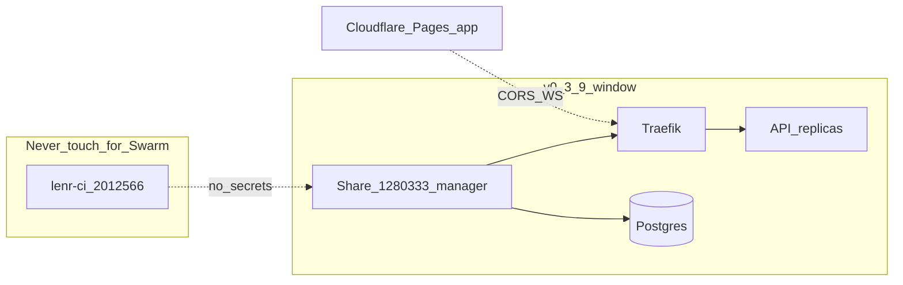

# Swarm operator lab — learn the stack on two KVM2s

**Audience:** first-time Docker Swarm / Ansible / Traefik / Terraform / Cloudflare  
**Timebox:** one sitting (no purchase, no cutover)  
**Companion map:** [`TWO_KVM2_SWARM_TOPOLOGY.md`](TWO_KVM2_SWARM_TOPOLOGY.md)

This lab walks the **real files in this repo**. You leave with a mental model of
how nodes are labeled, how Traefik routes traffic, and which confirm strings
guard live apply — without initializing Swarm on the public beta host.

---

## Lab rules (read once)

| Rule | Why |
|------|-----|
| Do **not** SSH-init Swarm on `185.211.4.66` | That box serves Compose beta today |
| Do **not** put Swarm or deploy keys on `45.93.100.251` | That box runs untrusted PR CI (`lenr-ci-1`) |
| Do **not** set `CONFIRM_SWARM_0_3_9` | Public cutover is a separate announced window |
| Copy `*.example` → **untracked** local files only | Secrets never enter git / PR / Slack |
| Prefer `staging-swarm-dry-run.sh local` until credentials exist | Proves gates without cloud write |

Optional day-2 cluster browser (not required for this lab): **D-Force**
(`d4s`) — k9s-style TUI for Compose/Swarm. See
[`D4S_DFORCE_OPERATOR.md`](D4S_DFORCE_OPERATOR.md). Do not point it at the CI
node; do not use it to bypass `CONFIRM_SWARM_*` scripts.

---

## Step 0 — Sketch the two boxes

On paper (or a whiteboard), draw:

```
┌─────────────────────────────┐     ┌─────────────────────────────┐
│ Share KVM2 1280333          │     │ CI KVM2 2012566             │
│ 185.211.4.66                │     │ 45.93.100.251               │
│ TRUSTED runtime             │     │ UNTRUSTED PR code           │
│ Compose + Caddy (today)     │     │ lenr-ci-1 runner only       │
│ → future: Swarm manager     │     │ NEVER Swarm / NEVER VPS_*   │
│   (only under 0.3.9)        │     │                             │
└─────────────────────────────┘     └─────────────────────────────┘
```

If a third cheap VPS appears later, it becomes `staging-manager-1` first — not
a second CI runner.

Verify inventory still matches (operator / agent with Hostinger API):

| Role | Id | IP | Must stay |
|------|----|----|-----------|
| Compose share | `1280333` | `185.211.4.66` | Public beta |
| Dedicated CI | `2012566` | `45.93.100.251` | Runner only |

---

## Step 1 — Prove local gates (no credentials)

From repo root:

```bash
./LENR_SIM_APP_v2/infrastructure/scripts/staging-swarm-dry-run.sh local
```

Expect:

1. `deploy.sh production` / wrong staging confirm → **exit 2** (gates work)
2. `terraform validate` → Success
3. `ansible-playbook --syntax-check` on `deploy-stack.yml` + `site.yml` → OK

Evidence lands under `/opt/cursor/artifacts/staging_swarm_local_dry_run.log`
(or `.staging-evidence/` locally).

Optional live sanity (Compose, not Swarm):

```bash
curl -sS https://lenr-sim-beta.conscious.energy/api/health | jq .
# expect version 0.3.7-beta, status healthy
```

---

## Step 2 — File walkthrough (what each path does)

Walk these in order. Open each file; do not edit production values yet.

### A. Inventory = “which nodes exist”

| File | Job |
|------|-----|
| [`ansible/inventory.staging.yml.example`](../../infrastructure/ansible/inventory.staging.yml.example) | Staging hosts + Traefik/API subdomain vars |
| [`ansible/inventory.yml.example`](../../infrastructure/ansible/inventory.yml.example) | Production-shaped inventory template |

**Learn:** Ansible never invents nodes. If `STAGING_MANAGER_IP` is wrong, you
configure the wrong machine. Placeholders must **never** be:

- `185.211.4.66` (live Compose) unless written cutover rehearsal
- `45.93.100.251` (CI) — forbidden always

```bash
cp LENR_SIM_APP_v2/infrastructure/ansible/inventory.staging.yml.example \
   LENR_SIM_APP_v2/infrastructure/ansible/inventory.staging.yml
# Edit with fake IPs for syntax-check practice, or real staging IP later.
# Keep inventory.staging.yml out of git (see .gitignore).
```

### B. Playbooks = “what SSH does on those nodes”

| Playbook | Job |
|----------|-----|
| `playbooks/setup-docker.yml` | Install Docker Engine / Swarm prerequisites |
| `playbooks/deploy-stack.yml` | Render Traefik + stack; `docker stack deploy` |
| `playbooks/site.yml` | Master entry (setup → deploy) |
| `playbooks/backup.yml` | Postgres backup tasks |

In `deploy-stack.yml`, note the hard checks:

- Swarm must already be `active` before stack deploy
- Secrets (`postgres_password`, `api_secret_key`) use Docker secrets, not env files in git
- GHCR login required for private image pulls

### C. Templates = “what Traefik and the stack look like”

| Template | Job |
|----------|-----|
| `templates/docker-stack.yml.j2` | Swarm services: Traefik, backend, Postgres |
| `templates/traefik.yml.j2` | Static Traefik config |
| `templates/traefik-dynamic.yml.j2` | Dynamic routers / middlewares |

**Learn to visualize routing:** Traefik publishes **80/443 in host mode** on the
manager; backend is reached via Swarm overlay + Traefik labels, not by exposing
FastAPI publicly. Dashboard stays **off** unless `traefik_dashboard_enabled` and
a real basic-auth hash are set (never placeholder `xxxxx`).

Key labels to find in `docker-stack.yml.j2`:

- `traefik.enable=true`
- `Host(\`{{ api_subdomain }}.{{ app_domain }}\`)` on the backend service
- ACME HTTP challenge on `/.well-known/acme-challenge/`

### D. Terraform = “DNS / Pages / optional VPS desired state”

| File | Job |
|------|-----|
| `terraform/staging.tfvars.example` | Staging Cloudflare + Hostinger knobs |
| `terraform/backend.hcl.example` | Remote state backend (operator laptop) |
| `modules/cloudflare/` | Pages hostname + DNS records |
| `modules/hostinger/` | Optional VPS create / import |

Staging defaults that protect you:

- `pages_hostname = "app-staging"` — never `@` / `www`
- `hostinger_vps_mode = "disabled"` until you intentionally create a node
- `manage_api_dns = false` until Traefik is ready

```bash
cp LENR_SIM_APP_v2/infrastructure/terraform/backend.hcl.example \
   LENR_SIM_APP_v2/infrastructure/terraform/backend.hcl
cp LENR_SIM_APP_v2/infrastructure/terraform/staging.tfvars.example \
   LENR_SIM_APP_v2/infrastructure/terraform/staging.tfvars
# Fill tokens on the operator machine only.
```

### E. Confirm-gated deploy script

[`scripts/deploy.sh`](../../infrastructure/scripts/deploy.sh):

| Env | Meaning |
|-----|---------|
| `CONFIRM_SWARM_0_3_8=I_STAGING_0_3_8` | Staging Swarm path |
| `CONFIRM_SWARM_0_3_9=I_CUTOVER_0_3_9` | Public Swarm + Pages cutover |

Without the exact string → non-zero exit. That is intentional.

---

## Step 3 — How you will “see” a Swarm (once a manager exists)

There is **no Swarm today** on either KVM2 (Compose + CI). When staging or
cutover creates a manager, this is your CLI dashboard:

```bash
# On the manager (SSH)
docker info | grep -A5 Swarm
docker node ls
docker node inspect self --pretty

docker stack ls
docker stack services lenr-sim          # name from playbook stack_name
docker service ls
docker service ps lenr-sim_backend --no-trunc

# Traefik edge
docker service logs lenr-sim_traefik --tail 80

# Networks / secrets (names only — do not cat secret values)
docker network ls
docker secret ls
```

From your laptop:

```bash
dig +short api-staging.conscious.energy
curl -sS https://api-staging.conscious.energy/api/health | jq .
```

### Optional GUIs (security first)

| Tool | Safe pattern | Unsafe pattern |
|------|--------------|----------------|
| Traefik dashboard | basic-auth + TLS; prefer private bind / VPN | Open `0.0.0.0:8080` without auth |
| Portainer CE | Deploy later with SSO/auth; manager-only | Unauthenticated public port |
| Cloudflare | DNS + Pages in dashboard; API token zone-scoped | Global API key in CI |

ASCII “visualize services” once deployed:

```
Internet
   │
   ├─ app / app-staging ──► Cloudflare Pages (static SPA)
   │
   └─ api / api-staging ──► :443 host mode
                              Traefik (manager)
                                 │
                                 ├─ lenr-sim_backend (replicas)
                                 └─ lenr-sim_postgres (volume)
```

---

## Step 4 — Single-node Swarm on two KVM2s (target shape)

With **only** share + CI:

1. CI stays isolated forever on `2012566`.
2. At **v0.3.9**, share `1280333` becomes the **single-node Swarm manager**
   (or you add a staging VPS first and cut over later).
3. Workers are optional. Replicas still run as multiple containers on one host.



---

## Step 5 — Security checklist for open public beta

Use this before any staging apply or cutover rehearsal:

- [ ] Confirm strings exact; scripts refuse paraphrases
- [ ] `VPS_*` / deploy SSH only on GitHub-hosted deploy jobs — **not** `lenr-ci`
- [ ] Cloudflare token: Zone DNS + Pages only (no account-wide if avoidable)
- [ ] `api.` / `api-staging.` A records `proxied=false` (WebSockets)
- [ ] Apex / `www` stay on WordPress.com NS until a separate site migration
- [ ] Docker secrets for DB/API keys; no passwords in compose committed to git
- [ ] Traefik dashboard off (or auth + non-public)
- [ ] GHCR pull credentials only on Swarm managers that need private images
- [ ] Firewall: 22 from admin IPs; 80/443 public; Swarm data ports not on CI
- [ ] Rollback Compose tag retained ≥ one release
  ([`ROLLBACK_AND_STAGING_CHECKLIST.md`](ROLLBACK_AND_STAGING_CHECKLIST.md))
- [ ] Academic: infra PR does not close `EQ-OPEN-*` or rewrite claim rows
- [ ] LENR-ARA DAQ (when present): **separate** host/secrets from Sim CI/Swarm

---

## Step 6 — What to do next (ordered, honest)

| # | Action | Who | Gate |
|---|--------|-----|------|
| 1 | Finish this lab + topology doc | You | — |
| 2 | Drop untracked `backend.hcl` / `staging.tfvars` / `inventory.staging.yml` | Operator | Tokens on laptop |
| 3 | Stay on local dry-run **or** buy staging KVM ≠ CI | Operator | Budget |
| 4 | `CONFIRM=I_STAGING_0_3_8 EXECUTE=1 … remote` | Operator | Creds + node |
| 5 | Staging apply under `CONFIRM_SWARM_0_3_8` | Operator | Traefik→API green |
| 6 | Announce + `CONFIRM_SWARM_0_3_9` cutover | Operator | Written window |

Program hub (docs/schemas/registries): see
[`../program/UMLENR_GOAL1_HUB_PACK/`](../program/UMLENR_GOAL1_HUB_PACK/README.md)
— portable pack for a PR against `ConsciousEnergy/UMLENR` (this agent’s GitHub
token cannot push that repo; open the PR from an account with write access).

---

## Quick command cheat sheet

```bash
# Local evidence (safe anytime)
./LENR_SIM_APP_v2/infrastructure/scripts/staging-swarm-dry-run.sh local

# Ansible syntax only (after copying inventory with fake or real IPs)
cd LENR_SIM_APP_v2/infrastructure/ansible
ansible-playbook --syntax-check playbooks/site.yml
ansible-playbook --syntax-check -i inventory.staging.yml playbooks/deploy-stack.yml

# Terraform validate only
cd LENR_SIM_APP_v2/infrastructure/terraform
terraform init -backend=false && terraform validate

# Remote plan/check (credentials required — no apply)
CONFIRM=I_STAGING_0_3_8 EXECUTE=1 \
  ./LENR_SIM_APP_v2/infrastructure/scripts/staging-swarm-dry-run.sh remote
```
