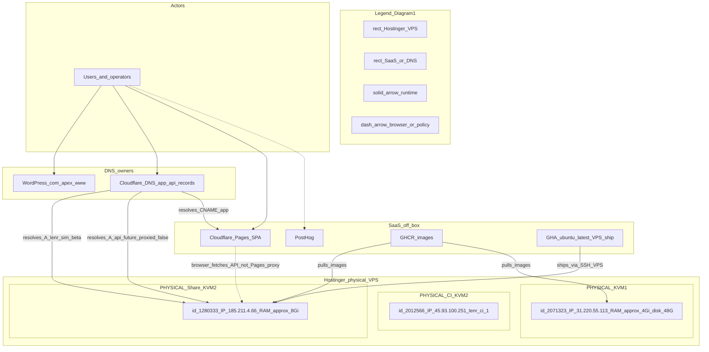
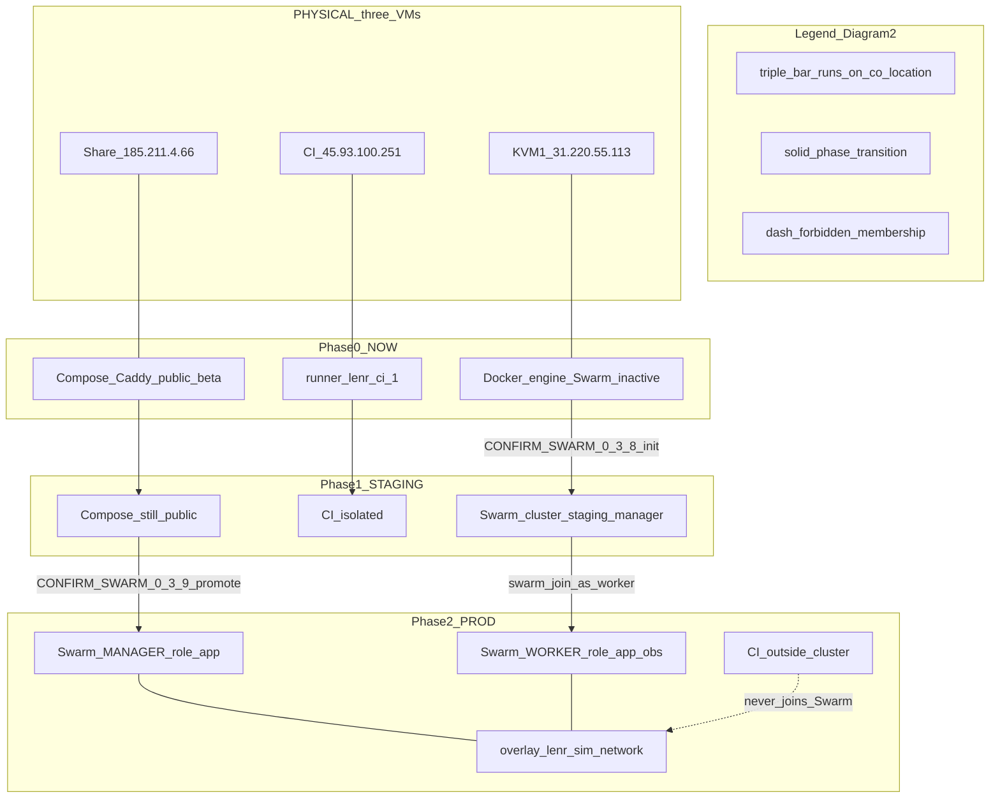
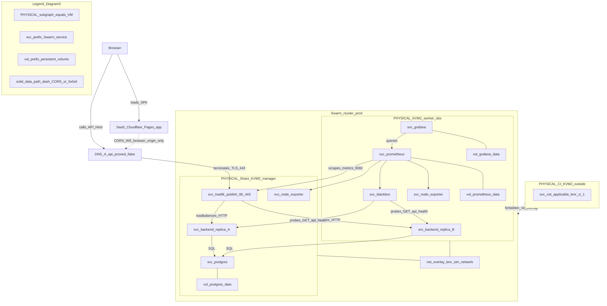
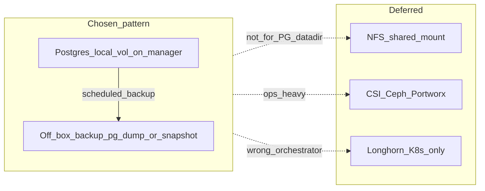

# Three-node Swarm topology (2×KVM2 + 1×KVM1)

**Train:** `dev` / v0.3.8-beta staging prep → v0.3.9 public cutover.  
**Hard line:** No public Swarm without `CONFIRM_SWARM_0_3_9=I_CUTOVER_0_3_9`.
CI KVM2 never joins Swarm. `EQ-OPEN-*` stay OPEN.

Companion walkthrough: [`KVM1_OPERATOR_WALKTHROUGH.md`](KVM1_OPERATOR_WALKTHROUGH.md).  
Observability: [`OBSERVABILITY_GRAFANA.md`](OBSERVABILITY_GRAFANA.md).  
Operator TUI (optional): [`D4S_DFORCE_OPERATOR.md`](D4S_DFORCE_OPERATOR.md) —
D-Force (`d4s`), k9s-like Swarm/Compose browser; not a cutover gate.  
DNS: [`DNS_AND_HOSTINGER_DECISIONS.md`](DNS_AND_HOSTINGER_DECISIONS.md).  
Learning map (two KVM2s only): [`TWO_KVM2_SWARM_TOPOLOGY.md`](TWO_KVM2_SWARM_TOPOLOGY.md).

**Last updated:** 2026-10-17.  
**Diagram source of truth:** this file (Architecture diagrams section). Stack template:
[`docker-stack.yml.j2`](../../infrastructure/ansible/templates/docker-stack.yml.j2).

## Locked host roles

| Host | Id / IP (today) | Forever role | Swarm role |
|------|-----------------|--------------|------------|
| Compose share | `1280333` / `185.211.4.66` | Public app host | **0.3.8:** Compose (healthy after brief Hostinger maintenance 2026-10-17). **0.3.9:** Swarm **manager** (Traefik + Postgres + ≥1 API) |
| Dedicated CI | `2012566` / `45.93.100.251` | `lenr-ci-1` only | **Never** Swarm; **never** `VPS_*` |
| Staging / data KVM1 | `2071323` / `31.220.55.113` (`srv2071323`) | Lightweight data + redundancy | **0.3.8:** staging **manager** (Docker installed; Swarm init awaits `CONFIRM_SWARM_0_3_8`). **0.3.9+:** **worker** (`app=true` + `observability=true`) |

## Why this shape

With one of two KVM2s reserved for untrusted PR CI, container rolling updates
alone cannot survive a manager host reboot. The KVM1 joins as a second
app-capable worker so Traefik can keep routing while one API replica drains.
Grafana/Prometheus run on the same worker under `observability=true` so scrapes
and dashboards do not starve Traefik/API/Postgres on the manager.

Frontend stays on **Cloudflare Pages** (`app.` / `app-staging`) — not on Swarm.

## Architecture diagrams

C4-aligned views for humans and agents. Notation follows
[C4 diagram checklist](https://c4model.com/diagrams/notation): each diagram has a
**title**, **scope**, in-diagram **legend** subgraph, and a summary table.
Mermaid flowcharts have no auto-legend — keep the `legend*` subgraphs in sync
with the glossary below.

Stable Mermaid node IDs (do not rename lightly): `shareMeta`, `ciMeta`,
`kvm1Meta`, `eShare0`, `eK1`, `eShare2`, `tr`, `apiA`, `apiB`, `pg`, `prom`,
`graf`.

### Glossary

| Term | Meaning |
|------|---------|
| Share | Hostinger KVM2 `1280333` / `185.211.4.66` — public app plane |
| CI | Hostinger KVM2 `2012566` / `45.93.100.251` — `lenr-ci-1` only |
| KVM1 | Hostinger KVM1 `2071323` / `31.220.55.113` — staging mgr → prod worker+obs |
| Compose env | Docker Compose + Caddy on Share (live `0.3.7-beta` today) |
| Swarm env | Docker Swarm cluster + stack on labeled nodes |
| `app=true` | Swarm node label — API replica placement |
| `observability=true` | Swarm node label — Prometheus/Grafana/blackbox |
| `node.role=manager` | Swarm raft role — Traefik + Postgres in our stack |
| `api.` / `api-staging.` | Traefik `Host()` rules — **only** public L7 API ingress |
| Pages | Cloudflare Pages SPA (`app.` / `app-staging`) — **not** Traefik ingress |
| Overlay | `lenr-sim-network` Swarm overlay |

### Edge and subgraph key

| Edge | Meaning |
|------|---------|
| `A --> B` | Runtime / control dependency |
| `A -.-> B` | Soft link, CORS, or **forbidden** path |
| `A --- B` | Co-location / “runs on” (no network hop) |
| `\|verb_proto\|` | Labeled relationship (protocol / confirm gate) |

| Subgraph prefix | Meaning |
|-----------------|---------|
| `PHYSICAL_*` / Hostinger SKU | Real VM / disk |
| SaaS / DNS owner | Off-box provider |
| `Swarm_*` | Orchestrator cluster boundary |
| `legend*` | Notation key for that diagram only |

---

### Deployment view — physical runtime

**Title:** Deployment diagram — LENR-Sim Hostinger + edge SaaS (v0.3.8 inventory)  
**Scope:** What physical and SaaS assets exist; DNS ownership; no Swarm internals.



| Asset | SKU | Id | IPv4 | Forever role |
|-------|-----|-----|------|--------------|
| Share | KVM2 | `1280333` | `185.211.4.66` | Public app plane |
| CI | KVM2 | `2012566` | `45.93.100.251` | Untrusted PR CI — never Swarm |
| KVM1 | KVM1 | `2071323` | `31.220.55.113` | Staging mgr → prod worker+obs |
| SPA | Pages | n/a | n/a | Frontend only |
| Apex | WordPress.com | n/a | n/a | Marketing `@`/`www` |

---

### Context-over-time — environments on hardware

**Title:** Environment mapping — Compose vs Swarm vs CI on fixed Hostinger VMs  
**Scope:** Same three VMs; orchestrator identity changes under confirm gates.



| Phase | Share runtime | CI runtime | KVM1 runtime | Swarm cluster? |
|-------|---------------|------------|--------------|----------------|
| 0 Now | Compose+Caddy | `lenr-ci-1` | Docker idle | No |
| 1 Staging | Compose public | Isolated | Staging Swarm **manager** | Yes — KVM1 only |
| 2 Prod | Swarm **manager** | Isolated | Swarm **worker** + obs | Yes — share + KVM1 |

**Rule:** Hardware is stable; “Swarm environment” = cluster membership + stack
scheduled onto hardware. CI never joins.

---

### Container view — stack placement

**Title:** Container diagram — LENR-Sim Swarm stack on Share + KVM1 (post-0.3.9)  
**Scope:** Service placement, overlay, volumes, public vs private ports. Phase 1
collapses all services onto KVM1 (single-node caveat).



| Service | Placement | Public ports | Persistence |
|---------|-----------|--------------|-------------|
| Traefik | Share `node.role=manager` | host 80/443; metrics overlay 8082 | ACME on manager disk |
| Backend | `app=true` spread | via Traefik only | bind mounts logs/data |
| Postgres | manager | overlay only | `postgres_data` (local) |
| Prometheus / Grafana / blackbox | KVM1 `observability=true` | not public | prom/grafana volumes (local) |
| node-exporter | global | overlay 9100 | none |
| CI runner | CI KVM2 | n/a | not a Swarm service |

**Traefik inputs:** only `api.` (prod) or `api-staging.` (Phase 1). Port 80 =
ACME + HTTPS redirect. Cloudflare Pages does **not** proxy into Traefik; the
browser calls the API host separately (dashed CORS edge).

---

## Persistent storage (not Longhorn)

Swarm has **no mature Longhorn equivalent**. Default Docker volumes are
**node-local**. Distributed block/file (NFS, Ceph, Portworx, CSI) is ops-heavy
and out of scope for 0.3.8 / 0.3.9.

| Approach | Use for LENR-Sim? |
|----------|-------------------|
| Local volume + placement pin | **Yes — default** (current stack) |
| App-level DB HA (Patroni / streaming) | Later if needed — not Phase 1 |
| NFS under Postgres datadir | **No** (latency / locking anti-pattern) |
| Ceph / Gluster / CSI / Longhorn | **Do not implement** on this Swarm |

**Contract:**

1. Keep stack volumes as `driver: local` in
   [`docker-stack.yml.j2`](../../infrastructure/ansible/templates/docker-stack.yml.j2).
2. Pin Postgres to `node.role == manager`; pin Prometheus/Grafana data to the
   observability node (KVM1 after cutover).
3. Node-local data is **not portable** — placement constraints prevent empty
   reschedules.
4. **Backup off-box** (`pg_dump` / host snapshots) — see
   [`ROLLBACK_AND_STAGING_CHECKLIST.md`](ROLLBACK_AND_STAGING_CHECKLIST.md).
5. Stateless API replicas do not need shared volumes.



## Node labels (contract)

Swarm allows **one value per label key**. Use separate keys so a node can be
both API and observability (KVM1). Prefer Ansible
[`join-workers.yml`](../../infrastructure/ansible/playbooks/join-workers.yml)
with inventory `swarm_node_labels`, or apply manually after join:

```bash
docker node update --label-add app=true <share_node_id>
docker node update --label-add app=true --label-add observability=true <kvm1_node_id>
```

| Label | Services |
|-------|----------|
| `node.role == manager` | Traefik, Postgres (stack default) |
| `node.labels.app == true` | Backend API replicas (spread) |
| `node.labels.observability == true` | Prometheus, Grafana, blackbox |

Stack template: [`docker-stack.yml.j2`](../../infrastructure/ansible/templates/docker-stack.yml.j2).  
Staging inventory example: [`inventory.staging.yml.example`](../../infrastructure/ansible/inventory.staging.yml.example).

## Failure domains (honest downtime)

| Event | Expected behavior |
|-------|-------------------|
| Backend image update | Rolling: `parallelism: 1`, `failure_action: rollback` |
| Bad deploy | Auto rollback or `docker service rollback <stack>_backend` |
| KVM1 reboot | API continues on share; Grafana/Prometheus down until worker returns |
| Share manager reboot | Full Traefik/API/Postgres outage until manager returns (local PG volume on manager) |
| Cutover failure | Compose/DNS rollback ≥ one release ([`ROLLBACK_AND_STAGING_CHECKLIST.md`](ROLLBACK_AND_STAGING_CHECKLIST.md)) |

**Not provided by this topology:** Swarm manager raft quorum (needs ≥3 managers).
Do not claim KVM1 alone provides manager HA. A fourth host is required later
for multi-manager quorum.

## Phased rollout (confirm gates)

| Phase | Confirm | Where | Public Swarm? |
|-------|---------|-------|---------------|
| 0 Prep / harden | — | Docs + KVM1 Docker; Swarm inactive | No |
| 1 Staging dry-run / apply | `CONFIRM_SWARM_0_3_8=I_STAGING_0_3_8` | KVM1 as staging manager; share stays Compose | No |
| 2 Public cutover | `CONFIRM_SWARM_0_3_9=I_CUTOVER_0_3_9` | Share → manager; KVM1 → worker; Pages on `app.` | Yes (announced window) |

See [`STAGING_SWARM_DRY_RUN.md`](STAGING_SWARM_DRY_RUN.md) and
[`../v0.3.9-beta/SWARM_PUBLIC_CUTOVER.md`](../v0.3.9-beta/SWARM_PUBLIC_CUTOVER.md).

Do **not** set `CONFIRM_SWARM_0_3_9` from CI/docs PRs. Do **not** close any
`EQ-OPEN-*`.

## Forbidden

- Swarm join / init on CI `2012566`
- Putting `VPS_*` or deploy secrets on `lenr-ci`
- Swarm init on live share without announced cutover + `CONFIRM_SWARM_0_3_9`
- Pointing D-Force (`d4s`) / Docker contexts at the CI host (or baking `d4s` into app images)
- Using `d4s` destructive actions to replace gated cutover / restore scripts
- Unauthenticated Grafana or Traefik dashboard on `0.0.0.0`
- Longhorn / NFS-as-Postgres-datadir on this Swarm train
