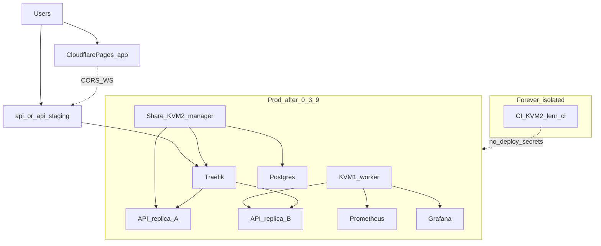

# Three-node Swarm topology (2×KVM2 + 1×KVM1)

**Train:** `dev` / v0.3.8-beta staging prep → v0.3.9 public cutover.  
**Hard line:** No public Swarm without `CONFIRM_SWARM_0_3_9=I_CUTOVER_0_3_9`.
CI KVM2 never joins Swarm. `EQ-OPEN-*` stay OPEN.

Companion walkthrough: [`KVM1_OPERATOR_WALKTHROUGH.md`](KVM1_OPERATOR_WALKTHROUGH.md).  
Observability: [`OBSERVABILITY_GRAFANA.md`](OBSERVABILITY_GRAFANA.md).  
Learning map (two KVM2s only): [`TWO_KVM2_SWARM_TOPOLOGY.md`](TWO_KVM2_SWARM_TOPOLOGY.md).

## Locked host roles

| Host | Id / IP (today) | Forever role | Swarm role |
|------|-----------------|--------------|------------|
| Compose share | `1280333` / `185.211.4.66` | Public app host | **0.3.8:** Compose. **0.3.9:** Swarm **manager** (Traefik + Postgres + ≥1 API) |
| Dedicated CI | `2012566` / `45.93.100.251` | `lenr-ci-1` only | **Never** Swarm; **never** `VPS_*` |
| New KVM1 | TBD after order | Lightweight data + redundancy | **0.3.8:** staging **manager**. **0.3.9+:** **worker** (`role=app` + `role=observability`) |

## Why this shape

With one of two KVM2s reserved for untrusted PR CI, container rolling updates
alone cannot survive a manager host reboot. The KVM1 joins as a second
app-capable worker so Traefik can keep routing while one API replica drains.
Grafana/Prometheus run on the same worker under `role=observability` so scrapes
and dashboards do not starve Traefik/API/Postgres on the manager.

Frontend stays on **Cloudflare Pages** (`app.` / `app-staging`) — not on Swarm.



## Node labels (contract)

Apply after join (manager runs these):

```bash
docker node update --label-add role=app <share_node_id>
docker node update --label-add role=app --label-add role=observability <kvm1_node_id>
```

| Label | Services |
|-------|----------|
| `node.role == manager` | Traefik, Postgres (stack default) |
| `node.labels.role == app` | Backend API replicas (spread) |
| `node.labels.role == observability` | Prometheus, Grafana |

Stack template: [`docker-stack.yml.j2`](../../infrastructure/ansible/templates/docker-stack.yml.j2).  
Staging inventory example: [`inventory.staging.yml.example`](../../infrastructure/ansible/inventory.staging.yml.example).

## Failure domains (honest downtime)

| Event | Expected behavior |
|-------|-------------------|
| Backend image update | Rolling: `parallelism: 1`, `failure_action: rollback` |
| Bad deploy | Auto rollback or `docker service rollback <stack>_backend` |
| KVM1 reboot | API continues on share; Grafana/Prometheus down until worker returns |
| Share manager reboot | Full Traefik/API/Postgres outage until manager returns |
| Cutover failure | Compose/DNS rollback ≥ one release ([`ROLLBACK_AND_STAGING_CHECKLIST.md`](ROLLBACK_AND_STAGING_CHECKLIST.md)) |

**Not provided by this topology:** Swarm manager raft quorum (needs ≥3 managers).
Do not claim KVM1 alone provides manager HA. A fourth host is required later
for multi-manager quorum.

## Phased rollout

| Phase | Confirm | Where |
|-------|---------|-------|
| Staging dry-run / apply | `CONFIRM_SWARM_0_3_8=I_STAGING_0_3_8` | KVM1 as staging manager; share stays Compose |
| Public cutover | `CONFIRM_SWARM_0_3_9=I_CUTOVER_0_3_9` | Share → manager; KVM1 → worker; Pages on `app.` |

See [`STAGING_SWARM_DRY_RUN.md`](STAGING_SWARM_DRY_RUN.md) and
[`../v0.3.9-beta/SWARM_PUBLIC_CUTOVER.md`](../v0.3.9-beta/SWARM_PUBLIC_CUTOVER.md).

## Forbidden

- Swarm join / init on CI `2012566`
- Putting `VPS_*` or deploy secrets on `lenr-ci`
- Swarm init on live share without announced cutover + `CONFIRM_SWARM_0_3_9`
- Unauthenticated Grafana or Traefik dashboard on `0.0.0.0`
