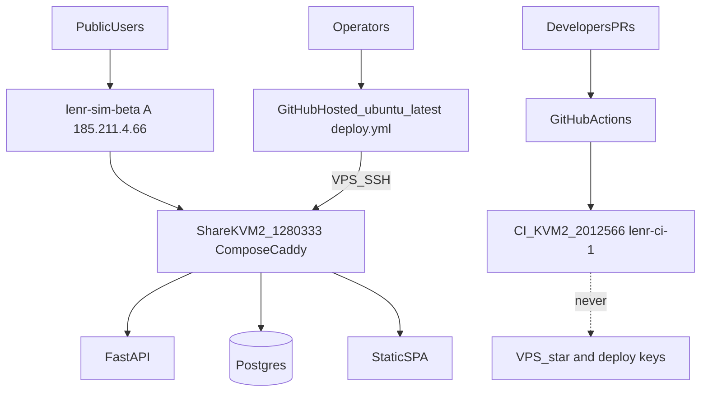
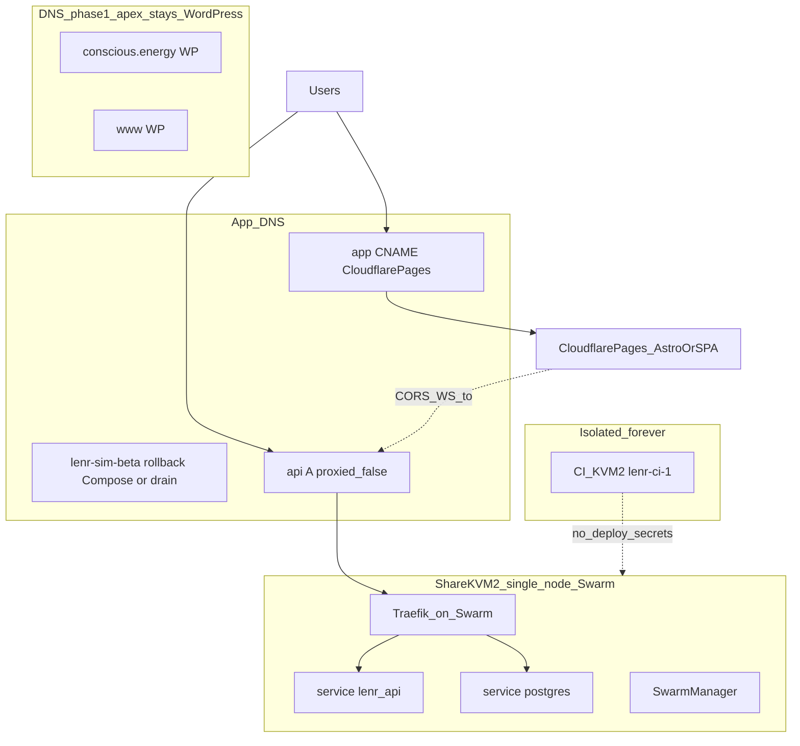
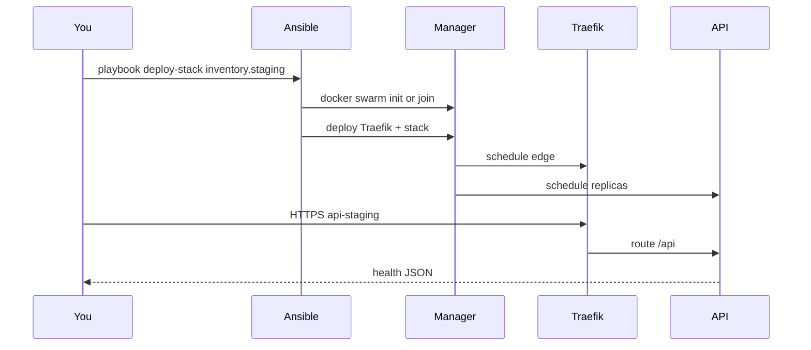
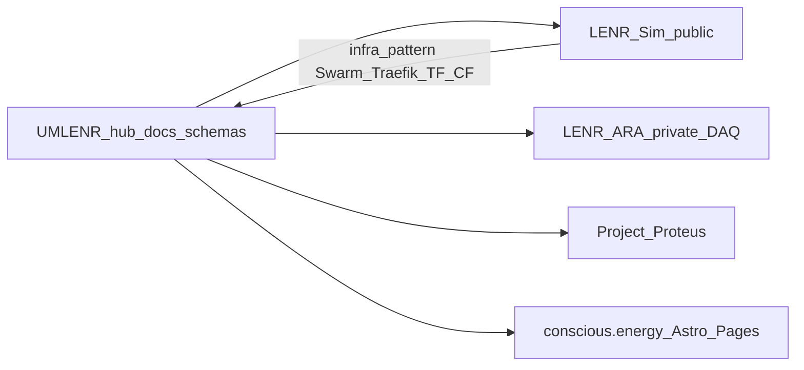

# Two-KVM2 Swarm topology — visualize, learn, stage safely

**Audience:** first-time Swarm / Traefik / Terraform / Cloudflare operators  
**Constraint:** stay on the **two** Hostinger KVM2s we already have  
**Non-goals:** no `CONFIRM_SWARM_0_3_9`, no Swarm init on live share without a written plan, no `VPS_*` on the CI runner

Related: [`FULL_STACK_BUILD_UNLOCK.md`](FULL_STACK_BUILD_UNLOCK.md) ·
[`DUAL_KVM2_SWARM_READINESS.md`](DUAL_KVM2_SWARM_READINESS.md) ·
[`DNS_AND_HOSTINGER_DECISIONS.md`](DNS_AND_HOSTINGER_DECISIONS.md) ·
[`STAGING_SWARM_DRY_RUN.md`](STAGING_SWARM_DRY_RUN.md) ·
[`../v0.3.9-beta/SWARM_PUBLIC_CUTOVER.md`](../v0.3.9-beta/SWARM_PUBLIC_CUTOVER.md)

---

## 1. What each tool is for (mental model)

| Tool | Job in this stack | Analogy |
|------|-------------------|---------|
| **Docker Compose** | One host, one `docker compose up` app stack (today’s public beta) | Laptop + docker-compose.yml |
| **Docker Swarm** | Cluster orchestrator: services, replicas, overlay networks, rolling updates | Compose ideas, but across nodes with a manager |
| **Ansible** | Idempotent SSH config: install Docker, render Traefik, deploy stack | “Runbooks as code” |
| **Traefik** | Edge reverse proxy + TLS (Let’s Encrypt) in front of Swarm services | Caddy’s role today, but Swarm-native |
| **Terraform** | Cloud DNS / Pages / optional VPS resources (plan before apply) | Desired-state for Cloudflare |
| **Cloudflare** | DNS (phased), later Pages SPA host; keep `api.` DNS-only for WebSockets | CDN + DNS control plane |
| **GitHub Actions (`lenr-ci`)** | Untrusted PR CI on a **dedicated** VM | Never the same box as deploy secrets |

**Compose vs Swarm (important):** Compose is what serves
https://lenr-sim-beta.conscious.energy **today**. Swarm is the **target**
orchestrator for public cutover (v0.3.9). You do not need Swarm running to keep
the open beta share healthy.

---

## 2. What we have today (two KVM2s)

Hostinger inventory (2026-10-04):

| Role | VM id | IP | OS | Must stay |
|------|-------|-----|-----|-----------|
| **Compose share** (public beta) | `1280333` | `185.211.4.66` | Ubuntu 24.04 | Compose + Caddy; no untrusted PR runner |
| **Dedicated CI** | `2012566` | `45.93.100.251` | Ubuntu 26.04 | `lenr-ci-1` only; **no** `VPS_*`, **no** Swarm |



**Security rule that drives the topology:** CI runs **untrusted branch code**.
That VM must never hold deploy SSH keys or sit on the Swarm that serves the
public API. Deploy stays on GitHub-hosted `ubuntu-latest` (or a future
`lenr-deploy` pool), not on `lenr-ci`.

---

## 3. Target picture (Swarm + Traefik + Pages) — still two KVM2s

With **only two** KVM2s, the honest production shape is:

1. **Keep CI on `2012566` forever** (or until you buy a third box).
2. **Promote the share host (`1280333`) to Swarm manager** only during the
   announced **v0.3.9** cutover window — after images are built, Traefik stack
   is validated, and rollback Compose procedure is rehearsed.
3. **Single-node Swarm** = manager schedules all services on itself. This is
   valid for open beta traffic; it is **not** multi-AZ HA.



### What “single-node Swarm” means for learning

| Concept | Single-node behavior |
|---------|----------------------|
| Manager | Same VM that runs tasks |
| Worker | Optional; omit in inventory for staging caveat |
| Overlay network | Still created; useful when you add a worker later |
| Replicas | `fastapi_workers: 2` can still be 2 containers on one host |
| Failure domain | Host reboot = full outage — accept for beta, plan 3rd node later |

When UMLENR / LENR-ARA need more isolation, **add a third KVM** (or larger
plan) as a dedicated Swarm worker or separate DAQ host — do not put DAQ on CI.

**Locked three-node product plan (2×KVM2 + 1×KVM1):** diagram source of truth is
[`THREE_NODE_SWARM_TOPOLOGY.md`](THREE_NODE_SWARM_TOPOLOGY.md)
(Architecture diagrams + storage decision — not Longhorn). Walkthrough:
[`KVM1_OPERATOR_WALKTHROUGH.md`](KVM1_OPERATOR_WALKTHROUGH.md). Observability:
[`OBSERVABILITY_GRAFANA.md`](OBSERVABILITY_GRAFANA.md).

---

## 4. Staging without a third VPS (what you can do now)

You **cannot** safely run a full staging Swarm on the CI box. Options:

| Option | Use when | Risk |
|--------|----------|------|
| **A. Local dry-run only** (recommended now) | Learning + CI gate | No live Traefik/TLS proof |
| **B. Staging single-node on a *new* cheap VPS** | Want real Traefik/ACME | Costs a 3rd line item |
| **C. Rehearse cutover on share in a maintenance window** | Pre-0.3.9 dress rehearsal | Touches public beta — needs announce + rollback |

**Do this week (no purchase):**

```bash
# 1) Prove gates + Terraform/Ansible syntax (no credentials)
./LENR_SIM_APP_v2/infrastructure/scripts/staging-swarm-dry-run.sh local

# 2) Read inventory contract (do not commit a filled copy)
cp LENR_SIM_APP_v2/infrastructure/ansible/inventory.staging.yml.example \
   LENR_SIM_APP_v2/infrastructure/ansible/inventory.staging.yml
# Edit STAGING_MANAGER_IP — never 45.93.100.251; avoid 185.211.4.66 unless
# you are in a written cutover rehearsal.

# 3) Terraform examples → untracked files on your laptop
cp LENR_SIM_APP_v2/infrastructure/terraform/backend.hcl.example \
   LENR_SIM_APP_v2/infrastructure/terraform/backend.hcl
cp LENR_SIM_APP_v2/infrastructure/terraform/staging.tfvars.example \
   LENR_SIM_APP_v2/infrastructure/terraform/staging.tfvars
# hostinger_vps_mode = "disabled" unless intentionally creating a staging VM
```

**When credentials exist (plan/check only):**

```bash
CONFIRM=I_STAGING_0_3_8 EXECUTE=1 \
  ./LENR_SIM_APP_v2/infrastructure/scripts/staging-swarm-dry-run.sh remote
```

Staging **apply** still requires `CONFIRM_SWARM_0_3_8=I_STAGING_0_3_8` and a
node that is not CI.

---

## 5. How to “see” the Swarm (operator visualization)

Once a manager exists (staging or cutover), these commands are your dashboard:

```bash
# Cluster membership
docker node ls

# Services and replicas
docker service ls
docker service ps <service_name>

# Stack deployed by Ansible / deploy.sh
docker stack ls
docker stack services lenr   # name may match playbook

# Traefik routers (on manager)
docker service logs <traefik_service> --tail 100

# From laptop: DNS + TLS + API
dig +short api-staging.conscious.energy
curl -sS https://api-staging.conscious.energy/api/health
```

Optional GUI later: Portainer or Traefik dashboard (**auth required**, bind to
private IP or SSO — never open unauthenticated on `0.0.0.0`).



---

## 6. Security & developer practices (non-negotiable)

1. **Split trust planes:** `lenr-ci` ≠ deploy ≠ DAQ. Never install the Actions
   runner on the Swarm manager that holds production DB volumes.
2. **Confirm strings:** staging `CONFIRM_SWARM_0_3_8=I_STAGING_0_3_8`; public
   `CONFIRM_SWARM_0_3_9=I_CUTOVER_0_3_9`. Scripts must exit non-zero without them.
3. **Secrets:** GitHub Actions secrets / untracked `*.tfvars` / `inventory.staging.yml`.
   Never PR bodies, Slack, or git.
4. **DNS phases:** keep WordPress.com NS for apex/`www` while app hosts move;
   Cloudflare Pages on `app.` only; `api.` A record `proxied=false` for WS
   ([`DNS_AND_HOSTINGER_DECISIONS.md`](DNS_AND_HOSTINGER_DECISIONS.md)).
5. **Least privilege tokens:** Cloudflare API token scoped to zone DNS/Pages;
   Hostinger API not on CI; deploy SSH key only on hosted deploy jobs.
6. **Rollback:** keep Compose share / previous image tag until Swarm health is
   proven ([`ROLLBACK_AND_STAGING_CHECKLIST.md`](ROLLBACK_AND_STAGING_CHECKLIST.md)).
7. **Academic honesty:** `EQ-OPEN-*` stay OPEN; infra PRs do not rewrite claim rows.

---

## 7. Phased path to open public beta (LENR-Sim) + UMLENR hub

Program intent (Conscious Energy / UMLENR):

| Track | Near-term | Later |
|-------|-----------|-------|
| **LENR-Sim** (this repo) | Compose public beta; Swarm cutover under 0.3.9 | Traefik `api.` + Pages `app.` |
| **UMLENR hub** (umbrella repo) | Docs-first Goal 1 PR: shared schemas, registries, release manifests | Point child repos (Sim, ARA, Proteus) at hub manifests |
| **LENR-ARA** (private DAQ) | Low-cost path; **separate** host/secrets from Sim CI/Swarm | Shared schemas from UMLENR; never co-tenant with `lenr-ci` |
| **conscious.energy** | Apex stays WordPress.com | Headless: WP.com CMS → Astro on Cloudflare Pages |
| **Project Proteus** | Refresh after hub docs baseline | Align release manifests with UMLENR |



**Infra alignment rule:** LENR-Sim remains the reference implementation for
Swarm/Ansible/Traefik/Terraform/Cloudflare. UMLENR docs should **link** these
runbooks rather than forking conflicting topologies. ARA gets its own trust
boundary (private network / separate VPS), consuming shared **schemas** only.

---

## 8. Suggested learning lab (one sitting, no cutover)

**Full step-by-step with file paths and CLI viz:**
[`SWARM_OPERATOR_LAB.md`](SWARM_OPERATOR_LAB.md).

1. Sketch the two boxes on paper; label “untrusted CI” vs “trusted runtime”.
2. Run `staging-swarm-dry-run.sh local` and read the log.
3. Fill `inventory.staging.yml` with **fake** IPs and run
   `ansible-playbook --syntax-check` only.
4. Open Traefik templates under `infrastructure/ansible/templates/` and find
   where `api-staging` and ACME email are injected.
5. Read Cloudflare module vars; confirm Pages hostname default is `app`, not `@`.
6. Decide: stay Compose for public beta until you either (a) buy a staging VPS,
   or (b) schedule a 0.3.9 cutover rehearsal on the share host.
7. Review the portable UMLENR Goal 1 pack
   ([`../program/UMLENR_GOAL1_HUB_PACK/`](../program/UMLENR_GOAL1_HUB_PACK/README.md))
   and open that PR from an account with write access to `UMLENR`.

---

## 9. Decision record — two KVM2s for now

| Decision | Choice | Rationale |
|----------|--------|-----------|
| CI placement | Stay on `2012566` | Blast radius; no deploy secrets |
| Public beta now | Compose on `1280333` | Already healthy `0.3.7-beta` with KM `auto` |
| Staging Swarm on CI | **Forbidden** | Untrusted code |
| Staging Swarm without 3rd VPS | Local dry-run + optional cutover rehearsal | Honest about HA |
| Production Swarm | Single-node manager on share at 0.3.9, or add worker later | Fits two-VPS budget |
| Apex DNS | Stay WordPress.com phase 1 | Protect marketing site |
| UMLENR / ARA | Separate trust planes; shared docs/schemas in hub | Program architecture |

When you are ready for a third VPS, the inventory grows by one
`staging-manager-1` (or prod worker) without redesigning CI.
