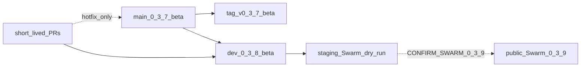

# Version control for v0.3.8-beta (Swarm migration prep)

This document is the **implementation map** for the `dev` integration train.
It does **not** authorize public Swarm cutover. Cutover remains gated by
`CONFIRM_SWARM_0_3_9=I_CUTOVER_0_3_9` in
[`../v0.3.9-beta/SWARM_PUBLIC_CUTOVER.md`](../v0.3.9-beta/SWARM_PUBLIC_CUTOVER.md).

## Branch and version model

| Ref | Markers | Deploy | Purpose |
|-----|---------|--------|---------|
| `main` + tag `v0.3.7-beta` | `0.3.7-beta` | Compose share ship only (`deploy.yml` on `main` + `v*` tags) | Live public beta |
| `dev` | `0.3.8-beta` | **No** auto VPS ship | Integration for Swarm prep, science, deps |
| Short-lived `consciousenergy/*` / `feat/*` | inherit base | PR → **`dev`** (default) or `main` (0.3.7 hotfix only) | Topic changes |

Policy source of truth: [`.github/BRANCHING.md`](../../../.github/BRANCHING.md).  
Agent map: [`AGENTS.md`](../../../AGENTS.md).  
Dependabot: `target-branch: dev` in [`.github/dependabot.yml`](../../../.github/dependabot.yml)
(read from default branch `main` after that config is on tip).

## Four version markers (must match within a branch)

- `LENR_SIM_APP_v2/backend/app/core/config.py` → `APP_VERSION`
- `LENR_SIM_APP_v2/frontend/package.json` → `"version"`
- `LENR_SIM_APP_v2/frontend/src/config/version.js` → `APP_VERSION`
- `LENR_SIM_APP_v2/infrastructure/docker/Dockerfile.backend` → `BUILD_VERSION`

On `dev`, all four are `0.3.8-beta`. Do not bump `main` until a promote PR.

## Implementation phases (0.3.8 train)

Ordered for progressive delivery. Each phase is a PR (or short PR ladder) into **`dev`**.

### Phase A — Version control + hygiene (docs/policy)

- [x] Long-lived `dev` at `0.3.8-beta` (consolidation)
- [x] Promote BRANCHING / Dependabot / CI `dev` filters onto default-branch `main` tip (#240)
- [ ] Keep `PR_AND_BRANCH_HYGIENE.md` current after each ladder

### Phase A2 — ARA Oct 2026 workbench Wave 1 (science; parallel to Swarm)

Owner doc: [`ARA_OCT2026_WORKBENCH.md`](ARA_OCT2026_WORKBENCH.md).

- Static crawler-readable `/models/*` (+ methodology/validation/sources/experiments)
- Additive predicted signatures / falsifiers / equation citations / taxonomy
- Storms / Takahashi / Hagelstein version headers; Schwinger lattice scaffold
- Model 0 baselines featured; Conscious Energy WP supersession = operator handoff
- Does **not** authorize Swarm apply or public cutover

### Phase B — Staging Swarm dry-run (no public traffic)

Owner docs: [`STAGING_SWARM_DRY_RUN.md`](STAGING_SWARM_DRY_RUN.md),
[`FULL_STACK_BUILD_UNLOCK.md`](FULL_STACK_BUILD_UNLOCK.md),
[`THREE_NODE_SWARM_TOPOLOGY.md`](THREE_NODE_SWARM_TOPOLOGY.md),
[`KVM1_OPERATOR_WALKTHROUGH.md`](KVM1_OPERATOR_WALKTHROUGH.md),
[`OBSERVABILITY_GRAFANA.md`](OBSERVABILITY_GRAFANA.md).

1. Operator orders Hostinger **KVM1** (staging manager → later prod worker)
2. Operator copies untracked Terraform/Ansible examples → real credentials
   (inventory manager IP = **KVM1**, never CI / never blind share promote)
3. Local: `./LENR_SIM_APP_v2/infrastructure/scripts/staging-swarm-dry-run.sh local`
4. Remote dry-run only with `CONFIRM=I_STAGING_0_3_8 EXECUTE=1 … remote`
5. Staging apply under `CONFIRM_SWARM_0_3_8=I_STAGING_0_3_8`
6. Validate Traefik → API, Pages CORS/WS on **staging** host ≠ CI box `2012566`
7. Optional: enable Prometheus/Grafana on `role=observability` (private access)

**Components in scope for staging:** Docker Swarm, Ansible playbooks, Traefik
ingress, Cloudflare DNS/Pages wiring (staging), Terraform remote state,
observability scaffolds.

**Forbidden without explicit ask:** Swarm init on live share `185.211.4.66`,
`CONFIRM_SWARM_0_3_9`, putting `VPS_*` on `lenr-ci`.

### Phase C — Learning / operator readiness

1. [`TWO_KVM2_SWARM_TOPOLOGY.md`](TWO_KVM2_SWARM_TOPOLOGY.md)
2. [`THREE_NODE_SWARM_TOPOLOGY.md`](THREE_NODE_SWARM_TOPOLOGY.md) +
   [`KVM1_OPERATOR_WALKTHROUGH.md`](KVM1_OPERATOR_WALKTHROUGH.md)
3. [`SWARM_OPERATOR_LAB.md`](SWARM_OPERATOR_LAB.md)
4. UMLENR Goal 1 pack → separate hub repo PR
   ([`../program/UMLENR_GOAL1_HUB_PACK/`](../program/UMLENR_GOAL1_HUB_PACK/README.md))

### Phase D — Public cutover (v0.3.9 — not 0.3.8)

Only under `CONFIRM_SWARM_0_3_9=I_CUTOVER_0_3_9` with an announced window:
[`../v0.3.9-beta/SWARM_PUBLIC_CUTOVER.md`](../v0.3.9-beta/SWARM_PUBLIC_CUTOVER.md).

Promote path: squash `dev` → `main` with marker bump to the cutover train,
retag, ship. Compose share stays until that confirm.

## Science / security invariants (carry forward)

- `EQ-OPEN-*` stay **OPEN**; Lean ≠ nature proof; `lenr_proved: false`
- Academic claim PRs stay off the CI/ops train
- Additive API contracts; no silent `contract_version` breaks
- Scheduled + PR audit gates aligned (`source-map-js`, documented jose ignore, etc.)

## Related product future work (not Swarm-blocking)

- Internationalization roadmap: [`I18N_FUTURE.md`](I18N_FUTURE.md)
  (French, Spanish, Italian, Japanese, Chinese, Russian)
