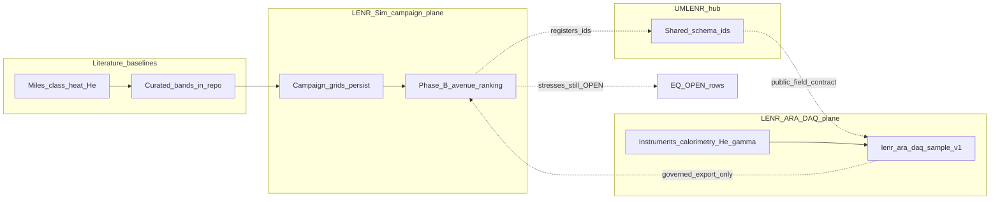

# EQ-OPEN closure / falsification runway (Phase F draft)

**Status:** draft science note only — **does not** discharge any `EQ-OPEN-*`  
**Train:** v0.3.9-beta academic companion (docs)  
**Hard line:** every row below stays **OPEN**; ledger twin `lenr_proved` stays **`false`**  
**North star:** prove or disprove the Unified Theory / electro-nuclear collapse account against applied experimental data under UMLENR governance — never by aspiration or simulation-only Lean identities.

This note drafts **what would later count** as affirmative discharge or negative discharge (falsification) for each open obligation. Closing a row requires a **separate** academic-review PR series with IR/Lean predicate updates, linked governed evidence, ledger + proof-matrix edits, and explicit human sign-off. See Lean `OpenQuestionBounds` / IR YAML: would-close-if lemmas are bookkeeping, not nature proof.

| Pointer | Artifact |
|---------|----------|
| Ledger (still OPEN) | [`../v0.3.7-beta/PHYSICS_MATURITY_LEDGER.md`](../v0.3.7-beta/PHYSICS_MATURITY_LEDGER.md) |
| Proof matrix | [`../v0.3.7-beta/PROOF_MATRIX.md`](../v0.3.7-beta/PROOF_MATRIX.md) |
| Goals / invariants | [`../v0.3.7-beta/GOALS.md`](../v0.3.7-beta/GOALS.md) |
| Hub trust planes | [`../program/UMLENR_GOAL1_HUB_PACK/TRUST_PLANES.md`](../program/UMLENR_GOAL1_HUB_PACK/TRUST_PLANES.md) |
| Hub schemas | [`../program/UMLENR_GOAL1_HUB_PACK/schemas/README.md`](../program/UMLENR_GOAL1_HUB_PACK/schemas/README.md) |
| LENR-ARA (early/private) | `LENR_ARA` (early/private DAQ; hub registry id `lenr-ara`) — **separate DAQ trust plane**; not co-tenant with public Sim DB or `lenr-ci` |

---

## Binding rules (this draft)

1. **No silent flips.** Simulation campaigns, Bayesian avenue ranking, and Lean identities alone **never** flip `EQ-OPEN-*` or `lenr_proved`.
2. **Two discharge modes.** Affirmative = obligation satisfied under stated definitions + governed data. Negative = obligation shown impossible / falsified under those definitions + data. Both advance honesty.
3. **No fabricated lab data.** This document contains **criteria and contracts**, not measured samples. Placeholders and example shapes are non-attested.
4. **Trust split.** Literature baselines and campaign posteriors live in LENR-Sim / UMLENR hub docs. Instrument streams and private DAQ live in LENR-ARA. Public exports strip private fields ([`TRUST_PLANES.md`](../program/UMLENR_GOAL1_HUB_PACK/TRUST_PLANES.md)).

---

## Closure / falsification criteria (draft; status OPEN)

Predicates align with Equation IR + Lean `OpenQuestionBounds` / `OpenObligations`. Units and Nat-scaled bookkeeping follow existing IR rows; lab evidence must map into those predicates with provenance, not free narrative.

### EQ-OPEN-MEV-01 (Q1 — MeV energy-partition channel)

| | |
|--|--|
| **IR / Lean** | [`EQ-OPEN-MEV-01.yaml`](../../../formalization/ir/equations/EQ-OPEN-MEV-01.yaml); `q1WouldCloseIf` ↔ open remainder \(= 0\) |
| **Obligation** | Account for nuclear-scale energy remainder so the unallocated MeV-gap bookkeeping closes under a **named** mechanism path (Hagelstein / Dicke / BEC remain labels until evidenced). |
| **Affirmative discharge (draft)** | Governed experiment or equivalently curated corpus shows a constrained phonon→nuclear (or ENC collapse) channel such that the open energy remainder maps to **identically zero** under the IR definition, with cited matrix element / occupation bounds (not free parameters past engine caps), and claim-tier + provenance attached. |
| **Falsification (draft)** | Under the stated mechanism definitions and measurement gates, the remainder stays strictly positive across the licensed domain (or the named channel is ruled out by calorimetry / spectroscopy upper limits incompatible with the required partition), recorded as negative discharge of this obligation’s **stated form** — not as “LENR impossible” globally. |
| **Does not count** | Working-hypothesis partition theorems (`EQ-WH-PART-01` / `EQ-WH-NONCLOSE-01`); campaign scenario tables; UI chips. |
| **Status now** | **OPEN** |

### EQ-OPEN-RAD-01 (Q2 — radiation / γ suppression)

| | |
|--|--|
| **IR / Lean** | [`EQ-OPEN-RAD-01.yaml`](../../../formalization/ir/equations/EQ-OPEN-RAD-01.yaml); `q2WouldCloseIf` ↔ \(\Gamma_{\mathrm{ph}}/\Gamma_{\gamma}\) bookkeeping ≥ \(10^{11}\) target **or** measured \(\mathrm{BR}_{\gamma}\) ≤ detector-derived upper bound under stated geometry |
| **Obligation** | Quantitative lattice γ-absorption / branching consistent with detector upper limits while accounting for heat. |
| **Affirmative discharge (draft)** | Time-correlated heat + γ (or UL) dataset with calibrated efficiency shows branching at or below the IR upper bound **and** lattice bookkeeping ratio meeting the stated target under cited absorption model — or an IR amendment that replaces the \(10^{11}\) target with a measured, peer-reviewed bound and Lean update in the same closure PR. |
| **Falsification (draft)** | Calibrated γ yield above the licensed upper bound while heat claims remain in-band for the same interval (prompt radiation not suppressed as required), or independent absorption measurements that make the lattice ratio unattainable under stated microphysics. |
| **Does not count** | Harmonic / Franck–Condon Lean bounds alone; ingest of a γ UL without efficiency + coincidence provenance. |
| **Status now** | **OPEN** |

### EQ-OPEN-RATE-01 (Q3 — lattice rate budget)

| | |
|--|--|
| **IR / Lean** | [`EQ-OPEN-RATE-01.yaml`](../../../formalization/ir/equations/EQ-OPEN-RATE-01.yaml); two-body \(\log_{10} N = -40\) non-closure (`EQ-RATE-2B-NC-01`); occupancy/collective Nat inputs in `OpenQuestionBounds` |
| **Obligation** | Named rate model yields \(\log_{10}(N_{\mathrm{events}}) \ge 0\) with **experimentally constrained** occupancy / collective factors (not free \(10^{6}\) cap assumptions). |
| **Affirmative discharge (draft)** | Under a named `rate_mode` (not silently replacing `two_body`), constrained \(n_{\mathrm{occ}}\) and \(f_{\mathrm{nuc}}\) from lab or governed corpus make the RateBudget product close, with Lean/IR `would_close_if` inputs attested and the two-body reference retained beside the closing path. |
| **Falsification (draft)** | All licensed mechanism paths remain below closure after capping factors at measured / literature-bounded values (negative discharge of “budget closes under current caps”); two-body non-closure stays as proved reference. |
| **Does not count** | UI `BUDGET_DOES_NOT_CLOSE` chip; engine cap product scenario grids labelled “not a posterior.” |
| **Status now** | **OPEN** |

### EQ-OPEN-EC-01 (Q4 — electron-capture energy path)

| | |
|--|--|
| **IR / Lean** | [`EQ-OPEN-EC-01.yaml`](../../../formalization/ir/equations/EQ-OPEN-EC-01.yaml); deficit identity [`EQ-OPEN-EC-DEFICIT-01`](../../../formalization/ir/equations/EQ-OPEN-EC-DEFICIT-01.yaml) (~\(10^{7}\) between 0.1 eV double-layer and 0.782 MeV) |
| **Obligation** | Condensed-matter path supplying \(E_{\mathrm{available}} \ge 0.782\,\mathrm{MeV}\) for capture under Widom–Larsen-class bookkeeping (Tennfors critique cited). |
| **Affirmative discharge (draft)** | Independent measurement or governed theory+data package demonstrating available electron energy ≥ threshold **in the licensed material / field regime**, with mass-renormalization domain gates met as physical claims (not UI gap-to-threshold cosmetics), Tennfors domain respected. |
| **Falsification (draft)** | Stated CM paths remain orders of magnitude below threshold under measured potentials / masses (deficit identity class), with no licensed alternative entrance channel — negative discharge of this EC-source form. |
| **Does not count** | Default mass-renormalization gap showing “0.000 MeV remaining” in UI; ARA P1 Widom scaffold ([`ARA_P1_WIDOM_START.md`](./ARA_P1_WIDOM_START.md)). |
| **Status now** | **OPEN** |

### EQ-OPEN-YIELD-01 (Q5 — integrated heat–helium yield)

| | |
|--|--|
| **IR / Lean** | [`EQ-OPEN-YIELD-01.yaml`](../../../formalization/ir/equations/EQ-OPEN-YIELD-01.yaml); band DEF [`EQ-OPEN-YIELD-BAND-01`](../../../formalization/ir/equations/EQ-OPEN-YIELD-BAND-01.yaml) |
| **Obligation** | Integrated \(^{4}\mathrm{He}\) vs heat discrepancy closes (\(\Delta N_{^{4}\mathrm{He},\mathrm{integrated}} = 0\) under IR scaling), distinguishing instantaneous Miles EMP (~2× band) from integrated \(10^{2}\)–\(10^{4}\) remainder. |
| **Affirmative discharge (draft)** | Time-resolved simultaneous heat + He with retention / collection efficiency provenance shows integrated yield within the IR closure definition (discrepancy → 0), not merely instantaneous atoms/s/W inside the Miles EMP factor band. |
| **Falsification (draft)** | Simultaneous calorimetry + He under stated protocols keep integrated discrepancy inside the open remainder band after efficiency corrections, with no duty-cycle resolution that zeros \(\Delta N\) — negative discharge of integrated-yield closure under those protocols. |
| **Does not count** | Instantaneous Miles EMP band membership alone; paper section existence (`ISSUE_LEDGER` “FIXED”). |
| **Status now** | **OPEN** |

### Global bit

| Field | Required value (this phase and until governance says otherwise) |
|-------|------------------------------------------------------------------|
| `lenr_proved` | **`false`** |
| All five `EQ-OPEN-*` above | **`OPEN`** |
| Lean “PROVED” identities / non-closure | Do **not** flip the scientific obligation |

---

## UMLENR data path map (literature → ranking → ARA / instruments)

No fabricated samples. Arrows are **trust and governance** flow, not a claim that data already exists.



| Stage | What lives here | What does **not** |
|-------|-----------------|-------------------|
| **1. Literature** | Miles-class heat–He bands, ICCF/companion citations already in paper + campaign presets, EMP bands in Lean DEF | New invented “lab” numbers |
| **2. Campaign ranking** | Simulation persist (`persist_source=simulation_campaign`), UQ / decision-oracle avenue scores, reviewer packs — **scenario tables / posteriors labelled honestly** | Closing `EQ-OPEN-*`; writing into ARA DB |
| **3. Instrument plan** | Operator-owned LENR-ARA acquisition: calorimetry, He assay, γ / neutron UL, timing — private host (`LENR_ARA` / hub registry `lenr-ara`) | Co-tenancy with `lenr-ci` or public Postgres |
| **4. Governed ingest** | Public-safe fields via planned `lenr-ara-daq-sample-v1` → hub registry → optional Sim oracle **side inputs** | Auto-flip of `rate_mode` or OPEN status |
| **5. Closure-candidate PRs** | Later: IR predicate + Lean + ledger + evidence links | This draft note |

Cross-links: campaign runner / grids under `backend/app/campaign/`; oracle optional lab ingest fields already documented as **not** auto-flipping `rate_mode` (CHANGELOG); ARA theory rebuilds remain separate from DAQ ([`ARA_P1_THEORY_REBUILDS.md`](./ARA_P1_THEORY_REBUILDS.md)).

### Instrument plan sketch — dual-counter + Cd differential (docs only)

Operator-owned LENR-ARA / private DAQ sketch for radiation honesty under
`EQ-OPEN-RAD-01` / `EQ-OPEN-RATE-01`. **Does not** discharge either obligation;
**does not** prove neutrons, neutrinos, or LENR.

| Element | Intent | Honesty lock |
|---------|--------|--------------|
| **Near counter** | SNM-14 / ³He (or equivalent) at working distance from the active volume | Count rate alone ≠ neutron proof |
| **Far counter** | Same detector class at a larger baseline (Klimov-style geometry) | Differential isolates local vs room / cosmic background |
| **Cd differential** | Bare vs Cd-wrapped on the near counter (background drop ~10× when reading true slow-n) | Cd-wrap is a **calibration / interpretation** observable; high rate under Cd is a falsifier of “thermal neutron” interpretation, not proof of a ν agent |
| **γ / soft-X companion** | Hard-γ UL + soft-X channel when claimed | Soft-X∧¬hard-γ ∧ Cd-high → `BRANCHING_INCONSISTENT_WITH_NEUTRON_INTERPRETATION` (scenario diagnostic only) |
| **Dual-counter coincidence** | Optional AND/OR timing between near and far | EMI / pulse-shape confounders stay first-class covariates |

Parkhomov detector-gas ν/ν̄ hypotheses stay **SPEC curated storytelling**
(`parkhomov_curated` `detector_gas_speculative` rows; `feeds_production_rate=false`)
and must **not** be treated as an `EQ-OPEN-EC-01` entrance channel. Efficiency-corrected
neutron UL geometry remains a proxy until wired (`neutron_rate_bound` honesty class
`detector_ul_not_proof`). See avenue note in
[`AVENUE_RANKING.md`](./AVENUE_RANKING.md) for the `detector_weak_screen` pack →
Q4/RAD/RATE lab-design link (no status flips).

---

## Ingest contract sketch vs `lenr-ara-daq-sample-v1`

Hub registry marks `lenr-ara-daq-sample-v1` as **planned** (LENR-ARA private owner; public fields only in hub later). LENR-Sim’s live simulation envelope remains `lenr-run-export-v1` ([`REPRODUCIBILITY_EXPORT_SCHEMA.md`](../v0.3.6-beta/REPRODUCIBILITY_EXPORT_SCHEMA.md)).

### Separation of schemas

| Schema id | Plane | Role |
|-----------|-------|------|
| `lenr-run-export-v1` | Sim / public | Reproducible **simulation** run (params, seeds, results, claim tiers) |
| `lenr-ara-daq-sample-v1` | DAQ / private→public-safe | One **instrument sample** or aggregated interval with calibration provenance |
| `umlenr-release-manifest-v1` | Hub | Release packaging — not science discharge |

### Draft public field set (sketch — non-normative until hub JSON Schema lands)

Illustrative shape only. **Not** attested data; do not copy into production as measurements.

```json
{
  "schema_version": "lenr-ara-daq-sample-v1",
  "sample_id": "ara-uuid-or-ulid",
  "recorded_at": "ISO-8601",
  "trust_plane": "daq",
  "instrument": {
    "calorimetry_id": "string",
    "he_assay_id": "string",
    "gamma_detector_id": "string"
  },
  "interval_s": 0,
  "observables": {
    "excess_power_W": null,
    "sigma_Q_W": null,
    "he4_atoms_per_s": null,
    "he4_atoms_integrated": null,
    "gamma_cps": null,
    "gamma_ul_log10": null
  },
  "calibration": {
    "efficiency_refs": [],
    "retention_caveat": "string",
    "citations": []
  },
  "maps_to_open_questions": ["EQ-OPEN-YIELD-01"],
  "lenr_proved": false,
  "private_extensions_stripped": true
}
```

### Mapping rules (draft)

1. **Additive oracle side inputs.** Existing optional ingest keys (`excess_power_W`, `he4_atoms_per_s`, `sigma_Q_W`, γ UL, …) may be **populated from** a validated public export of `lenr-ara-daq-sample-v1`; they must not silently replace `two_body` or flip OPEN rows.
2. **EQ targeting.** `maps_to_open_questions` is advisory stress tagging for Phase B ranking / closure-candidate triage — not a status field.
3. **Strip private extensions** before any hub or Sim persistence (`private_extensions_stripped: true`).
4. **Honesty defaults.** Every sample carries `lenr_proved: false` until a governance-approved global flip (out of scope here).
5. **Contract evolution.** Breaking changes → new major schema id per hub [`schemas/README.md`](../program/UMLENR_GOAL1_HUB_PACK/schemas/README.md). Sim keeps `lenr-run-export-v1` additive-only.

### What a future closure-candidate PR must attach

- Linked `sample_id`(s) or literature DOIs with retention/efficiency notes  
- IR / Lean predicate diff (would-close or falsify under those inputs)  
- Ledger + proof-matrix status change in the **same** review  
- Explicit human sign-off; no CI auto-merge of science discharge  

---

## Quantitative distance to ≥5σ (YIELD heat MoE; still unmet)

Paper / BDS-302 criterion: \(S_{\mathrm{heat}} = Q_{\mathrm{excess}} / \sigma_Q\) with discovery-grade analytics requiring \(S \ge 5\), `literature_reported` measurement-specific σ_Q, verified Q↔σ pairing, and non-seed measured Q. **Clearing the analytics flag still does not close `EQ-OPEN-YIELD-01` or set `lenr_proved`.**

Helpers (code): `calorimetry_significance.py`, `discovery_grade_gap.py`, `sigma_distance.py`. Lean locks: `EQ-HEAT-SIG-01` / `EQ-HEAT-SIG-NC-01` (`CalorimetrySignificance.lean`); collapse UQ ≠ discovery MoE (`EQ-BBL-HEAT-NC-01`).

| Distance status | Meaning | Closure implication |
|-----------------|---------|---------------------|
| `undefined` | No finite Q and σ_Q pair (campaign / §5B corpus default) | Gates `not_met` |
| `below_bar` | \(S_{\mathrm{heat}} < 5\); shortfall \(= 5 - S\) reported | Gates `not_met` |
| `at_or_above_bar_gates_blocked` | Arithmetic \(S \ge 5\) but provenance / pairing / seed gates fail (e.g. Miles peak \(S=26\) under instrument_precision) | **Not** discovery; EQ-OPEN stays OPEN |
| `at_or_above_bar_gates_clear` | Analytics `discovery_grade_eligible` true (e.g. Kasagi NiCu) | **Still** `honest_closure: not_met`; EQ-OPEN OPEN; `lenr_proved: false` |

**Corpus MoE coverage bookkeeping** (literature + ICCF27 hydrate; counts only): minority of rows carry numeric σ_Q; fewer have cite-gated `literature_reported` + verified pairing; analytics-eligible rows **never** auto-discharge this runway. Campaign packs stamp corpus gap envelopes (`not_met`) by design — collapse UQ sample depth does not tighten cite-gated σ_Q.

**Inventory lock (BDS-343):** publishable `literature_reported` total σ_Q + verified Q↔σ pairing for the curated 25-row corpus is **exhausted** at **2/25** (Kasagi NiCu + Ni radiant). Do **not** invent σ_Q / pairing for Iwamura / Mizuno / Arata / Celani / commercial Ni–H. EMP instrument-precision / floor rows (Miles, De Ninno, McKubre) stay exploratory with structured “why not discovery” reasons on Analytics / §5B. Soft chips remain `analytics_gates_clear` — never “≥5σ met”. **`discovery_grade_eligible` ≠ EQ-OPEN discharge ≠ `lenr_proved`** (Lean `discovery_grade_analytics_does_not_prove_lenr` / `HeatDiscoveryProof`).

**Lean + runway exhaust (BDS-344):** `CalorimetrySignificance` now binds Kasagi Ni control milli-σ arithmetic, McKubre-class `instrument_floor` ⇏ discovery, soft-chip ≠ scientific discharge, and **`dual_kasagi_analytics_does_not_close_eq_open_or_lenr`** (even both cleared analytics flags keep `lenr_proved` false and Q5 open). Served UI config marks `software_honest_5sigma_runway_exhausted: true` + `promote_prep_recommended: true` with the five remaining **scientific/governance** blockers listed under `CORPUS_MOE_COVERAGE.remaining_scientific_blockers` — **no** honesty flag flips. Prefer-merge software levers for honest ≥5σ literature MoE invention on this train are largely exhausted; next human/ops step is **promote+ship prep** when asked (version markers / release gate / announced Swarm window) — **not** auto `main` / Path B and **not** closing EQ-OPEN-*.

**All-five EQ-OPEN NC + next lab MoE targets (BDS-346):** Lean strengthens analytics≠proof binding with **`discovery_grade_analytics_does_not_close_any_eq_open`** and **`dual_kasagi_analytics_does_not_close_any_eq_open_or_lenr`** — cleared analytics (incl. dual Kasagi) leave **Q1–Q5 all open** under stated witnesses (not Q5-only). Served UI adds `NEXT_LAB_MOE_TARGETS` (concrete avenue-linked lab/MoE asks covering all five EQ-OPEN ids; status `blocked_awaiting_lab`) and `lean_all_eq_open_nc_bound: true`. Exhaust note now points reviewers at those lab targets rather than inventing further curated-25 σ_Q pairs. **Still no** honesty flag flips; **still no** auto `main` / Path B.

**Lab-ask precision densification (BDS-348):** Software Prefer-merge honest ≥5σ literature-MoE runway remains **exhausted** (no fabricated σ). This loop densifies each `NEXT_LAB_MOE_TARGETS` row with measurable `lab_acceptance`, residual `still_does_not_discharge`, quantitative `corpus_gap_now`, and planned `daq_observables` (lenr-ara-daq-sample-v1 field hints). Lean adds **`LabAskProxies`** + **`lab_ask_proxies_do_not_discharge_eq_open`** / **`all_lab_asks_met_with_dual_kasagi_do_not_discharge`** — even all five asks notionally met keep Q1–Q5 open, `lenr_proved` false, and lab-ask ≠ discharge. Served UI locks `lean_lab_ask_nc_bound` + `lab_ask_met_ne_eq_open_discharge`. **Still no** honesty flag flips; **still no** auto `main` / Path B.

**Analytics §5B runway criteria inline (BDS-354 / gap-map P3):** `/analytics` Overview now renders Affirmative / Falsification / Does-not-count excerpts per OPEN id beside chips (mirrors Theory Paper §5B), with cite-gated high-success-odds guidance (MoE pairing exhausted @ 2/25; soft chips only; Miles exploratory; densified `NEXT_LAB_MOE_TARGETS`). In-app DocViewer slug `/docs/eq-open-closure-runway` serves this note. **Still no** honesty flag flips; criteria remain **documented, not met**.

**Post-ship MoE hunt (Prefer-merge `dev` only):** Intensified primary-source watt MoE / peak↔σ hunt for Iwamura / Mizuno / Arata / Celani / Miles reaffirms inventory **exhausted at 2/25**. Analytics surfaces `REFUSED_FABRICATED_MOE_CAMPAIGNS` with cites attempted + missing MoE text. Celani *JCMNS* 29 “12 ± 2 W” (DOI `10.70923/001c.72494`) is a documented **near-miss** (method indetermination / raw-uncorrected episode) — **not** discovery-grade. Miles JEAC 346 ±0.04 W accuracy bound stays exploratory; follow-on ±0.020 W remains unpaired. **No** promote→`main` / Path B from this densification.

**Packet ↔ ledger / PRED / EQ-OPEN crosswalk (BDS-359 / gap-map P4):** `/docs/reviewer-packets` renders a read-only Packet A–E → Issue Ledger **C/M/m** → legacy **IL-001…018** → PRED → EQ-OPEN map (served merge instructions fixed). Navigation only — paper FIXED/ADDRESSED ≠ OPEN discharge; mapping never sets `lenr_proved` or raises claim tiers. Prefer-merge target remains **`dev` only**; promote→`main` waits on coordinator-flagged verified finding.

For `EQ-OPEN-YIELD-01`, prefer time-resolved heat+He **and** cite-gated heat MoE ≥5σ where heat underwrites closure. Instantaneous Miles EMP band membership and exploratory \(S_{\mathrm{heat}}\) alone **do not count**.

## UI / Analytics cross-links (bookkeeping only)

Reviewer surfaces that **point at** this runway without changing status:

| Surface | Role |
|---------|------|
| `/analytics` Overview §5B panel | EQ-OPEN Affirmative / Falsification / Does-not-count excerpts (still OPEN) + avenue chips + ≥5σ missing-requirements checklist (`not_met`) + MoE coverage / Δσ distance + high-success-odds cite-gated guidance |
| `/docs/eq-open-closure-runway` | In-app DocViewer of this note (criteria draft only) |
| `/docs/reviewer-packets` crosswalk | Packet A–E ↔ C/M/m ↔ IL aliases ↔ PRED ↔ EQ-OPEN (still OPEN; navigation only) |
| Theory Paper §5B | Runway criteria + related avenue ids + five_sigma_relevance tags + quantitative distance block |
| History row chips | `discovery_grade_gap` / `honest_closure` / `Δσ` distance status from export envelopes |
| [`AVENUE_RANKING.md`](./AVENUE_RANKING.md) | Lab-design stress map into these OPEN rows |
| `discovery_grade_gap.py` / `sigma_distance.py` | Cite-gated σ_Q / pairing gap + quantitative shortfall bookkeeping (analytics only) |

Cross-links never discharge an obligation. Prefer ≥5σ cite-gated heat MoE where YIELD heat claims underwrite closure (`EQ-OPEN-YIELD-01`); RAD/RATE/EC paths stay orthogonal to the calorimetry ≥5σ bar.

## Out of scope for this note

- Executing closure or setting `lenr_proved: true`  
- Inventing lab results or committing binary DAQ dumps  
- Theory Paper frontend / UI green chips that imply CLOSED  
- Mixing Swarm / CI ops into this academic track  

**Next (when evidence exists):** separate closure-candidate PR series per obligation, not an edit to this runway that quietly changes status.
