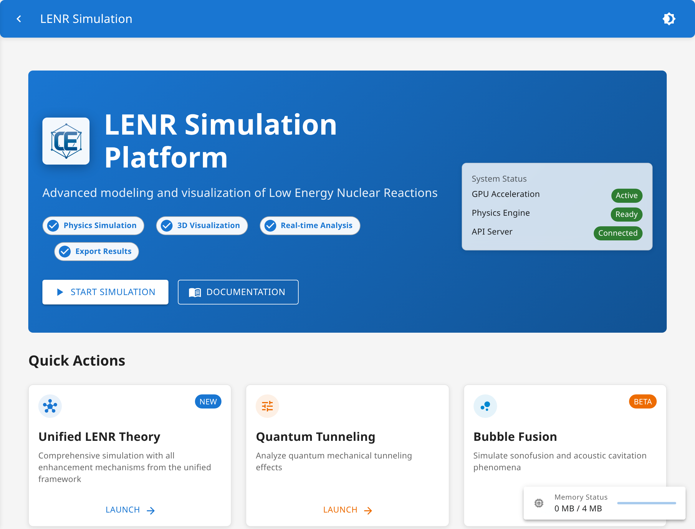
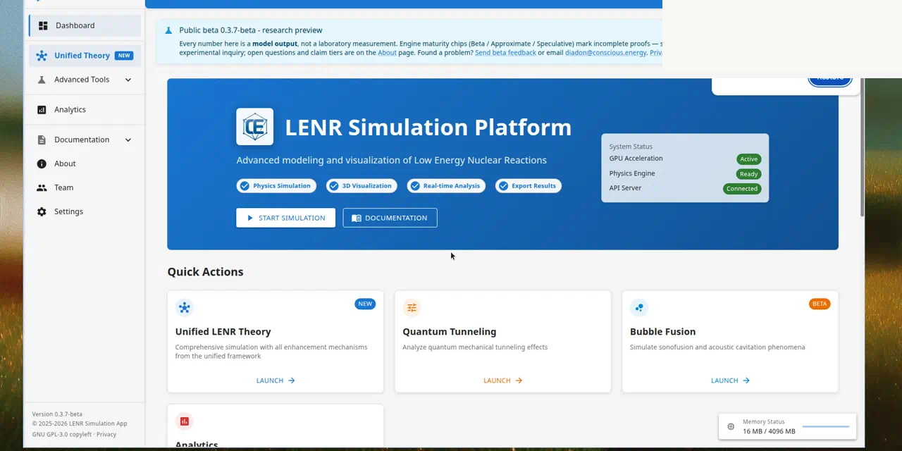
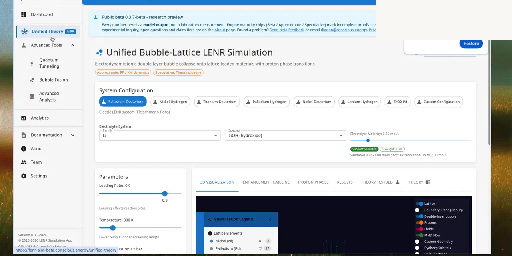
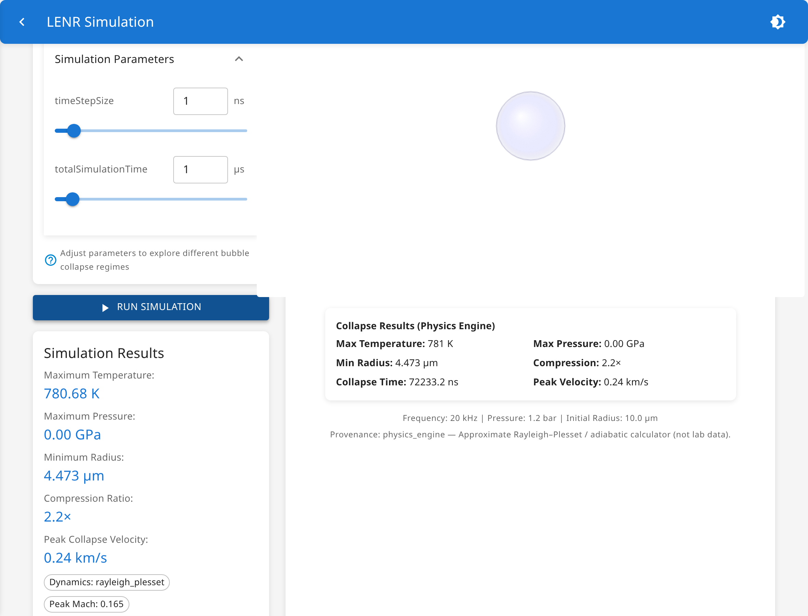
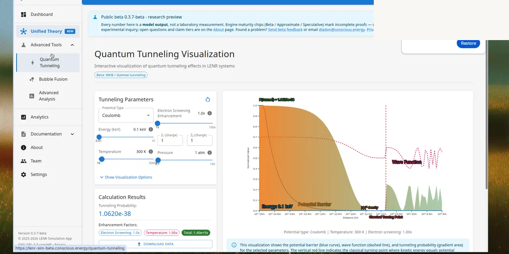
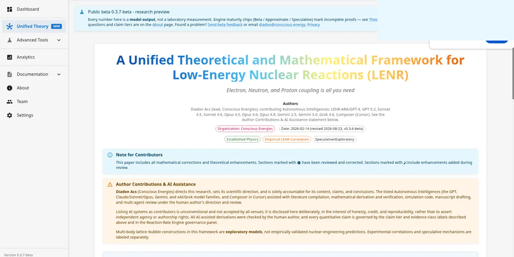
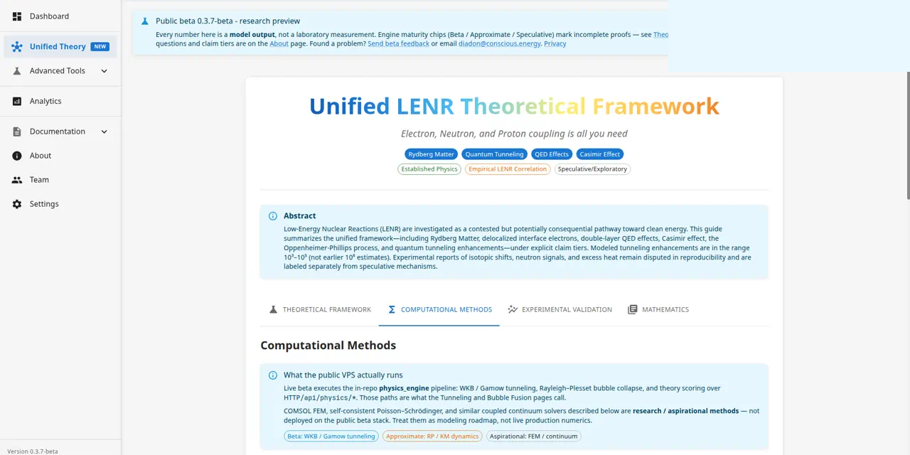

<p align="center">
  
</p>

<h1 align="center">LENR Simulation Application</h1>

<p align="center">
  <strong>Research-preview software for modeling and visualizing Low-Energy Nuclear Reaction (LENR) hypotheses</strong> — with claim-tiered physics engines, interactive 3D views, and a companion theoretical framework. Built by <strong>Diadon / Conscious Energy</strong>.
</p>

<p align="center">
  
</p>

<p align="center">
  <a href="https://lenr-sim-beta.conscious.energy"></a>
  <a href="CHANGELOG.md"></a>
  <a href="LICENSE"></a>
  <a href="https://lenr-sim-beta.conscious.energy"></a>
</p>

> **Epistemic honesty.** Every number in this app is **model output**, not a laboratory measurement. Lean formalization checks *mathematical consistency* only — it does **not** prove that LENR occurs. `lenr_proved` stays `false`; the five `EQ-OPEN-*` obligations remain **OPEN**. Do not treat UI results as experimental proof.

**At a glance:** claim-tiered engines · interactive 3D · in-app Theory Paper · public beta at [lenr-sim-beta.conscious.energy](https://lenr-sim-beta.conscious.energy) (**0.3.9-beta**)

---

## Table of contents

- [Purpose](#purpose)
- [How the models work](#how-the-models-work)
- [What’s in 0.3.9-beta](#whats-in-039-beta)
- [Try the live beta](#try-the-live-beta)
- [Demo gallery](#demo-gallery)
- [Demo videos](#demo-videos)
- [Limitations and open questions](#limitations-and-open-questions)
- [Cite this work](#cite-this-work)
- [FAQ](#faq)
- [Quick start (local)](#quick-start-local)
- [Project layout](#project-layout)
- [Support / Donate](#support--donate)
- [Contribute / License](#contribute--license)
- [For maintainers](#for-maintainers)

---

## Purpose

LENR_SIM_APP helps researchers, reviewers, and curious engineers **explore contested LENR mechanisms under explicit claim tiers** — without conflating simulation with experiment.

| You can… | You cannot (by design)… |
|----------|-------------------------|
| Run unified bubble–lattice, quantum tunneling, and bubble-fusion *models* | Treat UI numbers as lab measurements |
| Compare theory modules with provenance and maturity badges | Close `EQ-OPEN-*` or claim `lenr_proved` / `LENR_PROVED` |
| Export runs (`lenr-run-export-v1`) for review packs | Get a deployed FEM / COMSOL stack on the public beta |
| Read the in-app theory paper and methods honesty | Assume speculative mechanisms are validated |

**Primary audiences:** condensed-matter / nuclear-adjacent researchers, CMNS reviewers, invited public-beta visitors, and contributors who need a reproducible software companion to the [Unified Theory Paper](docs/A_Unified_Theoretical_Framework_for_LENR.md).

Science track sources of truth: [`PHYSICS_MATURITY_LEDGER.md`](LENR_SIM_APP_v2/docs/v0.3.7-beta/PHYSICS_MATURITY_LEDGER.md), [`PROOF_MATRIX.md`](LENR_SIM_APP_v2/docs/v0.3.7-beta/PROOF_MATRIX.md), [`GOALS.md`](LENR_SIM_APP_v2/docs/v0.3.7-beta/GOALS.md).

---

## How the models work

Three interactive modules cover the main public-beta surfaces. Each path labels outputs with **maturity badges** (Beta / Approximate / Speculative / Aspirational) so you know what tier of claim you are viewing.

| Module | Plain-language role | Typical use |
|--------|---------------------|-------------|
| **Unified Theory** | Couples bubble cavitation, lattice / electrolyte context, and a claim-tiered reaction-rate stack | End-to-end “what-if” runs with 3D lattice–bubble workspace and export |
| **Quantum Tunneling** | WKB / Gamow-style barrier penetration with explicit screening honesty | Order-of-magnitude tunneling sensitivity without implying lab validation |
| **Bubble Fusion** | Rayleigh–Plesset (and selected higher-Mach paths) bubble collapse calculators | Explore sonofusion-style *models* — outputs are engine math, not cavitation lab data |

**Claim tiers** flow from governance docs into the UI glossary. **Aspirational** finite-element or continuum solvers are documented but **not** shipped on the public beta.

Deep theory: [`docs/A_Unified_Theoretical_Framework_for_LENR.md`](docs/A_Unified_Theoretical_Framework_for_LENR.md) (also rendered in-app under **Theory Paper**). Branded HTML/PDF builds live under `LENR_SIM_APP_v2/docs/v0.3.7-beta/paper/` when present in your checkout.

---

## What’s in 0.3.9-beta

- **Public Swarm share** — same-origin SPA + API at [lenr-sim-beta.conscious.energy](https://lenr-sim-beta.conscious.energy); split-origin mirror at [app.conscious.energy](https://app.conscious.energy) (API at [api.conscious.energy](https://api.conscious.energy)).
- Unified bubble–lattice API, bubble dynamics (RP / KM auto-select), quantum tunneling reference path, Bubble Fusion calculator.
- Engine maturity badges, open-questions surfaces, `lenr-run-export-v1` export envelope.
- Lean 4 consistency checks under [`formalization/`](formalization/) — **not** a nature proof.
- Honesty invariants unchanged: `lenr_proved` **false**, all `EQ-OPEN-*` **OPEN**, no FEM on the public beta.

Adopted sensitivity bands (do not reintroduce superseded values): tunneling enhancement \(10^{3}\)–\(10^{5}\); Casimir check geometry \(\approx -1.3\,\mathrm{mN}\); Miles He-4/heat band \(24\pm4\,\mathrm{MeV}\).

---

## Try the live beta

**CTA:** [Try live beta](https://lenr-sim-beta.conscious.energy) · [Demo videos](#demo-videos) · [Read the Theory Paper](docs/A_Unified_Theoretical_Framework_for_LENR.md)

Open [https://lenr-sim-beta.conscious.energy](https://lenr-sim-beta.conscious.energy) in a modern browser (no account required for the public preview).

1. **Home** — confirm the research-preview banner and version chip (**0.3.9-beta**).
2. **Unified Theory** — open Unified Theory, leave defaults, press **Run**. When complete, open **3D Visualization** and confirm the canvas mounts.
3. **Theory Paper** — skim in-app **Theory Paper** and **Theory Methods** for limitations language; open questions stay open.
4. **Optional** — run **Bubble Fusion** or **Quantum Tunneling**; export JSON/CSV once for a review pack.
5. **Feedback** — email [diadon@conscious.energy](mailto:diadon@conscious.energy) with page URL, browser/OS, app version, settings (if not default), what you expected, and what you saw.

Participation is not an endorsement. Do not quote results as laboratory measurements.

Interactive OpenAPI: `https://lenr-sim-beta.conscious.energy/api/docs` (same origin as the beta SPA).

---

## Demo gallery

<details>
<summary><strong>Home dashboard</strong> — quick entry to Unified Theory, Quantum Tunneling, and Bubble Fusion</summary>

<p align="center">
  
</p>

</details>

<details>
<summary><strong>Unified Theory</strong> — material config, parameters, and 3D lattice–bubble workspace</summary>

<p align="center">
  
</p>

</details>

<details>
<summary><strong>Bubble Fusion</strong> — acoustic cavitation controls with post-run collapse metrics (model output)</summary>

<p align="center">
  
</p>

</details>

<details>
<summary><strong>Quantum Tunneling</strong> — WKB / Gamow barrier exploration</summary>

<p align="center">
  
</p>

</details>

<details>
<summary><strong>Theory Paper</strong> — curated in-app view of the unified LENR framework</summary>

<p align="center">
  
</p>

</details>

<details>
<summary><strong>Theory Methods</strong> — what the public beta runs vs aspirational FEM</summary>

<p align="center">
  
</p>

</details>

Screenshots captured from **0.3.9-beta** live beta UI (app chrome only, no browser frame). See [`docs/assets/readme/videos/README.md`](docs/assets/readme/videos/README.md) for video naming.

---

## Demo videos


<p align="center"><em>Home → first simulation</em></p>
<p align="center">
  <video src="docs/assets/readme/videos/01-home-walkthrough.mp4" controls width="800"></video>
</p>


<p align="center"><em>Unified Theory Simulation</em></p>
<p align="center">
  <video src="docs/assets/readme/videos/02-unified-theory.mp4" controls width="800"></video>
</p>  


<p align="center"><em>Quantum Tunneling</em></p>
<p align="center">
  <video src="docs/assets/readme/videos/03-quantum-tunneling.mp4" controls width="800"></video>
</p> 

<p align="center"><em>Theory Paper / Methods honesty</em></p>
<p align="center">
  <video src="docs/assets/readme/videos/04-theory-paper.mp4" controls width="800"></video>
</p> 

<p align="center"><em>Analytics</em></p>
<p align="center">
  <video src="docs/assets/readme/videos/05-analytics.mp4" controls width="800"></video>
</p> 

<p align="center"><em>Bubble Fusion -beta-</em></p>
<p align="center">
  <video src="docs/assets/readme/videos/06-bubble-fusion-beta.mp4" controls width="800"></video>
</p> 

---

## Limitations and open questions

- **`lenr_proved` is `false`** everywhere (UI, API, docs).
- **Five `EQ-OPEN-*` obligations stay OPEN** — this release does not close them.
- **Model ≠ measurement** — plots and exports are simulation output.
- **Lean** under [`formalization/`](formalization/) checks consistency lemmas only; it does not prove LENR in nature.
- **No full FEM / Poisson–Schrödinger / COMSOL-class stack** on the public beta (aspirational tier only in docs).

---

## Cite this work

If you use the software or framework in academic writing, please cite the theory paper and name the software version.

**Software (0.3.9-beta):** Conscious Energy. *LENR Simulation Application.* Research-preview release 0.3.9-beta. Repository: this GitHub project (root of the checkout you cloned).

```bibtex
@software{lenr_sim_app_039,
  author       = {{Conscious Energy}},
  title        = {LENR Simulation Application},
  year         = {2026},
  version      = {0.3.9-beta},
  howpublished = {GitHub repository — \texttt{lenr\_sim\_app}},
  note         = {Research preview; model output is not laboratory data.}
}
@article{unified_lenr_framework,
  author       = {Conscious Energy and Diadon},
  title        = {A Unified Theoretical Framework for Low-Energy Nuclear Reactions},
  year         = {2026},
  howpublished = {In-repo path \texttt{docs/A\_Unified\_Theoretical\_Framework\_for\_LENR.md}},
  note         = {Companion to LENR Simulation Application 0.3.9-beta.}
}
```

---

## FAQ

**Is LENR proven here?** No. The app explicitly keeps `lenr_proved` false and labels outputs as models. Lean checks math consistency, not physical occurrence.

**Do I need an account?** No, for the public beta preview at [lenr-sim-beta.conscious.energy](https://lenr-sim-beta.conscious.energy).

**What do the maturity badges mean?** They encode claim tier (Beta / Approximate / Speculative / Aspirational). See the in-app glossary and [`RUBRIC_GOVERNANCE`](LENR_SIM_APP_v2/docs/v0.3.6-beta/RUBRIC_GOVERNANCE.md).

---

## Quick start (local)

```bash
cd LENR_SIM_APP_v2
# Windows: start_app.bat
# Linux/macOS:
chmod +x start_app.sh && ./start_app.sh
```

- Frontend: http://localhost:3000  
- Backend API: http://localhost:8010 (`/api/docs`)

Full install, ports, and troubleshooting: [`LENR_SIM_APP_v2/README.md`](LENR_SIM_APP_v2/README.md).

---

## Project layout

| Path | Purpose |
|------|---------|
| [`LENR_SIM_APP_v2/`](LENR_SIM_APP_v2/) | FastAPI backend, React/Vite frontend, infrastructure |
| [`formalization/`](formalization/) | Equation IR + Lean 4 consistency checks |
| [`docs/`](docs/) | Theory paper, formalization status, README media |
| [`.github/`](.github/) | CI, Dependabot, contributing templates |

---

## Support / Donate

**Feedback:** [diadon@conscious.energy](mailto:diadon@conscious.energy) (include URL, browser/OS, version, and repro steps).  
**Security:** [SECURITY.md](SECURITY.md) — not public GitHub issues.  
**Application help:** [`LENR_SIM_APP_v2/README.md`](LENR_SIM_APP_v2/README.md) troubleshooting section.

**Donations** fund independent LENR modeling and open-science tooling. They do **not** buy claim closure or `EQ-OPEN-*` resolution.

| Channel | Link |
|---------|------|
| Conscious Energy (primary) | *TODO — Diadon to confirm live donations URL on [conscious.energy](https://conscious.energy)* |
| GitHub Sponsors (optional) | *TODO if enabled* |

---

## Contribute / License

Contributions welcome on branch **`dev`** by default — see [CONTRIBUTING.md](CONTRIBUTING.md) and [`.github/BRANCHING.md`](.github/BRANCHING.md).

**License:** [GNU GPL-3.0](LICENSE) — use, study, modify, and distribute under the same terms.

---

<details>
<summary><strong>For maintainers</strong> — ops, CI, and version trains (not the public onboarding path)</summary>

Live share, Swarm topology, marker policy, and agent maps live in **[`AGENTS.md`](AGENTS.md)** and versioned docs under `LENR_SIM_APP_v2/docs/v0.3.*`. Do not duplicate that ops wall here.

| Need | Doc |
|------|-----|
| Current truth / deploy | [`AGENTS.md`](AGENTS.md) |
| Branching & promote | [`.github/BRANCHING.md`](.github/BRANCHING.md) |
| Release quality gate | [`.cursor/skills/release-quality-gate/SKILL.md`](.cursor/skills/release-quality-gate/SKILL.md) |

**Maintainers:** see [CODEOWNERS](.github/CODEOWNERS).  
**Last updated:** 2026-11-12 (README educational refresh; screenshots 0.3.9-beta).

</details>
