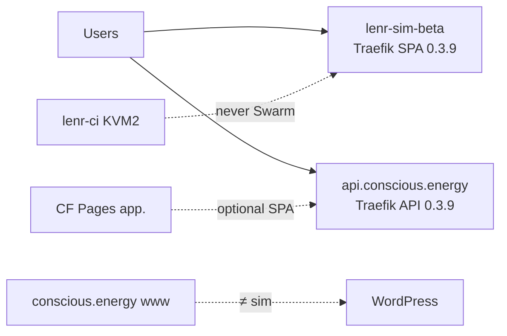

# LENR Simulation Application

**Research-preview software for modeling and visualizing Low-Energy Nuclear Reaction (LENR) hypotheses** — with claim-tiered physics engines, interactive 3D views, and a companion theoretical framework. Built by **Diadon / Conscious Energy**.

[](https://lenr-sim-beta.conscious.energy)
[](CHANGELOG.md)
[](LICENSE)
[](https://lenr-sim-beta.conscious.energy)

> **Epistemic honesty.** Every number in this app is **model output**, not a laboratory measurement. Lean formalization checks *mathematical consistency* only — it does **not** prove that LENR occurs. `lenr_proved` stays `false`; the five `EQ-OPEN-*` obligations remain **OPEN**.

**Public beta (live):** [https://lenr-sim-beta.conscious.energy](https://lenr-sim-beta.conscious.energy) — Traefik SPA + API on the Swarm share host, version **0.3.9-beta** (Compose stack retired; see [`AGENTS.md`](AGENTS.md)). API: [https://api.conscious.energy](https://api.conscious.energy).

### Docs map (public vs team)

| Audience | Start here |
|----------|------------|
| Public / contributors | This README, [`CONTRIBUTING.md`](CONTRIBUTING.md), [`LENR_SIM_APP_v2/README.md`](LENR_SIM_APP_v2/README.md) |
| Agents / current truth | [`AGENTS.md`](AGENTS.md) |
| Branching / releases | [`.github/BRANCHING.md`](.github/BRANCHING.md) |
| Topology (diagram SOT) | [`THREE_NODE_SWARM_TOPOLOGY.md`](LENR_SIM_APP_v2/docs/v0.3.8-beta/THREE_NODE_SWARM_TOPOLOGY.md) |
| Public Swarm cutover gate | [`SWARM_PUBLIC_CUTOVER.md`](LENR_SIM_APP_v2/docs/v0.3.9-beta/SWARM_PUBLIC_CUTOVER.md) |
| Operators (live Swarm) | [`docs/v0.3.8-beta/README.md`](LENR_SIM_APP_v2/docs/v0.3.8-beta/README.md), [`LIVE_SHARE_STATUS.md`](LENR_SIM_APP_v2/docs/v0.3.7-beta/LIVE_SHARE_STATUS.md) |
| Academic parallel train | [`LENR_SIM_APP_v2/docs/v0.3.7-beta/`](LENR_SIM_APP_v2/docs/v0.3.7-beta/) (`EQ-OPEN-*` stay OPEN) |

---

## Version trains

| Branch | Markers must be | Role |
|--------|-----------------|------|
| `main` | **`0.3.9-beta`** | Live public Swarm release line (Traefik SPA + API); ship / hotfix |
| `dev` | **`0.3.9-beta`** | Integration tip; **never** auto-deployed by `deploy.yml` |

Four version markers must match **within** a branch:

- `LENR_SIM_APP_v2/backend/app/core/config.py` → `APP_VERSION`
- `LENR_SIM_APP_v2/frontend/package.json` → `"version"`
- `LENR_SIM_APP_v2/frontend/src/config/version.js` → `APP_VERSION`
- `LENR_SIM_APP_v2/infrastructure/docker/Dockerfile.backend` → `BUILD_VERSION`

Default PR base is **`dev`**. Promote to public with a controlled `dev` → `main` PR (do not continuously merge). Do **not** bump `main` markers except via that promote. Full policy: [`.github/BRANCHING.md`](.github/BRANCHING.md) and [`CONTRIBUTING.md`](CONTRIBUTING.md).

---

## Deployment architecture

**Live today:** Swarm Traefik on the share manager serves same-origin SPA + API at `lenr-sim-beta.conscious.energy` and API at `api.conscious.energy` (**0.3.9-beta**). Compose share is retired (rollback images retained). CI is a dedicated host and is **never** part of Swarm. Marketing site `conscious.energy` / `www` is WordPress — **not** the sim. Optional Cloudflare Pages host: `app.conscious.energy` → API.



| Surface | URL / host | Meaning |
|---------|------------|---------|
| Live public share | https://lenr-sim-beta.conscious.energy | Traefik SPA + API **0.3.9-beta** (Swarm) |
| Live public API | https://api.conscious.energy | Traefik API **0.3.9-beta** |
| Prod SPA (Pages) | `app.conscious.energy` | Cloudflare Pages — optional split-origin |
| Marketing | https://conscious.energy | WordPress — separate from the sim |
| Self-hosted CI | dedicated KVM2 `lenr-ci` | PR/test runner only; share must keep **no** `.runner` |

Do **not** re-arm public Swarm apply without a new announced window + confirm. See [`AGENTS.md`](AGENTS.md) and [`SWARM_PUBLIC_CUTOVER.md`](LENR_SIM_APP_v2/docs/v0.3.9-beta/SWARM_PUBLIC_CUTOVER.md).

---

## What this application is for

LENR_SIM_APP helps researchers, reviewers, and curious engineers **explore contested LENR mechanisms under explicit claim tiers** — without conflating simulation with experiment.

| You can… | You cannot (by design)… |
|----------|-------------------------|
| Run unified bubble–lattice, quantum tunneling, and bubble-fusion *models* | Treat UI numbers as lab measurements |
| Compare theory modules with provenance and maturity badges | Close `EQ-OPEN-*` or claim `LENR_PROVED` |
| Export runs (`lenr-run-export-v1`) for review packs | Get a deployed FEM / COMSOL stack on the public beta |
| Read the in-app theory paper and methods honesty | Assume speculative mechanisms are validated |

**Primary audiences:** condensed-matter / nuclear-adjacent researchers, CMNS reviewers, and contributors who need a reproducible software companion to the [Unified Theory Paper](docs/A_Unified_Theoretical_Framework_for_LENR.md).

---

## Screenshots (public beta UI)

<p align="center">
  
</p>

<p align="center"><em>Dashboard — quick entry to Unified Theory, Quantum Tunneling, and Bubble Fusion</em></p>

<p align="center">
  
</p>

<p align="center"><em>Unified Theory — material/electrolyte config, parameters, and 3D lattice–bubble workspace</em></p>

<p align="center">
  
</p>

<p align="center"><em>Bubble Fusion — acoustic cavitation controls with engine-maturity labeling</em></p>

<p align="center">
  
</p>

<p align="center"><em>Quantum Tunneling — WKB / Gamow barrier exploration</em></p>

<p align="center">
  
</p>

<p align="center"><em>Theory Paper — curated in-app view of the unified LENR framework</em></p>

<p align="center">
  
</p>

<p align="center"><em>Theory Methods — what the public beta actually runs vs aspirational FEM</em></p>

> **Demo video.** A walkthrough video will be linked here when available (owned separately from this docs pack).

---

## Scope of the public beta

**Shipped / live on the public share (0.3.9-beta Swarm)**

- Unified bubble–lattice simulation API (`/api/unified/*`) with claim-tiered theory pipeline
- Bubble dynamics: Rayleigh–Plesset baseline; Keller–Miksis auto-select when Mach ≥ 0.3 (approximate maturity)
- Quantum tunneling (WKB/Gamow) reference path with domain-limited screening honesty
- Engine maturity badges (Beta / Approximate / Speculative / Aspirational)
- Open-questions / working-hypothesis surfaces; export envelope `lenr-run-export-v1`
- Lean 4 + equation IR under [`formalization/`](formalization/) for consistency / non-closure lemmas
- Multi-format governance docs under [`LENR_SIM_APP_v2/docs/v0.3.7-beta/`](LENR_SIM_APP_v2/docs/v0.3.7-beta/)

**Explicitly not on the public beta (deferred / aspirational)**

- Full FEM / Poisson–Schrödinger / COMSOL-class continuum solvers
- Declaring any `EQ-OPEN-*` closed
- Energetic or “practical freedom” product claims

Adopted sensitivity bands (do not reintroduce superseded values): tunneling enhancement \(10^{3}\)–\(10^{5}\); Casimir check geometry \(\approx -1.3\,\mathrm{mN}\); Miles He-4/heat band \(24\pm4\,\mathrm{MeV}\).

---

## Project layout

| Path | Purpose |
|------|---------|
| [`LENR_SIM_APP_v2/`](LENR_SIM_APP_v2/) | Application: FastAPI backend, React/Vite frontend, Swarm infrastructure, release docs |
| [`formalization/`](formalization/) | Equation IR + Lean 4 consistency checks (not a nature proof) |
| [`docs/`](docs/) | Repository docs, Unified Theory Paper, formalization status, README screenshots |
| [`archive/status-reports/`](archive/status-reports/) | Historical status reports (provenance) |
| [`.github/`](.github/) | CI workflows, Dependabot, PR template, CODEOWNERS |

👉 **Install & run:** see [`LENR_SIM_APP_v2/README.md`](LENR_SIM_APP_v2/README.md)

---

## Quick start (local)

```bash
cd LENR_SIM_APP_v2
# Windows: start_app.bat
# Linux/macOS:
chmod +x start_app.sh && ./start_app.sh
```

- Frontend: http://localhost:3000
- Backend API: http://localhost:8010 (`/api/docs`)

Canonical ports: [`LENR_SIM_APP_v2/docs/v0.3.6-beta/PORT_TOPOLOGY_POLICY.md`](LENR_SIM_APP_v2/docs/v0.3.6-beta/PORT_TOPOLOGY_POLICY.md)

**Where to try it without installing**

| Environment | URL |
|-------------|-----|
| Live public beta | https://lenr-sim-beta.conscious.energy |
| Staging API | https://api-staging.conscious.energy/api/health |
| Staging SPA (Pages, when configured) | https://app-staging.conscious.energy |

---

## Application architecture (high level)

```
┌─────────────────────────────────────────┐
│  React / Vite frontend (:3000)          │
│  Dashboard · Unified Theory · QT · BF   │
│  Theory Paper / Methods · Analytics     │
└──────────────────┬──────────────────────┘
                   │ REST + WebSocket
┌──────────────────┴──────────────────────┐
│  FastAPI backend (:8010)                │
│  /api/unified/* · /api/physics/*        │
│  Theory pipeline · run export           │
└──────────────────┬──────────────────────┘
                   │
┌──────────────────┴──────────────────────┐
│  Physics engines (claim-tiered)         │
│  WKB/Gamow · bubble RP/KM · theories/*  │
│  Open questions / WH-ENP · guardrails   │
└─────────────────────────────────────────┘
         │
         ▼
  formalization/  (Lean + IR — consistency only)
```

---

## Documentation map

| Doc | Use when |
|-----|----------|
| [`AGENTS.md`](AGENTS.md) | Short current-truth map for humans and agents |
| [`LENR_SIM_APP_v2/README.md`](LENR_SIM_APP_v2/README.md) | Local install, features, troubleshooting |
| [`THREE_NODE_SWARM_TOPOLOGY.md`](LENR_SIM_APP_v2/docs/v0.3.8-beta/THREE_NODE_SWARM_TOPOLOGY.md) | Hardware ↔ Swarm diagram SOT |
| [`SWARM_PUBLIC_CUTOVER.md`](LENR_SIM_APP_v2/docs/v0.3.9-beta/SWARM_PUBLIC_CUTOVER.md) | 0.3.9 public cutover gate (operator) |
| [`docs/A_Unified_Theoretical_Framework_for_LENR.md`](docs/A_Unified_Theoretical_Framework_for_LENR.md) | Canonical theory paper |
| [`LENR_SIM_APP_v2/docs/v0.3.7-beta/`](LENR_SIM_APP_v2/docs/v0.3.7-beta/) | Maturity ledger, proof matrix, goals |
| [`docs/FORMALIZATION/FORMAL_PROOF_STATUS.md`](docs/FORMALIZATION/FORMAL_PROOF_STATUS.md) | Lean theorem status |
| [`CHANGELOG.md`](CHANGELOG.md) | Version history |
| [`CONTRIBUTING.md`](CONTRIBUTING.md) / [`.github/BRANCHING.md`](.github/BRANCHING.md) | How to contribute |
| [`SECURITY.md`](SECURITY.md) | Vulnerability reporting |

---

## Development

Branch from **`dev`** by default. Use **`main`** only for live **0.3.9-beta** Swarm ship / hotfix. See [CONTRIBUTING.md](CONTRIBUTING.md) and [`.github/BRANCHING.md`](.github/BRANCHING.md).

```bash
# Backend
cd LENR_SIM_APP_v2/backend && python -m pytest tests/ app/tests/ -o addopts="" --tb=short

# Frontend
cd LENR_SIM_APP_v2/frontend && npm ci && npm test
```

CI includes release-blocking science gates and (where configured) `lake build` over `formalization/lean`. Prefer **one topic per PR**; keep CI/ops PRs separate from academic claim edits (`EQ-OPEN-*` stay OPEN).

---

## License

**GNU GPL-3.0** — see [LICENSE](LICENSE). Free to use, study, modify, and distribute under the same terms.

## Support

1. Application README troubleshooting: [`LENR_SIM_APP_v2/README.md`](LENR_SIM_APP_v2/README.md)
2. Beta feedback: email linked from the public beta banner (`diadon@conscious.energy`)
3. Security issues: [SECURITY.md](SECURITY.md) (not public GitHub issues)

## Project status

| Item | State |
|------|-------|
| Live public share | **0.3.9-beta** Swarm (Traefik SPA + API) |
| Current app version markers | **`0.3.9-beta`** (`main` and `dev`) |
| `main` | Live Swarm release line; ship via Ansible / SSH — not auto from bare push |
| `dev` | Integration tip; **never** auto-deployed by `deploy.yml` |

---

**Last updated:** 2026-11-05 · Maintainers: [CODEOWNERS](.github/CODEOWNERS)
