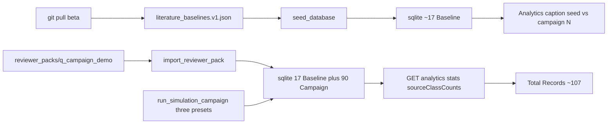

# Analytics pack hydrate (2026-08-26)

**Question this diagram answers:** why a local `git pull` of beta shows ~18
Analytics records while a cloud campaign run showed ~107, and how import
restores that N without re-simulating.

**Commit note:** dated for pack import. Imported rows are model outputs. They
do not set `lenr_proved` or rewrite `EQ-OPEN-*`.

Related: `LENR_SIM_APP_v2/docs/v0.3.6-beta/RESEARCHER_REVIEW_PACK.md`,
`LENR_SIM_APP_v2/docs/v0.3.6-beta/ANALYTICS_TRANSPARENCY.md`.
