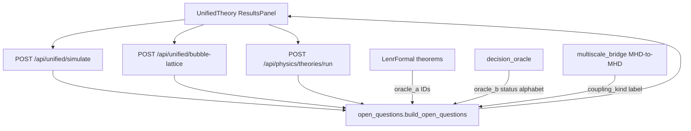
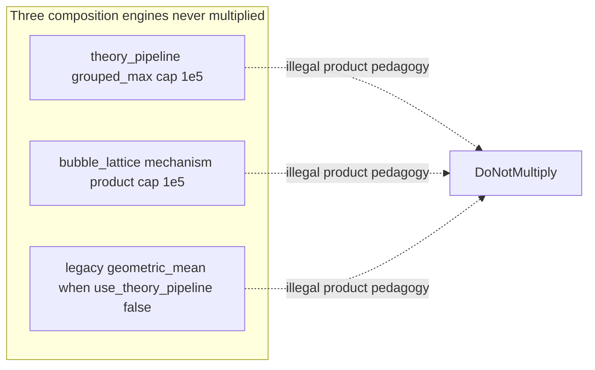
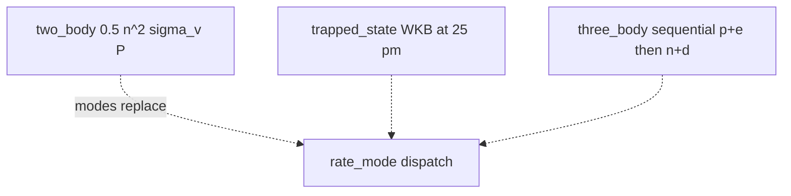
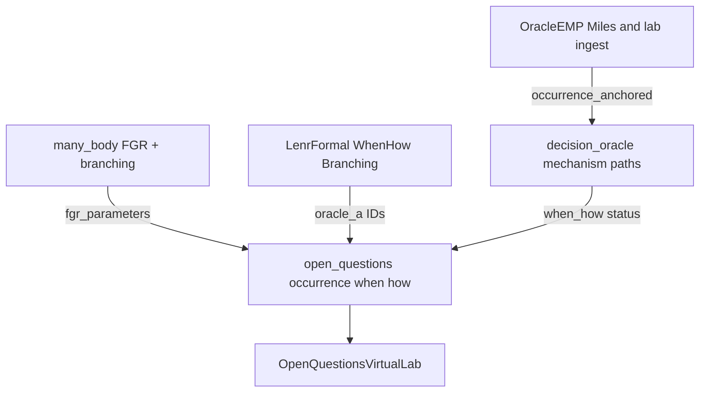

# Open-questions virtual lab — architecture map (2026-08-22)

**Question this diagram answers:** how a unified / bubble-lattice / theory-pipeline
run becomes an additive `open_questions` determination without changing
`contract_version` or multiplying rival engines.

**Commit note:** dated at introduction of the virtual lab; regenerate if routes move.

Verified against:

- `LENR_SIM_APP_v2/backend/app/physics_engine/many_body/`
- `LENR_SIM_APP_v2/backend/app/api/routes/unified_simulation.py`
- `LENR_SIM_APP_v2/backend/app/api/routes/physics.py` (`/theories/run`)
- `LENR_SIM_APP_v2/backend/app/physics_engine/theory_pipeline.py`
- `LENR_SIM_APP_v2/backend/app/physics_engine/open_questions.py`
- `LENR_SIM_APP_v2/backend/app/physics_engine/decision_oracle.py`
- `LENR_SIM_APP_v2/backend/app/physics_engine/mhd/multiscale_bridge.py`
- `LENR_SIM_APP_v2/frontend/src/components/physics/OpenQuestionsVirtualLab.jsx`

Engines that must never be multiplied: theory-pipeline grouped product,
bubble-lattice mechanism product, legacy geometric-mean
(`use_theory_pipeline=false`). Rate modes `two_body` | `trapped_state` |
`three_body` are a dispatch, not a product. MHD bridge is a restriction
cascade (`coupling_kind: mhd_to_mhd_cascade`), not a QED operator.
