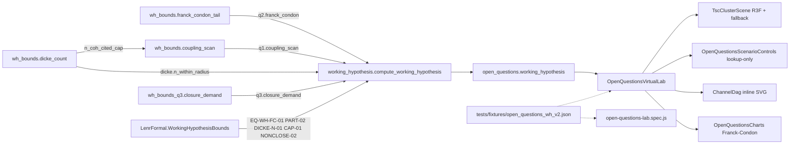
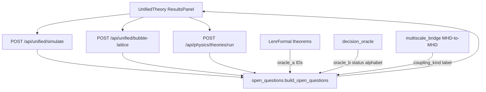
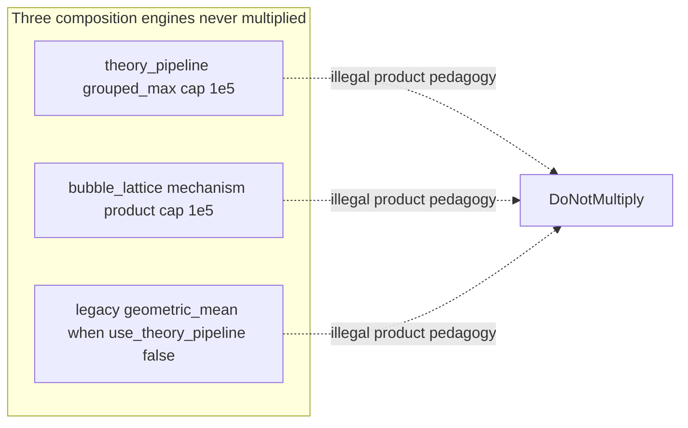
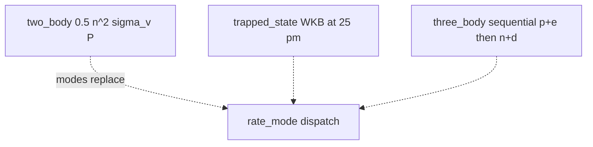
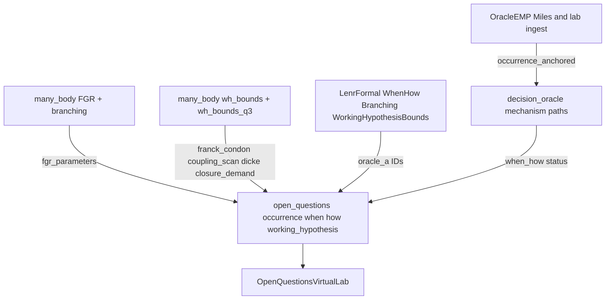

# Open-questions virtual lab — architecture map (2026-08-22)

**Question this diagram answers:** how a unified / bubble-lattice / theory-pipeline
run becomes an additive `open_questions` determination without changing
`contract_version` or multiplying rival engines.

Additive `working_hypothesis` (`WH-ENP-01`) is assembled by
`working_hypothesis.compute_working_hypothesis` and attached to the same block.
Lean `LenrFormal.WorkingHypothesis` certifies conservation and non-closure;
`EQ-OPEN-*` stay OPEN.

**Commit note:** dated at introduction of the virtual lab; regenerate if routes move.

## WH-ENP-01 v2 (2026-09-04, additive)

Derived bounds that sharpen the WH-ENP-01 remainder without discharging it
(claim tier `speculative_exploratory`; `lenr_proved` stays false).

- **Backend blocks** (attached under `open_questions.working_hypothesis`, same
  `contract_version`): `q2.franck_condon` (displaced-oscillator Poisson tail,
  `many_body/wh_bounds.franck_condon_tail`), `q1.coupling_scan`
  (conservation-constrained rows, `wh_bounds.coupling_scan`),
  `dicke.n_within_radius` / `dicke.n_coh_licensed_max` (`wh_bounds.dicke_count`),
  `q3.closure_demand` (required product vs engine caps and a scenario grid,
  `many_body/wh_bounds_q3.closure_demand`). All are assembled by
  `working_hypothesis.compute_working_hypothesis`; the `two_body` baseline is untouched.
- **Lean** `LenrFormal.WorkingHypothesisBounds`: `EQ-WH-FC-01`, `EQ-WH-PART-02`,
  `EQ-WH-DICKE-N-01`, `EQ-WH-CAP-01`, `EQ-WH-NONCLOSE-02` (see
  `docs/FORMALIZATION/FORMAL_PROOF_STATUS.md`). CI `lake build` is followed by a
  no-`sorry` grep gate over `formalization/lean/LenrFormal`.
- **Frontend** (`LENR_SIM_APP_v2/frontend/src/components/physics/`):
  `TscClusterScene.jsx` (lazy-loaded react-three-fiber TSC 4D cluster;
  `TscClusterSceneFallback.jsx` renders when WebGL is missing or the chunk fails,
  and `prefers-reduced-motion` disables animation), `OpenQuestionsScenarioControls.jsx`
  (lookup-only scenario explorer over the server-emitted `coupling_scan.rows`,
  `franck_condon` arrays and `closure_demand.grid`; no client-side physics),
  `ChannelDag.jsx` (inline SVG channel graph used by `OpenQuestionsWorkingHypothesis.jsx`),
  and a Franck–Condon \(\log_{10}P_N\) vs \(S\) chart in `OpenQuestionsCharts.jsx`,
  all composed under `OpenQuestionsVirtualLab.jsx`.
- **Tests**: Playwright `tests/e2e/open-questions-lab.spec.js`; Vitest specs beside
  each component; shared fixture `LENR_SIM_APP_v2/frontend/tests/fixtures/open_questions_wh_v2.json`
  mirrors the backend contract stub.

Verified against:

- `LENR_SIM_APP_v2/backend/app/physics_engine/many_body/`
- `LENR_SIM_APP_v2/backend/app/api/routes/unified_simulation.py`
- `LENR_SIM_APP_v2/backend/app/api/routes/physics.py` (`/theories/run`)
- `LENR_SIM_APP_v2/backend/app/physics_engine/theory_pipeline.py`
- `LENR_SIM_APP_v2/backend/app/physics_engine/open_questions.py`
- `LENR_SIM_APP_v2/backend/app/physics_engine/decision_oracle.py`
- `LENR_SIM_APP_v2/backend/app/physics_engine/mhd/multiscale_bridge.py`
- `LENR_SIM_APP_v2/backend/app/physics_engine/working_hypothesis.py`
- `LENR_SIM_APP_v2/backend/app/physics_engine/many_body/wh_bounds.py`, `wh_bounds_q3.py`
- `formalization/lean/LenrFormal/WorkingHypothesisBounds.lean`
- `LENR_SIM_APP_v2/frontend/src/components/physics/OpenQuestionsVirtualLab.jsx`
- `LENR_SIM_APP_v2/frontend/src/components/physics/TscClusterScene.jsx`, `OpenQuestionsScenarioControls.jsx`, `ChannelDag.jsx`
- `LENR_SIM_APP_v2/frontend/tests/e2e/open-questions-lab.spec.js`, `tests/fixtures/open_questions_wh_v2.json`

Engines that must never be multiplied: theory-pipeline grouped product,
bubble-lattice mechanism product, legacy geometric-mean
(`use_theory_pipeline=false`). Rate modes `two_body` | `trapped_state` |
`three_body` are a dispatch, not a product. MHD bridge is a restriction
cascade (`coupling_kind: mhd_to_mhd_cascade`), not a QED operator.
