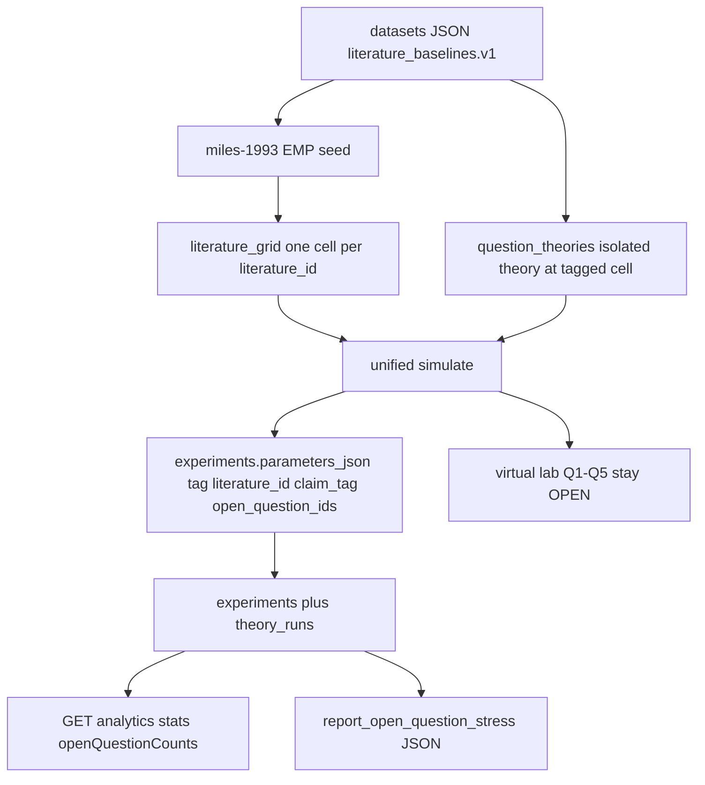

# Q-anchored theory vs literature campaign (2026-08-26)

**Question this diagram answers:** how Miles and other literature_ids become
persisted campaign rows with open-question provenance, how isolated theories
are run at those cells, and why Q1–Q5 remain OPEN.

**Commit note:** dated for the Q-theory campaign; regenerate if persist keys
move. Extra rows are model outputs. They do not set `lenr_proved` or rewrite
`EQ-OPEN-*`.

Related: `LENR_SIM_APP_v2/docs/v0.3.6-beta/RESEARCHER_REVIEW_PACK.md`,
`docs/ARCHITECTURE/THEORY_REVIEWER_CAMPAIGN_2026-08-26.md`.
