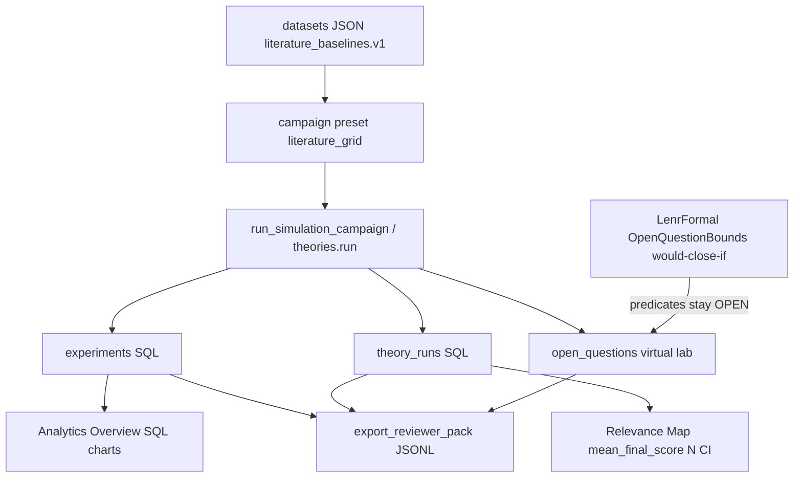
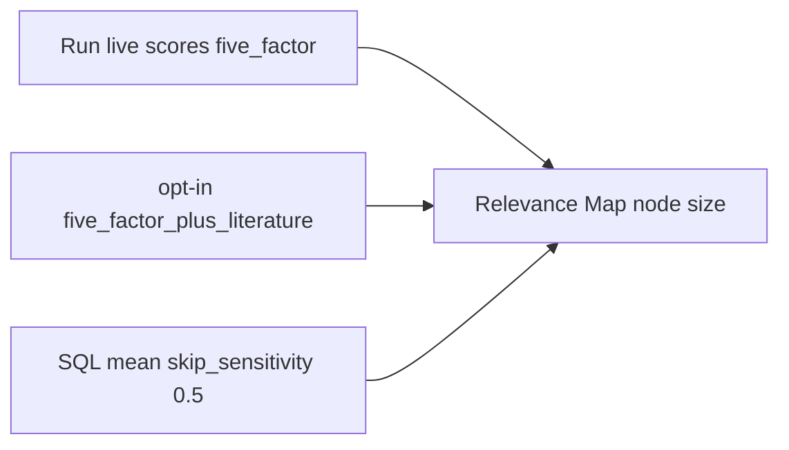

# Campaign → SQL → Analytics → open-questions lab (2026-08-26)

**Question this diagram answers:** how literature-anchored campaign cells become
persisted `experiments` / `theory_runs`, show up on Analytics, and still leave
Q1–Q5 OPEN in the virtual lab.

**Commit note:** dated for the theory reviewer-pack campaign; regenerate if
routes move. Extra rows are model outputs. They do not set `lenr_proved` or
rewrite `EQ-OPEN-*`.

Related: `LENR_SIM_APP_v2/docs/v0.3.6-beta/RESEARCHER_REVIEW_PACK.md`,
`LENR_SIM_APP_v2/docs/v0.3.6-beta/ANALYTICS_TRANSPARENCY.md`,
`docs/ARCHITECTURE/OPEN_QUESTIONS_VIRTUAL_LAB_2026-08-22.md`.
